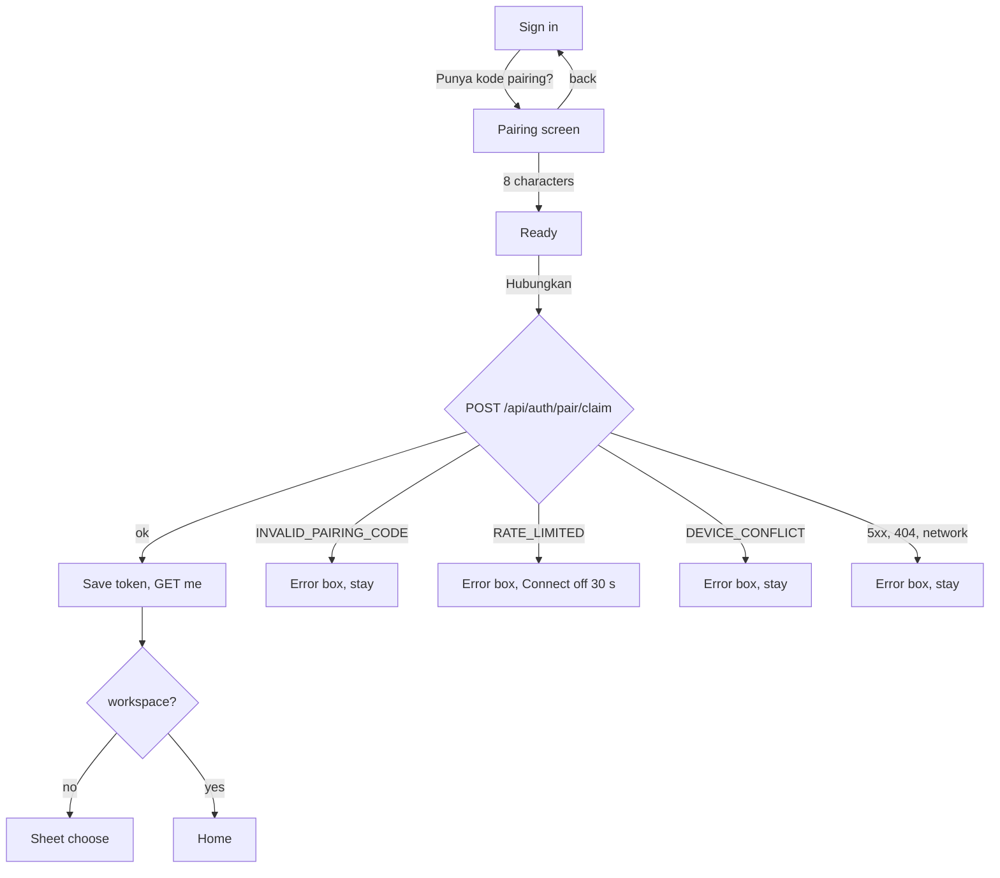

# 10 Pairing code screen

Android spec for FEAT-118. Conversion table, tokens and touch-target rules are in `01-shell-and-navigation.md`. Sign in around this screen is in `06-sheet-choose-and-sign-in.md` part A.

Web sources: `src/components/app/PairDeviceModal.tsx` (the other half: it makes the code), `src/app/api/auth/pair/generate/route.ts`, `src/app/api/auth/pair/claim/route.ts`, `src/lib/auth/pairing-store.ts`, `src/lib/auth/issue-mobile-session.ts`.
Android sources: `ui/pairing/PairingScreen.kt`, `ui/auth/SignInScreen.kt` (`PairingWithBack`, `onUsePairing`), `data/ApiClient.kt` (`claim`), `data/SecureTokenStore.kt`.

## 1. Purpose

Sign a phone in with a short code that the user made on zippp.link while signed in there. It is the legacy path from the companion build (context §8). It stays as a third way in, after Google and email link, because it is the only path that works when a phone has no Google account and no mail app. It is not shown in the main flow, only behind "Punya kode pairing?" on the sign in screen.

## 2. Facts and contradictions

1. **The web makes the code, the phone only claims it.** Web: Settings, "Pair device" opens `PairDeviceModal`, which calls `POST /api/auth/pair/generate` (cookie auth), shows the 8 character code, a 10 minute countdown (`PAIRING_TTL_SECONDS = 600`) and an optional QR. Android claims it with `POST /api/auth/pair/claim`. The web modal is the only place a code is born, so the phone screen must say where to get one.
2. **The code alphabet is Crockford base 32** (`0123456789ABCDEFGHJKMNPQRSTVWXYZ`). The server normalises input: it drops spaces and hyphens, then maps `O` to `0`, `I` and `L` to `1`, `U` to `V` (`normalizePairingCode`). The current Android filter accepts any letter or digit and does no mapping. That is safe (the server maps) but lets the user type `I`, `L`, `O`, `U`. Spec: keep accepting them and map on the phone too, so the 8 character counter and the displayed code match what the server will hash.
3. **The current screen is unstyled Material.** `PairingScreen` uses `MaterialTheme.typography`, a default `OutlinedTextField` and `Button`. It does not use `ZipppShell`, the tokens or `ZipppButton`. The spec restyles it to the sign in look (Brand tone) so the two screens read as one flow.
4. **`claim` returns credits and a workspace, Android ignores both.** `PairClaimResponse` carries `user.credits` and `workspace`. `onPaired(token, credits)` stores a credits number. Under DEC-002 and the owner decision of 2026-11-05 Android shows no credit numbers, and an unknown balance is not empty (file 02). Spec: keep the `onPaired` signature for now, but nothing may display the number or treat 0 as "out of quota". The workspace in the response may seed the `me` cache so Home does not flash the Sheet choose screen.
5. **The wording has two unused keys.** `android.pairing.scanQr` (QR scan) belongs to FEAT-107 and is out of scope here. `android.pairing.connecting` ("Connecting…") exists but the screen shows only a spinner. The spec uses it as the busy label.
6. **Error mapping gap.** The web claim route also returns `INVALID_REQUEST` (400) and `NOT_FOUND` (404, mobile API dark). The current `pairingError` sends both to the generic "Could not connect this device". That is acceptable for `INVALID_REQUEST` (a client bug) but `NOT_FOUND` means the server has the mobile API switched off, which is a build and environment problem (see `00-audit-and-defects.md`, wrong base URL). It maps to the server message and is logged (no code text shown).
7. **The pairing code is a secret for 10 minutes.** It must not be logged, written to analytics, or kept after a successful claim. The field is cleared on success and on leaving the screen.

## 3. Layout tree

Shell: Brand tone, no header, no pill (same as sign in). The screen is entered from sign in and shares its background. There is a back control.

```
ZipppShell(Brand, no header)               background orange #EE5329, text ink
  Column(padding 24 / 16 / 48, spacedBy 16, scrollable, imePadding)
    Row(back)                              48dp tap row: ic_arrow_left 20dp + android.signin.back 14sp semibold ink
    Text "zippp"                           ZipppType.wordmark 24sp, ink on orange
    Spacer(weight 1)                       pushes the block into the lower two thirds
    Text android.pairing.title             ZipppType.h1 30sp, ink
    Text android.pairing.subtitle          ZipppType.body 14sp, ink
    Text android.pairing.where             ZipppType.small 12sp, ink   ("Buat kode di zippp.link, menu Pengaturan > Hubungkan perangkat.")
    CodeField                              56dp, radius 8dp, white, 2dp border line (focus: ink), see 3.1
    Box(error)                             white rounded 8dp box, 12dp padding, small danger (contrast on orange)
    Button android.pairing.connect         Primary (maroon, white text), 56dp, full width
```

Web match: there is none for the claim side. The shell, type scale and button come from `01`. The code field copies the web input style from the sheet naming field (`06` section 3.2: 56dp, 8dp radius, 2dp border `line`, orange focus) with the focus border in ink because the shell itself is orange.

### 3.1 CodeField

```
BasicTextField / OutlinedTextField         fillMaxWidth, height 56dp
  text style                               Inter 20sp semibold, letterSpacing 4sp, centred, monospace feel via tabular digits
  placeholder android.pairing.codeHint     "XXXX-XXXX", 20sp, muted
  keyboardOptions                          capitalization Characters, keyboardType Ascii, imeAction Done, autoCorrect false
  visualTransformation                     inserts "-" after the 4th character for display only
  value rule                               uppercase, keep [0-9A-Z], map O->0, I->1, L->1, U->V, max 8 characters
  paste                                    accepted, "ab12-cd34" and "ab12 cd34" both become AB12CD34
  semantics                                contentDescription android.pairing.codeHint, isPassword false
```

State is the 8 clean characters. The hyphen is added by the visual transformation, not stored. This replaces the current `take(9)` rule, which stores the hyphen and lets "ABCD-" count as 4 characters.

### 3.2 Connect button

| State | Look |
|---|---|
| Code shorter than 8 | Alpha 0.4, not clickable |
| Code is 8 | Enabled |
| Busy | 20dp white spinner, label `android.pairing.connecting`, disabled |

Tapping the IME Done key with a full code does the same as the button.

## 4. States

| State | Condition | Shows |
|---|---|---|
| Idle | empty field | Placeholder, Connect disabled |
| Typing | 1 to 7 characters | Characters grouped 4-4, Connect disabled |
| Ready | 8 characters | Connect enabled |
| Busy | claim in flight | Spinner and `android.pairing.connecting`, field read only, back disabled |
| Error | claim failed | White error box under the field, field and button re-enabled, code kept (the user may fix one character) |
| Success | claim ok | Token saved, field cleared, leave screen, guard order from `01` section 5 |
| Rate limited | `RATE_LIMITED` | Error box with `android.pairing.rate_limited`. Connect stays disabled for 30 seconds with no countdown text |
| Offline | no network | `android.error.server` in the error box |

The error box clears as soon as the user edits the code.

## 5. Behaviour and network

| Step | Call | Result |
|---|---|---|
| Open screen | none | no network |
| Connect | `POST /api/auth/pair/claim` with `{ pairing_code, device_id, device_name, app_version, platform:"android" }` (no Authorization header) | token, user, workspace, device |
| Success | `SecureTokenStore.saveToken(token)` | store the JWT (Keystore AES-256-GCM). `device_id` is `store.deviceId()` |
| After success | `GET /api/auth/mobile/me` | workspace and plan, then `01` guard order: Sheet choose or Home |

Device name: `"${Build.MANUFACTURER} ${Build.MODEL}"` trimmed, fallback `Android`. The server trims it to 80 characters (`device-store.ts`), so the phone does not need its own limit.

Error mapping (reads `code` only, never the server text):

| Server code | HTTP | Android key | Note |
|---|---|---|---|
| `INVALID_PAIRING_CODE` | 401 | `android.pairing.invalid_code` | Expired, used or wrong |
| `RATE_LIMITED` | 429 | `android.pairing.rate_limited` | |
| `DEVICE_CONFLICT` | 409 | `android.pairing.device_conflict` | The device is already bound to another account |
| `STORE_UNAVAILABLE`, `SERVER_MISCONFIGURED` | 503 | `android.error.server` | |
| `NOT_FOUND` | 404 | `android.error.server` | Mobile API dark or wrong base URL. Log the code, not the text |
| `INVALID_REQUEST` | 400 | `android.pairing.error` | Client bug |
| network, timeout, other | n/a | `android.pairing.error` | |

The token lifetime is 30 days (`TOKEN_TTL_SECONDS`). Nothing on this screen refreshes it.

## 6. Wording keys

Present (verified in `spec/wording.txt`): `android.pairing.title`, `android.pairing.subtitle`, `android.pairing.codeHint`, `android.pairing.connect`, `android.pairing.connecting`, `android.pairing.invalid_code`, `android.pairing.rate_limited`, `android.pairing.error`, `android.pairing.device_conflict`, `android.signin.back`, `android.error.server`.

Not used here: `android.pairing.scanQr` (FEAT-107).

Missing, to add (en then id, no em dashes):

| Key | en | id |
|---|---|---|
| `android.pairing.where` | Make a code at zippp.link: Settings, then Pair device. It works for 10 minutes. | Buat kode di zippp.link: Pengaturan, lalu Hubungkan perangkat. Berlaku 10 menit. |

Rules: no kredit, saldo, Rp, `$` or purchase link anywhere on this screen. The existing strings comply.

## 7. Wireframe (360dp wide, Brand tone)

```
+--------------------------------------+ 360dp
| status bar                           |
|  [<] Kembali ke masuk                |  48dp tap row
|                                      |
|  zippp                               |  24sp, ink on orange
|                                      |
|                                      |
|  Hubungkan Perangkat Anda            |  30sp ExtraBold
|  Masukkan kode 8 karakter dari       |  14sp
|  akun Zippp Anda                     |
|  Buat kode di zippp.link:            |  12sp
|  Pengaturan, lalu Hubungkan          |
|  perangkat. Berlaku 10 menit.        |
|                                      |
|  +--------------------------------+  |
|  |          AB12-CD34             |  |  56dp, white, 2dp border
|  +--------------------------------+  |
|  +--------------------------------+  |
|  | Kode tidak valid atau sudah    |  |  white box, danger text
|  | kedaluwarsa. Buat kode baru.   |  |
|  +--------------------------------+  |
|  [         Hubungkan             ]   |  56dp, maroon, white text
|                                      |  48dp bottom padding
+--------------------------------------+
```

Margins: 24dp left and right, 16dp between blocks. Max content width 430dp, centred.

## 8. Flow

```
Sign in --[Punya kode pairing?]--> Pairing
Pairing --type 8 chars--> Ready --[Hubungkan]--> POST claim
   claim ok            --> save token --> GET me --> Sheet choose | Home
   INVALID_PAIRING_CODE--> error box, stay
   RATE_LIMITED        --> error box, Connect off 30 s
   DEVICE_CONFLICT     --> error box, stay
   5xx / 404 / network --> error box (server or generic), stay
Pairing --[<] or system back--> Sign in (field cleared)
```



## 9. Android-only differences, allowed

| Difference | Why |
|---|---|
| No web counterpart screen | The web only generates codes |
| Brand tone (orange) shell | Same family as sign in |
| Error on a white box | Red on orange fails contrast |
| System back replaces a Cancel button | Platform convention |
| QR scan not here | FEAT-107 |
| Input mapping of `O`, `I`, `L`, `U` on the phone | Matches the server normaliser so what the user sees is what is hashed |

## 10. Acceptance checklist (screenshot checkable)

1. The screen is orange `#EE5329`. The wordmark is ink Archivo Black 24sp. The title is 30sp ExtraBold.
2. The subtitle and the "where to get a code" line are both visible without scrolling at 360dp wide and 1.0 font scale.
3. The code field is 56dp high, white, 8dp corners, 2dp border. Placeholder `XXXX-XXXX`. Focus border is ink.
4. Typing `ab12cd34` shows `AB12-CD34`. Typing `O` shows `0`, `I` or `L` shows `1`, `U` shows `V`.
5. Pasting `ab12 cd34` and `ab12-cd34` both give `AB12-CD34`.
6. Connect is 56dp, maroon, white text, at alpha 0.4 until 8 characters are entered.
7. Tapping Connect shows a 20dp spinner and the text "Menghubungkan…". The field and back control do not respond while busy.
8. A wrong code shows the invalid-code message in a white box. The code stays in the field. Editing it clears the message.
9. Eight wrong attempts quickly show the rate-limited message and Connect is disabled.
10. A code that is already linked to another device account shows the device-conflict message.
11. Airplane mode shows the service-unavailable message and nothing else (no raw text).
12. A valid code lands on Sheet choose (no workspace) or Home (workspace), with no flash of the sign in screen.
13. After success the stored data contains the token and no pairing code (`adb shell run-as` on a debug build).
14. Back arrow and system back return to Sign in with an empty field.
15. At 1.3x font scale nothing is clipped and Connect is reachable by scrolling. Every tappable is at least 48dp (layout inspector).
16. No text on the screen contains kredit, saldo, Rp, `$`, a price or a purchase link.

## 11. Decisions log

| # | Decision | Owner call or default | Date | Files |
|---|---|---|---|---|
| 1 | Keep the pairing screen after FEAT-113 device proof. It costs one screen and no backend, and it is the fallback when Google is unavailable | Default, owner may reverse | 2026-11-05 | 10, 06 |
| 2 | The screen shows the 10 minute lifetime in text (`android.pairing.where`) | Default | 2026-11-05 | 10 |
| 3 | After a claim the app calls `me` only. It may seed from the claim `workspace` to avoid a flash of the Sheet choose screen | Default | 2026-11-05 | 10 |
