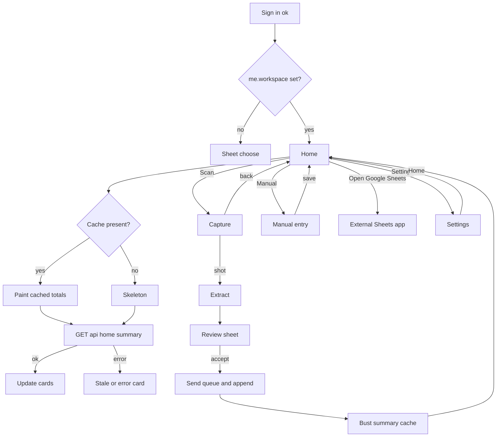
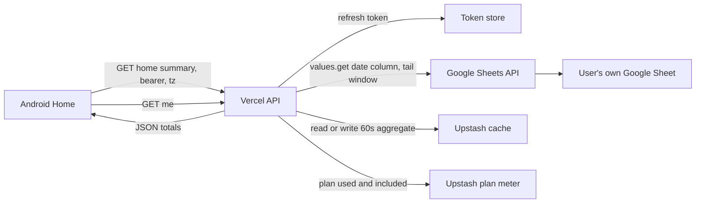

# Android spec 07: Home dashboard

Parent card: FEAT-118 (screen specs). Build card: FEAT-120. Depends on FEAT-104
(month tabs and daily totals), FEAT-119 (bearer on sheet and device routes), FEAT-116 (Space goals), FEAT-117 (plan meter).

Web reference: none. The web opens on capture (`/app` redirects to `/app/snap`,
`AppShell.tsx` lines 97 to 99). This screen is Android only by owner decision
(2026-11-05): the Android main screen is a personal wealth dashboard, not the
scan screen. Parts of it mirror web elements that already exist (sheet card from
`settings/sheet`, quota from `PlanCard`, goals from `settings/space`).

Unit rule: 1 CSS px = 1 dp, 1 rem = 16 dp, text in sp. Tokens are
`ui/theme/Tokens.kt` (`ZipppColors`, `ZipppRadius`, `ZipppSpace`, `ZipppType`).
Components are in `ui/theme/Shell.kt`.

## 1. Purpose

Answer three questions in one glance, then get out of the way:

1. How much did I spend today?
2. What was my last spending?
3. Is my Google Sheet connected, and how do I add the next receipt?

The screen is the entry point after sign in. Scan and Manual are one tap away.
The numbers come from the user's own Google Sheet. zippp does not keep a copy of
receipts (AGENTS.md: the Sheet is the system of record).

## 2. Personas and jobs

| Persona | Job on Home | What they must not hit |
|---|---|---|
| Member, personal finance (DIR-001) | Check today and last spending, add a receipt in two taps | A spinner with no numbers, a wrong total |
| Space mate (DIR-001) | See the shared goals line, add a receipt | Another person's receipts. Home reads only the signed in user's own sheet |
| Returning user after days away | See that data is stale if the network is down | A silent zero that looks real |
| New user with a sheet, no receipts | Understand what to do next | An empty dashboard with no hint |

Legacy business personas (resto, sales, reimbursement) are parked (context §4.1).
Home still works for any template that maps `amount` and `date` (section 8).

## 3. Information hierarchy

Priority decides what survives when the screen is short, the data is missing, or
a slice is not built yet. Visual order is in section 5.

| Pri | Block | Required | Source |
|---|---|---|---|
| P0 | Header (wordmark, Settings) | yes | file 01 |
| P1 | Today spending | yes | `GET /api/home/summary` |
| P1 | Last spending | yes | `GET /api/home/summary` |
| P1 | Scan receipt (56dp) and Manual (52dp) | yes | none |
| P1 | Google Sheets connected card | yes | `me.workspace` |
| P2 | Drafts waiting | when count > 0 | `BatchStore` (local) |
| P3 | Quota bar | optional, FEAT-117 | `me.plan` |
| P4 | Space snapshot with goals | optional, FEAT-116 | `GET /api/spaces`, `GET /api/spaces/{id}/assets` |

Cut order when space is tight: P4, then P3, then P2 collapses to one line. P0 and
P1 never get cut.

## 4. Decisions that shape this screen

1. Home replaces the two options in file 01 section 6. It keeps the useful parts
   of both: the sheet row from Alternative B and the quota and Space cards from A.
2. Numbers are read live from the user's Sheet through the server, with a 60
   second cache of aggregates only. No receipt rows are stored (section 9).
3. "Today" is the receipt **Date** column equal to today in the user's time zone,
   not the capture time. A receipt dated yesterday and scanned today counts for
   yesterday.
4. Money is shown as a grouped number plus the ISO currency code from the sheet.
   No currency symbols (DEC-002: no Rp, no $ words on Android).
5. Manual entry lives on Home. Capture shows no Manual pill (file 02 updated).
6. No credit counts and no purchase paths. Quota shows as a percentage (owner call
   2026-11-05).

## 5. Layout tree (top to bottom)

Frame: file 01 section 4.1 with `ShellTone.Page`. Header shows the wordmark and
Settings. Home button is hidden on Home. No credit pill.

```
AppFrame(showHome = false, showSettings = true)
  ZipppShell(tone = Page)
    Column(verticalScroll, spacedBy 16dp,
           padding start 24, end 24, top 16, bottom 48)
      [A] TodayCard
      [B] LastCard
      [C] DraftsCard            only when drafts > 0
      [D] Actions
            ZipppButton(Primary, 56dp)   Scan receipt
            ZipppButton(Mist, 52dp)      Manual
      [E] SheetCard
      [F] QuotaCard             optional (P3)
      [G] SpaceCard             optional (P4)
```

Max content width 430dp, centred (same as the header).

### [A] TodayCard (hero)

| Property | Value |
|---|---|
| Compose | `Column` in a `Box`, `clip(RoundedCornerShape(ZipppRadius.card))`, `background(ZipppColors.surface)` |
| Padding | 20dp all sides |
| Min height | 112dp |
| Label | `ZipppType.small`, `ZipppColors.muted`: Spent today |
| Amount | `ZipppType.h1` (30sp, ExtraBold), `ZipppColors.ink`, `maxLines = 1` |
| Currency code | `ZipppType.smallStrong`, `ZipppColors.muted`, 4dp right of the amount, baseline aligned |
| Receipts line | `ZipppType.smallStrong`, `ZipppColors.muted`, 4dp below the amount |
| Tap | Not tappable (no 48dp rule) |

Mixed currencies today: stack one amount line per currency, 4dp apart, same style.
Never add or convert across currencies.

### [B] LastCard

| Property | Value |
|---|---|
| Compose | `Row` in a card: `clip(card)`, `background(ZipppColors.card)`, padding 16dp |
| Left column | weight 1. Merchant `ZipppType.bodyStrong`, `ZipppColors.text`, `maxLines = 1`, ellipsis. Meta line `ZipppType.small`, `ZipppColors.muted`: date and time |
| Right | Amount `ZipppType.bodyStrong`, `ZipppColors.ink`, then currency code `ZipppType.small` muted |
| Label | Section label above the row inside the card: `ZipppType.small` muted: Last spending |
| Tap | Not tappable in v1 |

Sales-recap sheets have no Merchant column. The merchant line shows the first line
description instead; if that is also empty the row shows the amount only.

### [C] DraftsCard (P2)

White card, padding 16dp, `Row`: text `ZipppType.bodyStrong` "{count} waiting to send",
then `ZipppButton(Mist, 48dp wide-min 96dp)` Review. Review opens the review sheet
over capture for the first draft (file 03). Mirrors the `SnapScreen` queue strip.

### [D] Actions

| Button | Kind | Height | Label | Action |
|---|---|---|---|---|
| Scan receipt | `Primary` | 56dp | Scan receipt | Open Capture |
| Manual | `Mist` | 52dp | Enter manually | Open Manual entry |

Full width, 8dp apart. A 24dp camera icon (`ic_camera`, new drawable) leads the
Scan label with 8dp gap. When quota is exhausted both stay visible but the Scan
button is disabled (alpha 0.4) and the neutral card in [F] explains why. Manual is
also disabled, because it spends from the same quota.

### [E] SheetCard

| Property | Value |
|---|---|
| Compose | `ZipppSectionCard` |
| Header row | `ic_sheets` 24dp, 12dp gap, title column |
| Title | Sheet title, `ZipppType.bodyStrong`, `maxLines = 1`, ellipsis |
| Subtitle | Tab name, `ZipppType.small`, `ZipppColors.muted` |
| Button | `ZipppButton(Outline, 52dp, full width)` Open Google Sheets |
| Action | Open `https://docs.google.com/spreadsheets/d/{spreadsheet_id}` with an `ACTION_VIEW` intent. No deep link to a row in v1 |

Mirrors the connected state in `settings/sheet/page.tsx` (lines 351 to 363).

### [F] QuotaCard (optional, P3)

`ZipppSectionCard`. Title: Fair-use quota (reuse `android.settings.quota.title`).
Percentage text `ZipppType.bodyStrong`, bar 8dp high, full width, pill radius,
track `ZipppColors.mist`, fill `ZipppColors.orange`, fill `ZipppColors.danger`
at 100%. Data: `me.plan` (`used_pct`). Hidden when `plan` is null. Same widget as
Settings; reuse the composable.

### [G] SpaceCard (optional, P4)

`ZipppSectionCard`. Title: Space name. Subtitle: member count. Then up to 3 goals,
each a row: goal name `ZipppType.body`, percentage `ZipppType.smallStrong`, bar
8dp. Footer link row 48dp: Open Space (goes to Settings then Space, same as web).
Hidden when the user is in no Space. Data: `GET /api/spaces`, then
`GET /api/spaces/{id}/assets` for the first Space only.

## 6. Touch targets

| Element | Size | Note |
|---|---|---|
| Scan receipt | 56dp x full width | primary |
| Manual | 52dp x full width | secondary |
| Open Google Sheets | 52dp x full width | secondary |
| Review (drafts) | 48dp x min 96dp | |
| Header Settings | 48dp x 48dp hit area | file 01 |
| Retry / Reload in error cards | 48dp | |
| Open Space row | 48dp tall | |

Space between tappables is at least 8dp.

## 7. States and wireframes

Width in the sketches is the 430dp content column. `[ ... ]` is a button.
Numbers are examples, not fixtures.

### 7.1 Normal

```
+--------------------------------------+
| zippp                      (gear) Pengaturan |
+--------------------------------------+
|                                      |
|  +--------------------------------+  |
|  | Pengeluaran hari ini           |  |
|  | 125.000 IDR                    |  |
|  | 3 struk                        |  |
|  +--------------------------------+  |
|                                      |
|  +--------------------------------+  |
|  | Pengeluaran terakhir           |  |
|  | Alfamart            45.500 IDR |  |
|  | 5 Nov 2026 pukul 12.41         |  |
|  +--------------------------------+  |
|                                      |
|  [ (cam) Pindai struk            ]   |  56dp
|  [ Catat manual                  ]   |  52dp
|                                      |
|  +--------------------------------+  |
|  | (sheets) [zippp] Personal      |  |
|  |          2026-11               |  |
|  | [ Buka Google Sheets         ] |  |
|  +--------------------------------+  |
|  +--------------------------------+  |
|  | Kuota pemakaian wajar          |  |
|  | 42% terpakai  [=====-------]   |  |
|  +--------------------------------+  |
+--------------------------------------+
```

### 7.2 First run (sheet connected, no receipts ever)

```
|  +--------------------------------+  |
|  | Pengeluaran hari ini           |  |
|  | 0                              |  |
|  | Pindai struk pertama untuk     |  |
|  | memulai.                       |  |
|  +--------------------------------+  |
|  +--------------------------------+  |
|  | Pengeluaran terakhir           |  |
|  | Belum ada pengeluaran          |  |
|  +--------------------------------+  |
|  [ (cam) Pindai struk            ]   |
|  [ Catat manual                  ]   |
|  ( sheet card as in 7.1 )            |
```

No currency code is shown when there is no data (never invent a currency).

### 7.3 Loading skeleton (no cache yet)

```
|  +--------------------------------+  |
|  | ################               |  |  grey bars, ZipppColors.mist
|  | ##########                     |  |
|  | ######                         |  |
|  +--------------------------------+  |
|  +--------------------------------+  |
|  | ############        ########   |  |
|  | ########                       |  |
|  +--------------------------------+  |
|  [ (cam) Pindai struk            ]   |  enabled while loading
|  [ Catat manual                  ]   |  enabled while loading
|  ( sheet card from me.workspace )    |
```

Skeleton lasts only until the first response or error. Actions stay enabled.
Shimmer is off when the system sets "remove animations".

### 7.4 No spending today (but earlier history)

```
|  | Pengeluaran hari ini           |  |
|  | 0 IDR                          |  |
|  | Belum ada catatan hari ini     |  |
|  Last spending card shows the most recent receipt, any day. |
```

The currency code comes from the last receipt when there is one.

### 7.5 Offline or stale

```
|  +--------------------------------+  |
|  | Diperbarui 10.02. Menampilkan  |  |  amber card: AmberBg / AmberInk
|  | total tersimpan.   [ Muat ulang ]| |  48dp
|  +--------------------------------+  |
|  ( today and last cards from the device cache, label unchanged )
|  [ Pindai struk ]  [ Catat manual ]  |  stay enabled
```

The stale card sits above [A]. Totals are shown from the local cache. Scan and
Manual still work (they queue, file 02 section 5).

### 7.6 Sheet read error

```
|  +--------------------------------+  |
|  | Tidak bisa membaca sheet Anda. |  |  card, ZipppColors.danger text
|  | Coba lagi.       [ Muat ulang ]|  |
|  +--------------------------------+  |
|  ( today and last cards are hidden; actions and sheet card stay )
```

Variants by error code (section 10): Google access ended shows a Sign in with
Google row instead of Reload. Custom sheet shows the unsupported line with no
button.

### 7.7 Quota exhausted

```
|  +--------------------------------+  |
|  | Sisa kuota scan Anda telah     |  |  existing android.error.no_credits.short
|  | habis.        [ Muat Ulang ]   |  |  existing refresh key
|  +--------------------------------+  |
|  ( today and last cards still shown: reading the sheet costs no quota )
|  [ Pindai struk ] disabled           |
|  [ Catat manual ] disabled           |
```

No purchase link, no "buy on the web" text (DEC-002). Quota is exhausted when
`plan.included > 0 && plan.used >= plan.included`, or after a `NO_CREDITS` or
`PLAN_LIMIT` response. Unknown quota never counts as exhausted.

### 7.8 Drafts waiting

```
|  ( Today card, Last card )           |
|  +--------------------------------+  |
|  | 2 menunggu dikirim [ Periksa ] |  |  48dp button
|  +--------------------------------+  |
|  [ Pindai struk ] [ Catat manual ]   |
```

### 7.9 Sheet lost during a session

Rare. The guard (file 01 section 5) sends the user to Sheet choose when
`me.workspace == null`. Home never renders without a workspace. Before FEAT-119
Android cannot connect a sheet, so Sheet choose shows the existing neutral text and
Reload (file 06).

## 8. The sheet read (exact)

### 8.1 What is read

Home reads only the signed in user's own sheet using the Google token the server
already stores (`token-store.ts`, `getAuthenticatedClient(userId)` in `sheets.ts`).
The mobile bearer resolves to `userId` through `requestUser`, the same id the
append route uses (`loadWorkspaceForUser(userId)`). zippp holds no copy.

The workspace record gives the columns. `workspace.column_map` maps field ids to
header strings; `workspace.headers` is row 1. Needed ids:

| Field id | Used for | Required |
|---|---|---|
| `date` | today bucket | yes |
| `amount` | line amount | yes |
| `tax` | tax on the last line | no (treated as 0) |
| `merchant` | last spending title | no |
| `currency` | code next to amounts | no |
| `receipt_id` | group lines into receipts | no |
| `captured_at` | "last" ordering | no (falls back to row order) |
| `total` | fallback when `amount` is empty on every line | no |

If `date` or `amount` is missing from `column_map` (custom template with no
mapping), the endpoint returns `NOT_SUPPORTED` and Home shows the unsupported line.

### 8.2 Rows, receipts, and the amount rule

The append route writes **one row per line item** (`buildAppendRows`). Receipt
total repeats on every row. Tax is written on the **last line only**. So:

- A row's spend is `Amount + Tax` (blank counts as 0). This equals the daily block
  formula in FEAT-104 (`SUMIF Amount + SUMIF Tax`), so Home and the Sheet agree.
- Do not sum the `Total` column. It repeats per line and would multiply the figure.
- A receipt is the set of rows sharing one Receipt ID. A row with no Receipt ID
  (typed by hand) is its own receipt.
- Today spending = sum of row spend where the row date equals today.
- Receipts today = number of distinct receipts among those rows.
- Last spending = the receipt with the greatest `Captured at` (ISO string compare).
  Ties and missing `Captured at` fall back to the highest row number. Its amount is
  the sum of its rows' spend; if that is 0 and `total` is mapped, use the first
  row's Total. It shows merchant, amount, currency, receipt Date and the
  `Captured at` time.

### 8.3 Which tab and range

Before FEAT-104 (today's code, single tab `workspace.sheet_tab`, no month tabs):

1. `GET values/{tab}!{dateCol}:{dateCol}` with `valueRenderOption=UNFORMATTED_VALUE`.
   Count returned rows: `n` (including the header). One narrow column keeps the
   payload small even for a large sheet.
2. `GET values/{tab}!{firstCol}{start}:{lastCol}{n}` where
   `start = max(2, n - 399)`. Window is the last 400 rows. Same render options.
3. If the first row of the window is dated today, the window may cut today short.
   The response sets `truncated: true` and Home shows the truncated line. Step 2
   never runs for more than 400 rows.

After FEAT-104 (month tabs, daily block):

1. Compute the month tab name `YYYY-MM` from today in the user's time zone.
2. Today spending: read the daily block row for today (one cell range from
   `sheet-layout.ts`, helper `dailyTotalRange(month, day)`). Check the block's date
   label equals today. If the tab, block or label is missing or wrong, fall back to
   the row scan below on that tab. Response `source` is `daily_block` or `rows`.
3. Last spending: row scan of the last 400 rows of the month tab. If the month tab
   has no receipt yet (new month), scan the previous month tab, then stop.
4. Never read the Summary tab or hidden tabs for Home.

`sheet-layout.ts` does not exist yet. Until it does, only the pre-FEAT-104 path
runs. The code must not import a module that is missing: the daily block path is
behind a function `readDailyBlock()` that returns `null` until FEAT-104 ships.

### 8.4 Time zone and "today"

- The client sends `tz` (IANA name from `ZoneId.systemDefault().id`) on every call.
- The server validates it with `Intl.supportedValuesOf("timeZone")` (or a try on
  `Intl.DateTimeFormat`) and falls back to `Asia/Jakarta` when invalid or missing.
- Today is `Intl.DateTimeFormat("en-CA", { timeZone: tz })` formatted as
  `YYYY-MM-DD`.
- Row dates are calendar dates with no zone, so they compare as strings after
  normalising to `YYYY-MM-DD`.
- The cache key includes the date string, so the cache rolls over at local midnight.

### 8.5 Parsing dates

Read with `valueRenderOption=UNFORMATTED_VALUE` and the default
`dateTimeRenderOption=SERIAL_NUMBER`. The append path writes `USER_ENTERED`, so a
`YYYY-MM-DD` string becomes a real date, returned as a serial number.

| Cell value | Result |
|---|---|
| number (e.g. `46331`) | date = 1899-12-30 plus the integer part, in days |
| text `2026-11-05` | same date |
| text `05/11/2026` or `05-11-2026` | d/M/yyyy, accepted only when the day is above 12, or the spreadsheet locale is `id_ID` (read once from `properties.locale`) |
| anything else, empty, or out of range | row skipped, counted in `skipped` (diagnostic only, never shown) |

### 8.6 Parsing amounts (Indonesian thousands separator)

Amounts the app wrote are JSON numbers, so they come back as numbers. Text amounts
exist when a user typed or pasted them. Parse text with these rules, in order:

1. Trim. Strip a leading or trailing currency token (`Rp`, `IDR`, `USD`, `$`) and
   spaces.
2. If it matches `^-?\d{1,3}(\.\d{3})+(,\d+)?$` it is Indonesian: dots are
   thousands, comma is decimal. Remove dots, replace the comma with a dot.
3. Else if it matches `^-?\d{1,3}(,\d{3})+(\.\d+)?$` it is English: commas are
   thousands.
4. Else if it matches `^-?\d+([.,]\d+)?$` and has exactly one separator followed by
   one or two digits, it is a decimal. A single separator followed by exactly three
   digits is thousands (`12.500` is 12500, never 12.5).
5. Anything else is `NaN` and the row is skipped.

Negative values count (refunds). Display rounds to the currency's minor unit: 0
decimals for IDR, 2 for others.

### 8.7 Currency code

The `currency` column holds what the model returned. The server normalises it
before it leaves the API: trim, uppercase, map `RP` and `RP.` to `IDR`, `$` to `USD`.
Unknown or empty stays empty and Android shows the number alone. Android never
renders a currency symbol.

### 8.8 Display format

Android formats the number from the JSON value with `NumberFormat` for the app
language: `id` uses `.` for thousands, `en` uses `,`. The code follows after a thin
space. So `125000` shows `125.000 IDR` in Indonesian and `125,000 IDR` in English.
This is the sheet's own amount and code, not a conversion.

## 9. User flow

### 9.1 ASCII

```
Sign in ok
    |
    v
 me.workspace? --no--> Sheet choose (file 06)
    | yes
    v
  HOME  <-----------------------------------------------+
    | cache present? --yes--> paint cache (<300ms)       |
    |        |no                                          |
    |        v                                            |
    |    skeleton                                         |
    v                                                     |
 GET /api/home/summary (+ me + plan, in parallel)         |
    | ok          | error                                 |
    v             v                                       |
 update cards   stale card / error card                   |
    |                                                     |
    +--Scan--> Capture --shot--> Extract --> Review sheet |
    |             |back               | accept            |
    |             +-------------------+-------------------+
    |                                 v
    |                     send queue -> append -> bust summary cache
    +--Manual--> Manual entry --save--> (back to Home, refresh)
    +--Open Google Sheets--> external app
    +--Settings--> Settings --Home--> HOME
    +--Review (drafts)--> Review sheet over Capture
```

### 9.2 Mermaid



Navigation rule: Capture, Manual and Settings return to Home. System back on Home
exits the app. After any append that succeeds, Home refreshes when it next resumes.

## 10. System diagram

### 10.1 ASCII

```
 +----------------+  bearer   +--------------------------+
 | Android Home   |---------->| Vercel: GET              |
 | (cache 2KB in  |  tz=...   |  /api/home/summary       |
 |  private prefs)|<----------|  requestUser(bearer)     |
 +-------+--------+   JSON    +----+---------+-----------+
         |                         |         |
         | parallel                | token   | aggregate cache
         v                         v         v  (60s, no rows)
 +----------------+      +----------------+  +------------------+
 | GET /me        |      | Google Sheets  |  | Upstash Redis    |
 | (workspace,    |      | API v4         |  | home:{user}:{day}|
 |  plan)         |      | values.get x2  |  | + rate counter   |
 +----------------+      +----------------+  +------------------+
                                  ^
                                  | plan meter (used, included)
                         +--------+---------+
                         | Upstash: plan:*  |
                         +------------------+
```

The Sheet is the system of record. Upstash holds only a 60 second aggregate cache
and a rate counter. It does not hold receipts. The credit and plan ledger stays the
only record of money and credits.

### 10.2 Mermaid



## 11. Endpoint contract (PLANNED, add to context §7 when built)

```
GET /api/home/summary?tz=Asia/Jakarta
Authorization: Bearer <mobile token>        (or the web session cookie)
```

Auth: `requestUser(req)`. Mobile bearer needs `MOBILE_API_ENABLED=true`.

Success `200`:

```json
{
  "ok": true,
  "as_of": "2026-11-05T05:41:12.000Z",
  "tz": "Asia/Jakarta",
  "today": {
    "date": "2026-11-05",
    "totals": [{ "currency": "IDR", "amount": 125000 }],
    "receipts": 3
  },
  "last": {
    "merchant": "Alfamart",
    "amount": 45500,
    "currency": "IDR",
    "date": "2026-11-05",
    "captured_at": "2026-11-05T05:41:12.000Z",
    "receipt_id": "0a1b2c3d-0000-4000-8000-000000000000"
  },
  "sheet": {
    "id": "1AbC...",
    "title": "[zippp] Personal",
    "tab": "2026-11"
  },
  "source": "rows",
  "truncated": false
}
```

- `today.totals` is an empty array when nothing is recorded today.
- `last` is `null` when the sheet has no receipt.
- Money fields are numbers, in the currency's major unit. No formatting, no symbol.
- `source` is `rows` or `daily_block`.
- Header `Cache-Control: no-store` (the client holds its own copy).

Errors, all `{ "ok": false, "code": "..." }`:

| Status | Code | Meaning | Android shows |
|---|---|---|---|
| 401 | `UNAUTHORIZED` | no or bad token | Sign in |
| 401 | `DEVICE_REVOKED` | device revoked | Sign in, clear data |
| 404 | `MOBILE_API_DISABLED` | mobile API off | generic server text |
| 409 | `NO_SHEET` | no workspace | Sheet choose |
| 422 | `NOT_SUPPORTED` | `date` or `amount` not mapped | unsupported line |
| 403 | `GOOGLE_RECONSENT` | Google refused the token | sign in with Google row |
| 429 | `RATE_LIMITED` | too many calls | stale card, retry later |
| 502 | `SHEET_UNREADABLE` | Google 4xx or 5xx on read | error card with Reload |

Server rules:

- Cache: aggregates only, key `home:{userId}:{YYYY-MM-DD}:{tz}`, TTL 60 seconds.
  Delete the key after every successful append and manual save. The cache value is
  the response body above. It holds no rows.
- Rate limit: 30 requests per minute per user. Over the limit returns
  `RATE_LIMITED` with `Retry-After`.
- Sheets cost: 2 `values.get` calls per uncached request, well inside the Sheets
  per-user quota.
- Constants (60 s TTL, 400 row window, 30 per minute, `Asia/Jakarta`) go in
  `src/lib/billing/config.ts` (AGENTS.md rule: constants live there, and in
  `sheet-style.ts` for Sheets, which does not exist yet). No magic numbers in the
  route.
- Privacy: logs may hold the hashed user id, status code, duration and row counts.
  Never log merchant, amount, date, sheet id or any cell value. Do not echo Google
  error bodies to the client. Map them to the codes above.
- Admin and credit checks are unchanged. This route spends nothing.

### Context file §7 addition (to paste when built)

> **GET /api/home/summary (PLANNED, FEAT-120).** Bearer or cookie. Query `tz`.
> Reads the user's own Sheet: today's spend by currency, receipt count, and the last
> receipt. Row spend is Amount plus Tax. 60 second aggregate cache, rate limit 30
> per minute. Errors: UNAUTHORIZED, DEVICE_REVOKED, MOBILE_API_DISABLED, NO_SHEET,
> NOT_SUPPORTED, GOOGLE_RECONSENT, RATE_LIMITED, SHEET_UNREADABLE.

## 12. Client behaviour (Android)

1. On composition, read the cached summary from private prefs (a single JSON string,
   under 2 KB, key `home_summary_v1`). Paint it immediately.
2. Start three calls in parallel: `GET /api/home/summary`, `GET /api/auth/mobile/me`,
   and, for P4, `GET /api/spaces` after `me` returns. A failure in one block never
   blanks the others.
3. On success replace the cards, write the cache with `as_of`.
4. On failure with a cache present: keep the cards, show the stale card with the
   time of `as_of`.
5. On failure with no cache: show the error card, keep the actions.
6. Refresh again on `ON_RESUME` when the last refresh is over 60 seconds old, and
   after returning from Capture, Manual or Settings.
7. Pull to refresh on the scroll column. Reload buttons call the same refresh.
8. The cache is cleared on sign out and on `DEVICE_REVOKED`. `allowBackup=false`
   keeps it off Google backups.

## 13. Wording keys

All new keys go in `spec/wording.txt` (en and id), are mapped in
`scripts/gen-android-strings.mjs`, and use `{name}` placeholders. No em dashes, no
hype words, none of kredit, saldo, Rp, or a currency symbol.

| Key | en | id |
|---|---|---|
| `android.home.today.label` | Spent today | Pengeluaran hari ini |
| `android.home.today.receipts` | {count} receipts | {count} struk |
| `android.home.today.receiptsOne` | 1 receipt | 1 struk |
| `android.home.today.empty` | Nothing recorded today | Belum ada catatan hari ini |
| `android.home.today.first` | Scan your first receipt to start. | Pindai struk pertama untuk memulai. |
| `android.home.today.mixed` | Several currencies today | Beberapa mata uang hari ini |
| `android.home.today.a11y` | Spent today: {amount} {currency} from {count} receipts | Pengeluaran hari ini: {amount} {currency} dari {count} struk |
| `android.home.last.label` | Last spending | Pengeluaran terakhir |
| `android.home.last.meta` | {date} at {time} | {date} pukul {time} |
| `android.home.last.none` | No spending yet | Belum ada pengeluaran |
| `android.home.scan` | Scan receipt | Pindai struk |
| `android.home.manual` | Enter manually | Catat manual |
| `android.home.sheet.open` | Open Google Sheets | Buka Google Sheets |
| `android.home.drafts` | {count} waiting to send | {count} menunggu dikirim |
| `android.home.drafts.review` | Review | Periksa |
| `android.home.stale` | Updated {time}. Showing saved totals. | Diperbarui {time}. Menampilkan total tersimpan. |
| `android.home.error.sheet` | Could not read your sheet. Try again. | Tidak bisa membaca sheet Anda. Coba lagi. |
| `android.home.error.reconsent` | Google access ended. Sign in with Google again. | Akses Google berakhir. Masuk dengan Google lagi. |
| `android.home.error.unsupported` | Totals are not available for custom sheets. | Total tidak tersedia untuk sheet kustom. |
| `android.home.truncated` | Showing the latest rows only. | Hanya menampilkan baris terbaru. |
| `android.home.retry` | Reload | Muat ulang |
| `android.home.space.open` | Open Space | Buka Space |
| `android.home.space.goal` | {name}: {pct}% | {name}: {pct}% |

Reused as they are: `android.settings.quota.title`, `android.settings.quota.pct`,
`android.error.no_credits.short`, `android.error.no_credits.refresh`,
`android.error.device_revoked`, `android.error.server`, `app.settings.title`.
`app.sheets.open` already exists with the same text as `android.home.sheet.open`;
use `app.sheets.open` and drop the duplicate row.

## 14. Accessibility

1. TalkBack reads Today as one node using `android.home.today.a11y`. Last spending is
   one node: merchant, amount, date.
2. Reading order is the visual order. Stale and error cards come first because they
   sit first.
3. Every button has a text label. Icon-only elements (`ic_camera`, `ic_sheets`)
   carry `contentDescription = null` because the label sits next to them.
4. At 200 percent font scale nothing is clipped: the amount drops to 24sp when the
   formatted text is over 12 characters, cards grow in height, the bar stays 8dp.
5. Contrast: `ZipppColors.ink` on `ZipppColors.surface`, ink on card white, and
   `AmberInk` on `AmberBg` must each reach 4.5:1. Measure them in S-H4 and record
   the ratios in the card.
6. Error and stale states are shown in text, never by colour alone.
7. Skeleton shimmer respects the system "remove animations" setting.

## 15. Analytics and privacy

No analytics SDK, no event tracking, no crash reporter that captures screen
content. The server logs counts and status only (section 11). The device cache holds
the last summary, not rows, in app-private storage that is excluded from backups and
cleared on sign out.

## 16. Performance budget

| Metric | Budget |
|---|---|
| Cold start to first paint with a cache | under 300 ms after `onCreate` (read 2 KB prefs synchronously, no network first) |
| First paint with no cache | skeleton within 100 ms |
| Summary round trip, uncached | server p95 under 1.5 s (2 Sheets reads, 400 rows) |
| Summary round trip, cached | server p95 under 150 ms |
| Recompositions on refresh | cards keyed by id, only changed cards recompose |
| APK impact | one drawable (`ic_camera`), no new library |

## 17. Acceptance checklist (screenshot checkable)

1. Cold start with a stored token and a workspace lands on Home, not on Capture.
2. The header shows the wordmark and Settings. No Home button, no credit pill.
3. Today card is peach (`#F6D3C5`), 8dp corners, 20dp padding, amount at 30sp.
4. Today amount equals the Sheet: for a three-receipt fixture the card equals the
   hand sum of Amount plus Tax for today's rows.
5. A receipt with 4 lines counts once in "receipts", and its total is not
   multiplied by 4.
6. A receipt dated yesterday and scanned today does not appear in Today.
7. Last spending shows the receipt with the latest Captured at, with merchant,
   amount, code, date and time.
8. Amounts show grouped numbers and the ISO code. No symbol, no Rp, no `$`.
9. `12.500` typed as text in the Sheet reads as 12,500, not 12.5.
10. Scan receipt is 56dp high, Manual is 52dp, Open Google Sheets is 52dp (layout
    inspector). Every tappable is at least 48dp.
11. Scan opens Capture. System back from Capture returns to Home.
12. Manual opens Manual entry. Saving returns to Home and the Today card updates
    within one resume.
13. Capture shows no Manual pill and no Space or Settings text links.
14. Open Google Sheets opens the connected sheet in Sheets or the browser.
15. With two drafts waiting, the drafts card shows "2 menunggu dikirim" and Review
    opens the review sheet.
16. Airplane mode after one good load shows the stale card with the saved time, and
    the Today and Last cards still show numbers.
17. Airplane mode on a fresh install shows the error card and Reload, with Scan and
    Manual enabled.
18. Quota at 100 percent shows the neutral card, the Scan and Manual buttons are
    dimmed and not tappable, and no screen contains kredit, saldo, Rp, a price or
    a purchase link.
19. Unknown quota (plan not loaded) does not dim the buttons.
20. A custom-template sheet shows the unsupported line and no numbers.
21. The first frame with a cache appears under 300 ms (screen recording at 60 fps,
    count frames).
22. Sign out clears the cache: signing in as another account never shows the
    previous account's numbers.

## 18. Test plan

Server (Node test runner, new `src/lib/home/summary.test.ts`; parsing and
aggregation are a pure function with no Google calls):

| Case | Input | Expect |
|---|---|---|
| serial date | `46331` | 2026-11-05 (check against a known serial) |
| ISO text date | `2026-11-05` | same |
| d/M/yyyy with day above 12 | `25/11/2026` | 2026-11-25 |
| ambiguous d/M text, locale en | `05/11/2026` | row skipped |
| ID thousands | `"125.000"` | 125000 |
| ID thousands and decimal | `"1.250.000,50"` | 1250000.5 |
| EN thousands | `"12,500"` | 12500 |
| single separator, 3 digits | `"12.500"` | 12500 |
| single separator, 2 digits | `"12,50"` | 12.5 |
| currency token | `"Rp 45.500"` | 45500 |
| garbage | `"abc"` | row skipped |
| multi-line receipt | 4 rows, one Receipt ID | counted once, spend = sum(Amount) + Tax |
| row with no Receipt ID | 1 row | counted once |
| mixed currencies | IDR and USD rows today | two entries in `totals`, never merged |
| tz rollover | 2026-11-05T17:30Z with `Asia/Jakarta` | today is 2026-11-06 |
| window cut | 450 rows, today starts before row 51 | `truncated: true` |
| last receipt | later Captured at on an earlier row | picks the latest Captured at |
| missing column map | no `amount` | `NOT_SUPPORTED` |
| currency normalise | `Rp`, `rp.`, `$` | IDR, IDR, USD |

Route (mock `googleFetch`): auth failures, `NO_SHEET`, `GOOGLE_RECONSENT` mapping,
cache hit within 60 s, cache cleared after append, `RATE_LIMITED`, and a log capture
test that no cell value appears in logs.

Android: Compose UI test per state in section 7 with a fake summary (no network);
`assertHeightIsAtLeast(48.dp)` on every clickable node, `assertHeightIsEqualTo(56.dp)`
on Scan; device check with `adb exec-out screencap -p` for each wireframe, and
`adb shell uiautomator dump` to read bounds.

## 19. Slices

One slice at a time. Each ends with the compile and test gates for its side.

| Slice | Scope | Side | Depends on |
|---|---|---|---|
| S-H1 | This spec agreed. Add the `android.home.*` keys to `wording.txt` and the generator. Fix `app.review.allDone` em dash if touched | spec, wording | none |
| S-H2 | `src/lib/home/summary.ts` pure parse and aggregate, constants in `billing/config.ts`, tests from section 18 | server | S-H1 |
| S-H3 | `readTail()` in `sheets.ts`, route `/api/home/summary`, cache, rate limit, bust cache on append and manual save, context §7 | server | S-H2 |
| S-H4 | Android Home screen with fake data and all states, `ic_camera`, `ZipppButton` sizes (56 and 52dp) | android | S-H1 |
| S-H5 | `ApiClient.homeSummary`, device cache, stale handling, `MainActivity` entry change (Home first, Capture and Manual return to Home), remove Manual pill and Space and Settings links from Capture | android | S-H3, S-H4 |
| S-H6 | Optional cards: quota bar and Space snapshot | android | S-H5 |
| S-H7 | Daily block source after FEAT-104 ships | server | FEAT-104 |
| S-H8 | Device run with screenshots against section 17 | owner | S-H5 |

S-H2 and S-H3 can run in parallel with S-H4. Server gates: `npm test`,
`npx tsc --noEmit`, `npm run build`. Android gates:
`:app:compilePlayDebugKotlin`, `:app:compileSideloadDebugKotlin`.

## 20. Open questions

1. Month to date as a third index (P4). Left out of v1: the 400-row window cannot
   give a correct month figure before FEAT-104. After FEAT-104 the Summary row has
   it. Add then?
2. Should Last spending open the sheet at that row? Needs the row number and a
   `#gid=...&range=` link. Left out of v1.
3. Pull to refresh, or only Reload and resume refresh?
4. The Space card needs two calls (`spaces`, then `assets`). Add one summary field
   on `GET /api/spaces` instead?
5. FEAT-119 (bearer on sheet and device routes) is a separate card. Home does not need it (it reads the sheet with the
   stored Google token), but Sheet choose and "connect a sheet" on Android do.
