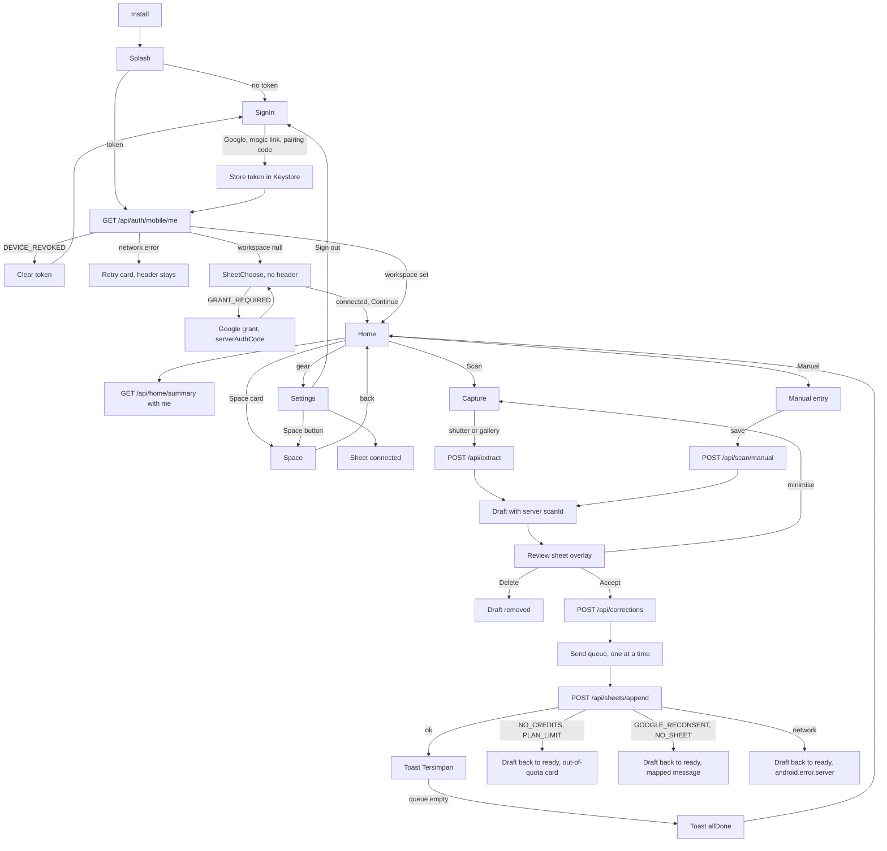
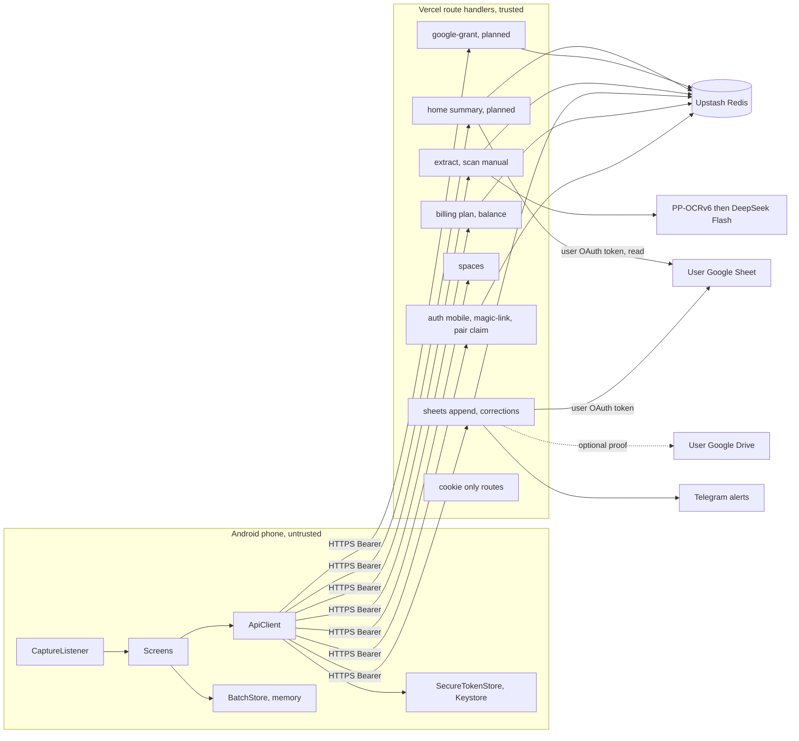
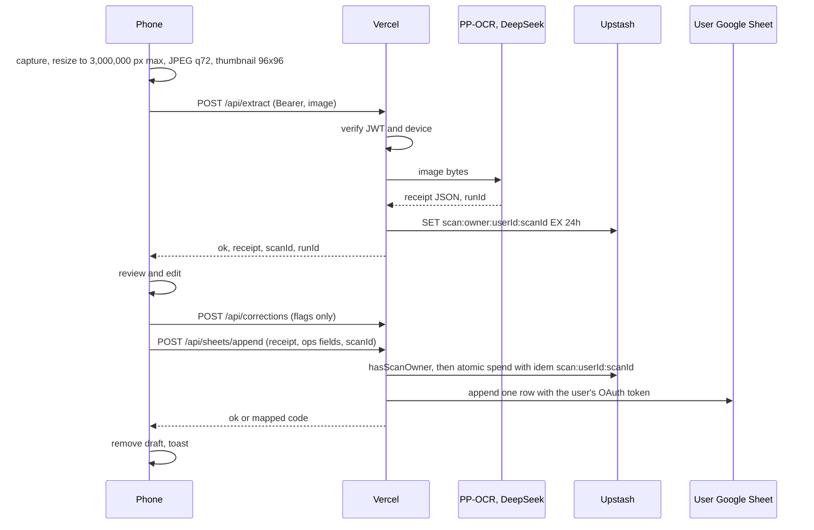

# 08 Flows, system diagram and wireframes

Android spec for FEAT-118. This file draws the whole app on one page: how a user moves through it, how the pieces talk to the server, what one scan leaves behind, what every screen looks like at 360dp, and a table of every screen with its entry points and exits.

It does not redefine anything. Layout values, wording keys and acceptance checks live in the per-screen files. When this file and a per-screen file disagree, the per-screen file wins. The 20 disagreements found on the first pass are resolved in section 7; section 8 lists what is still open.

Sources of truth, in order:

| File | Owns |
|---|---|
| `01-shell-and-navigation.md` | tokens, header, touch targets, guard order, navigation graph |
| `02-capture.md` | capture screen, send queue, extract errors |
| `03-review-sheet.md` | review bottom sheet, accept, corrections |
| `04-settings.md` | settings |
| `05-space.md` | Space |
| `06-sheet-choose-and-sign-in.md` | sign in, sheet setup |
| `07-home-dashboard.md` | Home dashboard (new main screen, `GET /api/home/summary`) |
| `09-bearer-route-slice.md` | FEAT-119: bearer on sheet, device, notice and contribute routes, Google grant |
| `00-audit-and-defects.md` | phone audit, root causes |
| `10-pairing.md` | Pairing screen (legacy 8 character code) |
| `11-manual-entry.md` | Manual entry screen |
| `12-google-grant.md` | Google grant screen (`serverAuthCode`) |

Conventions in the drawings:

- ASCII boxes are 360dp wide. One character is about 8dp across. One text line is about 16dp high. A 48dp target is 6 characters wide and 3 lines high.
- Square brackets `[ ]` are tappable. A number after a bracket is its height in dp.
- Wording keys are shown as `<key>`. Copy lives in `spec/wording.txt` only.
- Every diagram is given twice: ASCII for reading in a terminal, mermaid for rendering. They say the same thing.
- No credit counts, prices, kredit, saldo or Rp appear anywhere (DEC-002).

## 1. User flow, end to end

### 1.1 Main flow (ASCII)

```
INSTALL
   |
   v
+--------+  token?   no   +----------+  Google / magic link / pairing code
| Splash |--------------->| SignIn   |-----------------------------+
+---+----+                +----------+                             |
    | yes                                                          v
    v                                                       store token (Keystore)
 GET /api/auth/mobile/me  <-------------------------------------- +
    |
    |-- DEVICE_REVOKED -------------------------> clear token --> SignIn
    |-- network error --> Retry card (header stays)
    v
 me.workspace ?
    |-- null --> SheetChoose (no header)
    |              find / create / pick  (cookie-only today, FEAT-119 in 09)
    |              GRANT_REQUIRED --> Google grant (serverAuthCode) --> find again
    |              connected --> Continue
    v                                  |
+------------------------------------+ |
|              HOME                  |<+
|  today, last, sheet card, quota    |
|  [Scan] [Manual]  drafts card      |
|  Space card, Sheets card           |
|  GET /api/home/summary + me        |
+---+---------+----------+-----------+
    |         |          |
    | Scan    | Manual   | gear      Space card
    v         v          v           v
+---------+ +--------+ +----------+  +-------+
| Capture | | Manual | | Settings |->| Space |  Settings also links to Space;
+----+----+ +---+----+ +----+-----+  +-------+  back from Space always goes Home
     |          |           |
     |          |           +--> Sheet connected, Sign out --> SignIn
     | shutter  | save      +--> notification capture card
     | or gallery
     v          |
 POST /api/extract (bearer)
     |          |   POST /api/scan/manual (bearer)
     v          v
 draft in strip, scanId from server
     |
     v
+---------------------------+
| Review sheet (overlay)    |-- Delete --> draft removed
| edit, flags, ops fields   |-- minimise --> back to Capture
+------------+--------------+
             | Accept (flags clear, lines valid)
             v
 POST /api/corrections (fire and forget)
 send queue, one at a time
 POST /api/sheets/append (bearer, scanId)
             |
   +---------+----------+---------------------+-------------------+
   | ok      | NO_CREDITS/PLAN_LIMIT         | GOOGLE_RECONSENT   | network
   v         v                               v NO_SHEET           v
 toast     draft back to ready,         draft back to ready   draft back to ready
 "Tersimpan"  out-of-quota card         mapped message        android.error.server
   |
   v
 queue empty --> toast <app.review.allDone>; back goes to Home, which refreshes
 (summary cache is cleared after every append and manual save)
```

### 1.2 Main flow (mermaid)



### 1.3 Error and edge paths

| Situation | Where it shows | What the user sees | What happens next |
|---|---|---|---|
| No network at launch | Splash, then Home body | `<android.error.server>` and a 52dp Retry button, header stays | Retry re-runs `me` |
| No network at extract | Draft in the strip | draft ends `failed`, `<android.error.server>`, never an endless spinner (02 acceptance 12) | Retry sets `queued`, Delete removes |
| No network at append | Review sheet | draft returns to `ready` with an inline error line | user taps Accept again |
| Zero quota | Capture (card), Settings (red bar) | neutral card, Reload (`<android.error.no_credits.refresh>`), Help (`<android.error.no_credits.support>`) | no redirect, no purchase link |
| `DEVICE_REVOKED` on any call | any | `<android.error.device_revoked>` | token cleared, SignIn |
| Camera permission denied | Capture | 96dp box, `<android.camera.permission>`, `<android.camera.allow>` | Gallery and Manual still work |
| No workspace | SheetChoose | choose source screen | blocked until FEAT-119 makes the sheet routes accept bearer (09) |
| Google not granted (phone-only user) | SheetChoose, Home | grant screen (4.4) | `GOOGLE_GRANT_REQUIRED`, then `google-grant`, then find again (09 section 6) |
| Home summary fails | Home | stale card with saved totals, or error card; Scan and Manual stay enabled | Reload, or refresh on resume |
| Google token expired | Review sheet | `<android.error.google_reconsent>` | draft stays `ready` |
| App killed with drafts | next launch | drafts gone (FEAT-108 owns persistence) | user shoots again |

## 2. System diagram

### 2.1 Components (ASCII)

```
+------------------------- ANDROID PHONE (untrusted client) -------------------------+
|                                                                                    |
|  Screens (Compose)          State and storage            System integrations       |
|  Splash, SignIn, Pairing    BatchStore (in memory)       CameraX                   |
|  SheetChoose, Home          SecureTokenStore             Credential Manager        |
|  Capture, Review, Manual      Keystore AES-256-GCM       Photo picker              |
|  Settings, Space              ciphertext in private      NotificationListener      |
|                               prefs, allowBackup=false     CaptureListener         |
|        |                                                   CapturePrefs            |
|        v                                                                           |
|   ApiClient (OkHttp) --- baseUrl from BuildConfig ---- Authorization: Bearer JWT   |
+--------|---------------------------------------------------------------------------+
         | HTTPS
=========|=========================== TRUST BOUNDARY 1 ==============================
         v
+----------------------------- VERCEL (Next.js route handlers) --------------------+
|  Decides: identity, device binding, credits, plan limit, sheet access.             |
|  Never trusts: client credit counts, client scan ids it did not issue, UI state.   |
|                                                                                    |
|  /api/auth/mobile/*  /api/auth/magic-link/*  /api/auth/pair/claim                  |
|  /api/extract  /api/scan/manual  /api/sheets/append  /api/corrections              |
|  /api/billing/plan  /api/billing/balance  /api/spaces/*  /api/auth/logout          |
|  /api/home/summary (planned FEAT-120)  /api/auth/mobile/google-grant (planned)     |
+----|-------------------|----------------------|---------------------|-------------+
     |                   |                      |                     |
     v                   v                      v                     v
+---------+     +----------------+     +------------------+    +------------------+
| Upstash |     | Extraction     |     | Google APIs      |    | Telegram bot     |
| Redis   |     | PP-OCRv6 then  |     | Sheets, Drive    |    | admin and user   |
|         |     | DeepSeek Flash |     | via the USER's   |    | alerts (info     |
| credits |     | (image in,     |     | OAuth token held |    | only, no buy     |
| ledger, |     |  JSON out)     |     | on the server    |    | link on Android) |
| plan    |     +----------------+     +--------+---------+    +------------------+
| meter,  |                                     |
| scan    |                          =========== TRUST BOUNDARY 2 ===========
| owners, |                                     v
| sessions|                          +----------------------+
+---------+                          | User's Google Sheet  |  system of record
                                     | User's Google Drive  |  optional photo proof
                                     +----------------------+
```

Upstash also holds the 60 second Home aggregate cache (`home:{userId}:{day}:{tz}`, totals only, no rows).

### 2.2 Components (mermaid)



### 2.3 Routes the phone uses, and how each authenticates

Checked against `src/app/api` on 2026-11-05 (`resolveRequestUser`, `resolveBearerUser`).

| Route | Used for | Auth today | Android can call it |
|---|---|---|---|
| `POST /api/auth/mobile/google` | Google sign in | public, id token | yes |
| `POST /api/auth/magic-link/request`, `/consume` | magic link sign in | public | yes |
| `POST /api/auth/pair/claim` | pairing code | public, code | yes (legacy) |
| `GET /api/auth/mobile/me` | workspace, plan, spaces | bearer | yes |
| `POST /api/extract` | read a receipt photo | bearer when present, else cookie | yes |
| `POST /api/scan/manual` | manual entry scan id | bearer only | yes |
| `POST /api/sheets/append` | send one row | bearer or cookie | yes |
| `POST /api/corrections` | correction telemetry | bearer or cookie | yes |
| `GET /api/billing/plan` | quota percentage | bearer or cookie | yes |
| `GET /api/billing/balance` | credit count | bearer or cookie; returns credits, refCode, referral, invite | not called (no credit numbers); FEAT-119 trims it for mobile (09 item 7) |
| `/api/billing/subscribe` | Paddle checkout | bearer or cookie today (09 item 6 says a mobile token can get a checkout URL) | must NOT be called from Android (DEC-002); FEAT-119 makes it reject mobile |
| `/api/spaces/*` (list, detail, invite, leave, members, assets, join) | Space | bearer or cookie | yes |
| `POST /api/auth/logout` | sign out | bearer or cookie | yes |
| `GET /api/app-version` | OTA check | public | later (FEAT-105) |
| `GET /api/home/summary` | today and last spending read from the user's Sheet | planned, bearer or cookie (FEAT-120) | yes, once built (07 section 11) |
| `POST /api/auth/mobile/google-grant` | give a phone-only user Drive and Sheets tokens | planned, bearer (FEAT-119) | yes, once built (09 section 4.9) |
| **`/api/sheets/connect`** | find, list, pick, create sheet | **cookie only** | **no, needs backend slice** |
| **`/api/sheets/workspace`** | read workspace | **cookie only** | **no** |
| **`/api/sheets/map`** | column map | **cookie only** | **no** |
| **`/api/auth/devices`**, **`/api/auth/device/revoke`** | list and revoke devices | **cookie only** | **no** |
| **`/api/auth/pair/generate`** | make a pairing code | **cookie only** | not needed on the phone |
| **`/api/auth/me`** | web session probe | **cookie only** | not needed (`mobile/me` replaces it) |
| **`/api/notices`**, **`/api/contribute`** | admin notice, help improve reading | **cookie only** | no, left out |

FEAT-119 (`09-bearer-route-slice.md`) is the backend slice. It makes `sheets/connect`, `sheets/workspace`, `sheets/map`, `notices`, `contribute`, `auth/devices` and `auth/device/revoke` accept the bearer, adds `google-grant`, rejects mobile tokens on `billing/subscribe`, and trims `billing/balance` for mobile. Its rollout order is in 09 section 8. SheetChoose, the Settings device list and Home all wait on it or on the library step inside it (section 7, item 18).

### 2.4 Trust boundaries and where money is decided

| Decision | Made by | Never by |
|---|---|---|
| Who the user is | server, from the JWT (`resolveBearerUser`) plus the device registry | the phone |
| Is this device revoked | server, every call (`DEVICE_REVOKED`) | the phone |
| May this scan be spent | server, `/api/sheets/append`, atomic spend with idempotency key `scan:${userId}:${scanId}` | the phone |
| Is quota exhausted | server returns `NO_CREDITS` or `PLAN_LIMIT`; the phone only shows `me.plan` for display | a client counter |
| Credit grants, orders, referrals | server, Upstash ledger, every grant has an idempotency key | the phone |
| Scan id validity | server (`hasScanOwner`, 24 hour record per user) | the phone |
| Admin access | server, `ADMIN_EMAILS`, 404 otherwise | the phone |
| Google Sheets and Drive access | server, using the user's OAuth token; a phone-only user grants it once through `google-grant`, which rejects a different Google `sub` (09 section 4.9) | the phone (it never holds a Google token for Sheets) |
| Today and last spending on Home | server, read live from the user's own Sheet, aggregates only | the phone, and not a stored ledger |

Boundary 1 is the network edge. Everything arriving from the phone is input, not fact. Boundary 2 is the user's own Google account. zippp writes one row per accepted scan and keeps no copy of the receipt ledger.

The phone shows a quota percentage, never a credit count. The percentage is display only. Enforcement happens at append.

## 3. Data flow of one scan

### 3.1 Sequence (ASCII)

```
Phone                       Vercel                   Extraction     Upstash        User's Sheet
  |                           |                          |             |                |
  | shutter / gallery         |                          |             |                |
  | JPEG, <= 3,000,000 px     |                          |             |                |
  | q72, EXIF-rotated         |                          |             |                |
  | thumbnail 96x96 (local)   |                          |             |                |
  |-- POST /api/extract ----->|                          |             |                |
  |   Bearer, multipart image |-- verify JWT + device -->|             |                |
  |                           |-- image bytes ---------->|             |                |
  |                           |<-- receipt JSON, runId --|             |                |
  |                           |-- SET scan:owner:{u}:{s} EX 24h ------>|                |
  |<-- { ok, receipt, scanId, runId } --|                |             |                |
  |                           |                          |             |                |
  | draft in strip, review, edit, flags                  |             |                |
  |                           |                          |             |                |
  |-- POST /api/corrections ->| (per-field edited/flagged flags only)  |                |
  |-- POST /api/sheets/append |                          |             |                |
  |   receipt, staff, outlet, |-- hasScanOwner(u,s) ---->|------------>|                |
  |   payment, purpose,       |-- spend, idem scan:{u}:{s}, atomic --->|                |
  |   customer, scanId        |-- append one row, user OAuth token ----|--------------->|
  |<-- { ok, creditsRemaining, ...} or code ---|         |             |                |
  | remove draft, toast       |                          |             |                |
```

### 3.2 Sequence (mermaid)



### 3.3 Ids

| Id | Made by | Lives where | Lifetime | Purpose |
|---|---|---|---|---|
| Draft id | phone | `BatchStore`, memory | until accepted, deleted or process death | list key, UI only, never sent |
| `scanId` | server, at `/api/extract` or `/api/scan/manual` | phone draft; `scan:owner:{userId}:{scanId}` in Upstash | 24 hours on the server | ties one scan to one user and one spend |
| `runId` | server, at extract | phone draft | until accepted | joins correction telemetry to the extract run |
| Idempotency key `scan:${userId}:${scanId}` | server | `bill:idem:...` in the credit ledger | ledger rule | one scan spends once, a retry cannot spend twice |
| JWT | server | `SecureTokenStore` | device lifetime or revoke | identity plus device binding |

Known edge case (context section 11): `refundScan()` deletes `bill:idem:scan:${scanId}` without `userId`, so after a failed append a client retry can hit `409 SCAN_ALREADY_SENT` with no cached result. Fix before trusting mobile retry on flaky networks.

### 3.4 What is stored where

| Data | Phone | Vercel | Upstash | User's Google |
|---|---|---|---|---|
| Receipt photo | in memory during upload; gallery source stays in the gallery | request body only, passed to extraction | no | Drive only if photo proof is on (FEAT-103, not built) |
| Thumbnail | memory | no | no | no |
| Extracted fields | draft in memory | response only | no | one Sheet row after Accept |
| Corrections | no | received | per-field edited and flagged state, no values, no image | no |
| Credits, plan usage | `me.plan` percentage cached in memory | computed | ledger, plan meter | no |
| Home totals (today, last) | `home_summary_v1` in private prefs, under 2 KB, cleared on sign out | computed per request | aggregate cache, 60 seconds, no rows | read from the Sheet |
| Scan owner record | no | no | yes, 24 hours | no |
| Auth token | Keystore ciphertext | verified, not stored by the app tier | device registry, sessions | no |
| Google OAuth token for Sheets | never | read per request | stored server side | owner |

Never stored by zippp: a receipt ledger (the Sheet is the system of record; Home keeps totals for 60 seconds and no rows), the receipt image after extraction (per project law, to be re-verified when FEAT-103 lands), raw server error strings on the phone, credit counts on the phone, any secret in `NEXT_PUBLIC` or in the APK except the Preview-only bypass header in debug builds (keep that APK private).

## 4. Wireframes at 360dp

Screens follow the order a user meets them. Home is a placeholder that points to `07-home-dashboard.md`.

### 4.1 Splash (guard step 1)

```
+----------------------------------------+ 360dp, page #E8E8E8
|                                        |
|                                        |
|                                        |
|                                        |
|              .-----.                   |
|             (  ...  )   spinner 32dp   |
|              '-----'    track line,    |
|                         top orange     |
|                                        |
|                                        |
+----------------------------------------+
```

### 4.2 Sign in (Brand tone, no header)

```
+----------------------------------------+ orange #EE5329
| zippp                                  | wordmark 24sp ink, 24dp from edge
|                                        |
|                                        |  Spacer(weight 1)
|                                        |
| <android.signin.title>                 | h1 30sp ink
| <android.signin.subtitle>              | body 14sp
|                                        |
| [ <android.signin.google>            ] | 56dp, maroon, white text, full width
|                                        | 16dp
| [ <android.signin.emailHint>         ] | 52dp, white, radius 6, 1dp line
| [ <android.signin.sendLink>          ] | 52dp, mist
|                                        |
| <android.signin.linkSent>              | shown after send, 12sp
| [ <android.signin.tokenHint>         ] | 52dp, after link sent
| [ <android.signin.consume>           ] | 56dp, maroon
|                                        |
| [ <android.signin.usePairing>        ] | 48dp text row, 14sp semibold
|  +----------------------------------+  |
|  | error text, danger on white 8dp  |  | only on error, 12dp padding
|  +----------------------------------+  |
+----------------------------------------+
```

### 4.3 Pairing (legacy code, shown from the sign in screen)

Source: `ui/pairing/PairingScreen.kt`. No dedicated spec file exists; see section 7, item 14.

```
+----------------------------------------+ orange
| zippp                                  |
|                                        |
| <android.pairing.title>                | h1 30sp
| <android.pairing.subtitle>             | body 14sp
|                                        |
| [ <android.pairing.codeHint>  XXXXXXXX ] | 56dp, 8 characters, uppercase
| [ <android.pairing.connect>          ] | 56dp, maroon
|                                        |
| [ <android.signin.back>              ] | 48dp text row
| error: invalid_code, rate_limited,     |
|        device_conflict (mapped keys)   |
+----------------------------------------+
```

### 4.4 Sheet choose (no workspace, no header)

Spec: 06 part B. Card tone, white. Blocked on the backend slice (section 2.3).

Choose source:

```
+----------------------------------------+ white
|                                        |
| <app.sheets.chooseTitle>               | h1 30sp
| <app.sheets.chooseBody>                | body 14sp muted
|                                        |
|                                        |  Spacer(weight 1)
| [ <app.sheets.create>                ] | 56dp, maroon
| [ <app.sheets.useExisting>           ] | 52dp, mist
| [ <app.auth.signout>                 ] | 48dp text row
+----------------------------------------+
```

Wizard (template chips):

```
+----------------------------------------+
| <app.sheets.wizard.title>              | h1
| <app.sheets.wizard.body>               |
|                                        |
| ( Wallet )( Basket )( Receipt )( List )>  chips, min 48dp, scroll sideways
| <picked template name>                 | h3 18sp
| <picked template body>                 | 12sp muted
| +------------------------------------+ |
| | sheet header + one sample row      | | preview, may be hidden in first pass
| +------------------------------------+ |
| [ <app.sheets.wizard.continue>       ] | 56dp maroon
| [ <app.sheets.cancel>                ] | 52dp mist
+----------------------------------------+
```

Grant access (phone-only user, `GOOGLE_GRANT_REQUIRED`, 09 section 6.1). There is no spec section for this screen yet; the keys marked "to add" do not exist.

```
+----------------------------------------+ white
|                                        |
| <grant title, to add>                  | h1 30sp
| <grant body, to add: which account>    | body 14sp muted
|                                        |
|                                        |  Spacer(weight 1)
| [ <allow access, to add>        56dp ] | maroon, opens the Google consent sheet
| [ <app.auth.signout>            48dp ] | text row
| error: <android.error.google_grant_required>
|        <android.error.grant_mismatch> (to add)
+----------------------------------------+
```

Naming, picking and creating are drawn in 06 section 3.2. Error state: centred `<app.sheets.error>` 24sp, detail 12sp muted, `[ <app.sheets.retry> ]` 56dp.

### 4.5 Sheet connected (reached from Settings, and as the last step of setup)

```
+----------------------------------------+
| zippp                  [Home] [Setelan]| header, 48dp targets (only if a workspace exists)
|                                        |
| +------------------------------------+ |
| | <app.sheets.created> banner        | | orange card, only right after create
| +------------------------------------+ |
| <app.sheets.connected>                 | h1
| {spreadsheet_title} . {tab}            | body muted
| <app.sheets.template> {name}           | 12sp muted
|                                        |
| [ <app.sheets.open>      Sheets icon ] | Outline 52dp
| [ <app.sheets.create>                ] | 52dp mist
| [ <app.sheets.choose>                ] | 52dp mist
| [ <app.sheets.reconnect>             ] | 52dp mist
| [ <app.sheets.continue>              ] | 56dp maroon, goes to Home
+----------------------------------------+
```

### 4.6 Home (main screen)

Owned by `07-home-dashboard.md`, which has the full wireframes for normal, first run, loading, no spending today, stale, sheet read error, quota exhausted and drafts waiting. This box keeps the block order only.

```
+----------------------------------------+ page #E8E8E8
| zippp                         [Setelan]| header: wordmark, gear (no Home on Home)
|                                        |
| +------------------------------------+ |
| | [A] Today card, peach, 20dp padding| | <android.home.today.label>, amount 30sp
| +------------------------------------+ |
| +------------------------------------+ |
| | [B] Last spending card             | | merchant, amount, date and time
| +------------------------------------+ |
| | [C] Drafts card (only if drafts)   | | <android.home.drafts>  [Review 52dp]
| [ [D] Scan receipt  56dp, maroon     ] | <android.home.scan>
| [ [D] Manual        52dp, mist       ] | <android.home.manual>
| +------------------------------------+ |
| | [E] Google Sheets card             | | title, tab, [Open Google Sheets 52dp]
| +------------------------------------+ |
| | [F] Quota bar (optional)           | |
| | [G] Space card (always, opens Space)| |
| +------------------------------------+ |
+----------------------------------------+
```

### 4.7 Capture (02)

Ready, no drafts:

```
+----------------------------------------+ page #E8E8E8
| zippp                 [Home] [Setelan] | header 48dp targets, Home shows, no pill
|                       +--------------+ |
|                       | sheet title v| | sheet pill, 28dp visual, read-only, only if title known
|                       +--------------+ |
| +------------------------------------+ | viewfinder, aspect 3:4, radius 14
| | (  <app.capture.tapToShoot>  )     | | hint pill, black 55%, 12sp white
| |  +-                          -+    | |
| |  |  guide frame 9:16, 88%    |    | | corner marks 28dp, 4dp stroke, white 90%
| |  |  live camera preview      |    | |
| |  +-                          -+    | |
| |    <app.capture.frame>             | | 12sp white 80%
| +------------------------------------+ |
|                                        |
| [<app.capture.upload>]         [Flash] | row, hit boxes 48dp, pills 36dp visual
| +------------------------------------+ |
| | [Open sheet]  Sheets icon          | | Outline 52dp, only when spreadsheet_id known
| +------------------------------------+ |
+----------------------------------------+
```

Extracting, with the draft strip:

```
+----------------------------------------+
| zippp                 [Home] [Setelan] |
| +------------------------------------+ |
| | live preview, shutter enabled      | | up to 3 reads in parallel
| +------------------------------------+ |
| [Upload]                        [Flash]|
| +------------------------------------+ | strip: radius 8, 2dp line, white
| | [<]  [thumb48] <app.review.reading>[>] | prev/next 48x48, centre button fills
| |               1 <app.review.toReview>| | title 14sp bold, subtitle 12sp muted
| +------------------------------------+ |
+----------------------------------------+
```

Capture has no Manual pill and no Space or Settings text links (resolved, section 7 item 4). Manual lives on Home.

Failed draft (strip title is `<app.queue.failed>`, tapping opens the review sheet in the failed card, see 4.9). Error text is a mapped key, never a raw server string.

Out of quota:

```
+----------------------------------------+
| zippp                 [Home] [Setelan] |
| +------------------------------------+ |
| | live preview, shutter disabled     | |
| +------------------------------------+ |
| +------------------------------------+ | card radius 8, white, padding 12
| | <android.error.no_credits>         | | 14sp, centred, no number, no price
| | [ <...no_credits.refresh> ]  52dp  | | mist
| | [ <...no_credits.support> ]  52dp  | | outline
| +------------------------------------+ |
+----------------------------------------+
```

No camera permission:

```
+----------------------------------------+
| zippp                         [Setelan]|
| +------------------------------------+ |
| | <android.camera.permission>        | | viewfinder collapsed to 96dp
| | [ <android.camera.allow> ]   52dp  | | mist
| +------------------------------------+ |
| [<app.capture.upload>]                 | gallery still works
+----------------------------------------+
```

Flash on: the Flash pill turns orange with `<app.capture.flash> . <app.capture.on>`. Camera error: viewfinder 96dp with `<android.camera.error>`.

### 4.8 Review sheet, collapsed

Collapsed means minimised. The sheet is gone and the draft strip from 4.7 is what the user sees. There is no half-height state. Tapping the strip centre opens the expanded sheet. Scrim tap, the minimise pill and system back minimise.

### 4.9 Review sheet, expanded (03)

Ready draft:

```
+----------------------------------------+ scrim black 45% above
|                                        |
+----------------------------------------+ sheet, max 88% height, top radius 12
| [ v <app.review.minimize> ]   [<] 1/3 [>] | header 48dp targets, bottom line 1dp
+----------------------------------------+
| <merchant>                  Archivo 16 | peach field, 48dp high
| [ category        ] [ date           ] | 48dp each, 2 columns, gap 6
| [ subtotal        ] [ tax            ] |
| [ total                              ] | spans both columns, ExtraBold
| <app.review.dateAssumed>               | only when date assumed, amber, 11sp
| ---- ops fields (by template) --------- | see 4.11
| [ item description ][ qty 56 ][amt 96 ]| line rows, 48dp tall
| [ item description ][ qty    ][amt    ]|
+----------------------------------------+
| [ <android.review.accept>  52dp ][Hapus]| footer, border top, Hapus min 96dp
+----------------------------------------+
```

Reading state: body shows a 32dp spinner and `<app.review.reading>`. Failed card: error text 14sp danger, then `[ <app.queue.retry> ]` maroon 48dp and `[ <app.review.delete> ]` mist 48dp.

### 4.10 Review sheet, hard flags

```
+----------------------------------------+
| [ v Foto lagi ]               [<] 2/3 [>]|
+----------------------------------------+
| <merchant>                             |
| +------------------------------------+ | red 1dp border, padding 6
| | <app.review.hardFlagWarning>       | | 11sp danger
| | [x] <app.review.acknowledge>       | | row min 48dp, box 20dp
| +------------------------------------+ |
| [ category ] [ date                  ] |
| [ subtotal ] [ tax                   ] |
| [!total                              ] | red border while flagged and unedited
| ...                                    |
+----------------------------------------+
| [ Terima (dim 40%, inert) ]  [ Hapus ] | until a flagged field is edited
+----------------------------------------+   or the box is ticked
```

The banner stays after the field is edited. Only the footer unblocks.

### 4.11 Review sheet, ops fields

Which fields show comes from `opsFor(template_id)`:

```
resto-inventory                personal-expense           sales-recap
+---------------------------+  +----------------------+  +----------------------+
| <app.check.staff>   [v]   |  | <app.check.payment>  |  | <app.check.payment>  |
| <app.check.outlet>  [v]   |  |   (optional)    [v]  |  |   (optional)    [v]  |
|  required if 2+ outlets   |  +----------------------+  | <app.check.customer> |
|  and no default           |                            |   (optional) [text]  |
+---------------------------+  reimbursement             +----------------------+
                               +----------------------+  custom: none
                               | <app.check.purpose>  |
                               |   (optional) [text]  |
                               +----------------------+
```

Each dropdown is a 48dp read-only field with a 48dp-item menu. Outlet error after one Accept attempt: danger border and `<app.check.outletErr>`.

### 4.12 Review sheet, line edit

```
| [ Nasi goreng        ][ 2  ][  36.000 ]|  description weight 1, qty 56dp, amount 96dp
| [ Es teh             ][ 2  ][  10.000 ]|  each 48dp tall, row radius 4, 1dp line, padding 6
| <app.check.itemsErr>                   |  after Accept tapped once, 11sp danger
| <app.check.priceErr>                   |
```

Numbers go through `parseMoney` (Indonesian and US grouping). Unit price has no field; a flag on it clears only through the acknowledge box (03 open question 5).

### 4.13 Manual entry

Source: `ui/manual/ManualEntryScreen.kt`. The full spec is file 11. This wireframe is the overview; file 11 wins on detail. Entry is from Home only and from the notification prompt; back always returns to Home.

```
+----------------------------------------+ white card
| zippp                  [Home] [Setelan]| header
|                                        |
| <manual_title>                         | h1 30sp
| <manual_body>                          | body 14sp muted
|                                        |
| [ merchant                           ] | 52dp
| [ total                              ] | 52dp, decimal
| [ date  yyyy-MM-dd (today)           ] | 52dp
| [ category                           ] | 52dp
|                                        |
| error text (mapped key)                |
|  +----------------------------------+  |
|  | out of quota card (see 4.7)      |  | only when quota says empty
|  +----------------------------------+  |
| [ Save  56dp, maroon ]                 |
| [ Cancel 52dp, mist ]                  |
+----------------------------------------+
```

Behaviour: `POST /api/scan/manual` returns a server `scanId`, then the flow joins the normal review and append path, so credits and idempotency behave exactly like a camera scan.

### 4.14 Settings (04)

```
+----------------------------------------+ white card
| zippp                          [Home]  | header, no gear on Settings
|                                        |
| <app.settings.title>                   | h1 30sp
| +------------------------------------+ | quota card, peach #F6D3C5, radius 8, padding 16
| | <quota.title>              Active  | |
| | 42% used                           | | h1 30sp
| | [#########----------------]        | | bar 8dp, orange fill, red at 100%
| | 21 of 50 used                      | |
| | Ends 30 Nov                        | | hidden until period_end is available
| +------------------------------------+ |
| [ Zippp Space                  52dp  ] | mist
| +------------------------------------+ |
| | <android.settings.capture.title>   | | section card, white, 8dp, padding 16
| | body 12sp muted                    | |
| | access on / off                    | |
| | [ <...capture.openAccess>    52dp ] | | outline
| | <...capture.toggle>        (switch)| | row min 56dp
| +------------------------------------+ |
| +------------------------------------+ |
| | <android.settings.device.title>    | | read-only until devices routes take bearer
| | {model} . {app version}            | |
| +------------------------------------+ |
|                                        |  Spacer(weight 1)
| [ <app.sheets.connected>       52dp  ] | mist
| [ Keluar                       56dp  ] | maroon, white text, last
+----------------------------------------+
```

States of the quota card: loading hides it, plan null shows status `No plan yet` plus one neutral line and no bar, canceled shows status `Canceled` with the numbers, 100% turns the bar red and adds `<android.plan.limit>`.

### 4.15 Space (05)

List and create:

```
+----------------------------------------+ white card
| zippp                  [Home] [Setelan]|
| <app.space.title>                      | h1 30sp
| <app.space.subtitle>                   | body 14sp muted
| +------------------------------------+ |
| | <app.space.create.title>           | | section card
| | <app.space.create.name>            | |
| | [ <create.placeholder>       52dp ] | |
| | [ <app.space.create.button>  56dp ] | | brand orange
| +------------------------------------+ |
| +------------------------------------+ | row card, min 64dp, selected = mist
| | Keluarga Adit            Owner     | | name 18sp ExtraBold, role 12sp muted
| | 3 members                          | |
| +------------------------------------+ |
| +------------------------------------+ |
| | Kantor                   Member    | |
| +------------------------------------+ |
```

Detail card, members and invite:

```
| +------------------------------------+ |
| | Keluarga Adit            Owner     | | h2 20sp
| | <app.space.members.title>          | |
| | adit@x.com (you)           Owner   | | row min 56dp
| |-------------------------------------| | 1dp line
| | mira@x.com                 Member  | |
| |                       [ Remove 48 ]| | owner, other members only, danger 12sp
| | <app.space.invite.title>           | | owner only
| | [ email                       52dp ] | |
| | [ <app.space.invite.button>   52dp ] | | mist
| | link (selectable)  [Copy 48][Share]| |
| |   or: [ <app.space.leave.button> ] | | member only, mist, danger text
| +------------------------------------+ |
```

Assets and goals:

```
| | <app.space.items.title>            | |
| | Dana darurat                       | | goal row, min 56dp
| | 4.000.000 of 10.000.000            | | 12sp muted, no currency symbol
| | [####------]                       | | 8dp bar (Android addition, optional)
| |                   [Edit 48][Archive 48]|
| | Reksa dana                         | | asset row
| | Value 15.000.000                   | |
| | +--------------------------------+ | | item form, bg page, radius 6, padding 12
| | | ( Asset )( Goal )  chips 48dp  | | |
| | | [ name                   52dp ] | | |
| | | [ amount ] [ progress (goal) ] | | |
| | | [ note                   52dp ] | | |
| | | [ Save 52dp ]  [ Cancel 52dp ] | | |
| | +--------------------------------+ | |
```

Empty, loading and error list states render `<app.space.empty>`, `<app.space.loading>`, `<app.space.error>` (danger). A blank screen is a defect.

## 5. Screen inventory

Route names are proposed for the Compose navigation and replace the current `RootScreen` enum (`Camera`, `Settings`, `Manual`, `Space`, `Batch`, `Review`). `Batch` is removed in S7. Back means the system back button.

| Route | Screen | Spec | Entry points | Exits | Back behaviour |
|---|---|---|---|---|---|
| `splash` | Spinner while token and `me` load | 01 | cold start, resume with no cached state | `signin`, `sheet/choose`, `home`, retry card | exits app |
| `signin` | Google, magic link, token | 06 A | no token, `DEVICE_REVOKED`, sign out | `pairing`, `sheet/choose`, `home` | exits app |
| `pairing` | 8 character legacy code | 10 | `signin` | `signin`, `sheet/choose`, `home` | back to `signin` |
| `sheet/choose` | Checking, grant (12), choose source, wizard, naming, creating, picking, error | 06 B, 09 section 6, 12 | token with `workspace == null` | `sheet/connected`, `signin` (sign out) | exits app |
| `home` | Dashboard, main screen | 07 | after `me` with a workspace, header wordmark, header Home | `capture`, `manual`, `settings`, `space` (Space card), `review` (drafts card Review), grant screen, Sheets app | exits app |
| `capture` | Camera, strip, open sheet | 02 | Home Scan, notification prompt Camera action | `review` overlay, `settings` (gear), Home | back to `home`, always |
| `review` | Bottom sheet overlay on `capture` | 03 | tap strip, first read lands, tap failed draft, Home drafts card Review | minimise to `capture`, Accept, Delete | minimises, never discards |
| `manual` | Manual entry | 11 | Home Manual, notification prompt from `CaptureListener` | `review`, Home | back to `home`, always |
| `settings` | Quota, Space button, capture card, device, bottom stack | 04 | header gear | `space`, `sheet/connected`, `signin` (sign out) | back to `home` |
| `space` | Create, list, detail, assets, goals, invite | 05 | Home Space card, Settings Space button | Home, Settings | back to `home`, from either entry |
| `sheet/connected` | Sheet connected, open, switch | 06 B | Settings button, end of setup | `home`, `sheet/choose`, external Sheets app | back to `settings` |

Entry rules that apply to every route: no token goes to `signin`; `DEVICE_REVOKED` from any call clears the token and goes to `signin`; zero quota never redirects.

## 6. Android modules and who calls what

| Module | Role | Called by | Calls |
|---|---|---|---|
| `MainActivity` (`ZipppRoot`) | route state, token, plan, send queue runner | system | all screens, `ApiClient`, `SecureTokenStore` |
| `ApiClient` | OkHttp, Bearer header, error mapping | screens, queue runner | Vercel routes in section 2.3 |
| `SecureTokenStore` | Keystore AES-256-GCM token | `MainActivity`, sign in | none |
| `BatchStore` | in-memory drafts with status `queued`, `reading`, `ready`, `failed`, `accepted`, `sending` | Capture, Review, queue runner | none |
| Home cache `home_summary_v1` (planned) | last summary JSON in private prefs, under 2 KB, cleared on sign out and `DEVICE_REVOKED` | Home | none |
| `CaptureListener`, `CapturePrefs` | opt-in notification capture, local parse, prompt with Camera or Manual | Settings toggle, system | `MainActivity` intent extras `zippp_manual`, `zippp_amount`, `zippp_merchant` |
| Credential Manager | Google id token | Sign in | `POST /api/auth/mobile/google` |
| CameraX | preview, still capture, torch | Capture | none |

## 7. Resolved contradictions (track R1, 2026-11-05)

The first pass found 20 disagreements between files 00 to 09. All are resolved
below. Owner decisions used: Google grant is Option A (`serverAuthCode`); Manual lives
on Home only; Space is a card on Home that opens a top-level Space screen; the 60
second aggregate cache is accepted; Capture back always returns to Home. Where the
owner gave no rule, the option closest to the web was chosen and is marked "web".

| # | Issue | Resolution | Files changed |
|---|---|---|---|
| 1 | Header on Capture | Header shows on Capture (web shows it). Contents: wordmark, Home, gear. Home shows because Capture is a child of Home on Android (the web hides Home only on its own home). No pill | 01, 02, 03 (no change needed), 08 |
| 2 | 01 superseded by 07 | 01 section 6 states Home is decided, header table and nav graph updated, Space and Manual rules aligned, stale "drafts persist" line fixed | 01 |
| 3 | Spending source vs "no receipt ledger" | Owner accepted a 60 second server cache of aggregates. Aggregates only, never rows. Recorded as a decision | 07 (decision 8), FEAT-120 card |
| 4 | Manual placement | Manual lives on Home only. Scan and Manual are disabled only when the quota is known exhausted (`used >= included`, or `NO_CREDITS` or `PLAN_LIMIT` seen). Unknown quota never disables them | 02, 07, 08, 01 |
| 5 | Quota card key | Card text is `android.error.no_credits`. `android.error.no_credits.short` ("Kuota scan habis.") stays for one-line uses such as the Settings bar. `.refresh` and `.support` are the buttons | 01, 07, 08 |
| 6 | Button heights and kinds | One canonical table in 01 section 3: Primary 56, Brand 56 (where web uses `bg-brand`), Mist 52, Outline 52, Danger text 52. Open Google Sheets is Outline 52 everywhere. Sign out is Primary 56 (web). Buttons in one row share the tallest height | 01, 02, 03, 04, 05, 06, 07, 08 |
| 7 | Space top-level or Settings child | Top-level screen. Entry from the Home Space card and from Settings. System back and header Home return to Home | 01, 04, 05, 07, 08 |
| 8 | Draft persistence | Drafts do not survive process death. Persistence is FEAT-108. 03 was right | 01, 03 |
| 9 | Base URL for invite links | `BuildConfig` API base on the `www` host (`https://www.zippp.link`, or `https://preview.zippp.link` for Preview). Never the apex | 05 |
| 10 | 00 points to a missing file | Reference now names `01-shell-and-navigation.md` and `07-home-dashboard.md` | 00 |
| 11 | Capture entry and exit | Entry from Home Scan or the notification prompt. Back always lands on Home, never on the notification or another app | 01, 02, 08 |
| 12 | Counters | `n` is drafts whose status is not `accepted` or `sending`, in list order, `i` is the shown draft's 1-based position. Strip subtitle (02) and review header (03) read the same snapshot | 02, 03 |
| 13 | `app.review.allDone` em dash | Wording task W-1: rewrite the copy in `wording.txt` (en and id) before the review sheet ships | 03 (open question 6 became a task) |
| 14 | Pairing, Manual, grant have no spec | Track R2 wrote them: file 10 Pairing, 11 Manual entry, 12 Google grant screen. The section 4 wireframes are overviews; the per-screen files win on detail | 08 (pointers) |
| 15 | Unknown quota | 01 section 5 step 5 now says unknown balance or plan is never zero | 01 |
| 16 | Amber colours deleted from `Shell.kt` | Specified as `ZipppColors.amberBg = #FEF3C7` and `amberInk = #78350F`, added in slice S-H4 before Home code | 01, 07 |
| 17 | DEC-002 gaps in existing routes | Closed by FEAT-119 step 2 (`subscribe` refuses bearer, `balance` strips credits, referral and invite). Android already does not call them. Ship gate: 09 acceptance item 7 | none (09 already covers it) |
| 18 | 07 says Home needs no FEAT-119 | Wrong. Home depends on FEAT-119 step 1 (explicit `userId` in the Google helpers) and on `google-grant`. `GOOGLE_GRANT_REQUIRED` added to the 07 error table, with wireframe 7.10 and wording | 07, FEAT-120 card |
| 19 | Sheet setup phases differ | Android adds a `grant` phase (06). 09 names map: `CHECK` is `checking`, `GRANT` is `grant`, `CHOOSE` and `EMPTY` are `choose-source` or `picking`, `DONE` is `connected`. `android.error.no_sheet` keeps its text and always carries a Mist 52 button `android.error.no_sheet.action` that opens setup (wording task W-2) | 06, 02, 09 |
| 20 | Home keys not in `wording.txt` | Not a conflict. Wording task W-3: add all `android.home.*` keys, `android.error.google_grant_required`, `android.error.sheet_name_taken`, `android.error.no_sheet.action`, `android.home.error.grant.action`, mapped in `scripts/gen-android-strings.mjs`. Lands with S-H1 | 07, 06, 09 |

Extra mismatches found while resolving, also fixed: the duplicate-name key was
`android.sheets.duplicateName` in 06 and `android.error.sheet_name_taken` in 09 (now the
09 key); Review footer buttons in 03 (Accept 52, Delete outline) now follow the table
(Accept Primary 56, Delete Danger text 52); Space Invite and Leave in 05 were 56 and
are now 52.

Wording tasks created by this pass:

| Task | What | Where it lands |
|---|---|---|
| W-1 | Remove the em dash from `app.review.allDone` (en and id) | before the review sheet ships |
| W-2 | Add `android.error.no_sheet.action` (id "Siapkan sheet", en "Set up sheet") | with FEAT-119 on the phone |
| W-3 | Add the new `android.home.*` and error keys listed in item 20 | S-H1 |

## 8. Open questions for the owner (remaining)

The five owner decisions of 2026-11-05 closed the earlier list. What is still open:

1. **FEAT-119 (09 section 10), questions 2 to 6.** Revoke another device from the phone or keep it web only. Disconnect sheet web only. Column map editing web only. Rate limit numbers. `drive.file` hides sheets this app did not create or open.
2. **Home (07 section 20), questions 1 to 4.** Month to date as a third index after FEAT-104. Should Last spending open the Sheet at that row. Pull to refresh or Reload plus resume only. One summary field on `GET /api/spaces` instead of two calls.
3. **Capture (02 section 10).** PDF upload: rasterise page 1 with `PdfRenderer` or images only. Bearer support on `/api/sheets/connect` so the sheet pill can switch sheets (FEAT-119 makes this possible; decide whether the pill becomes tappable).
4. **Review (03 section 10).** Confirm the Android `Workspace` model decodes `template_id`, `staff_names`, `outlets`, `default_outlet`, `payment_options`. Undo on Delete or immediate like the web. Bearer on `/api/contribute`. Unit price as a visible optional field on both surfaces.
5. **Constants file.** AGENTS.md names `src/lib/billing/config.ts` and `sheet-style.ts`. `sheet-style.ts` does not exist, so Home constants go in `billing/config.ts`. Create `sheet-style.ts` instead?
