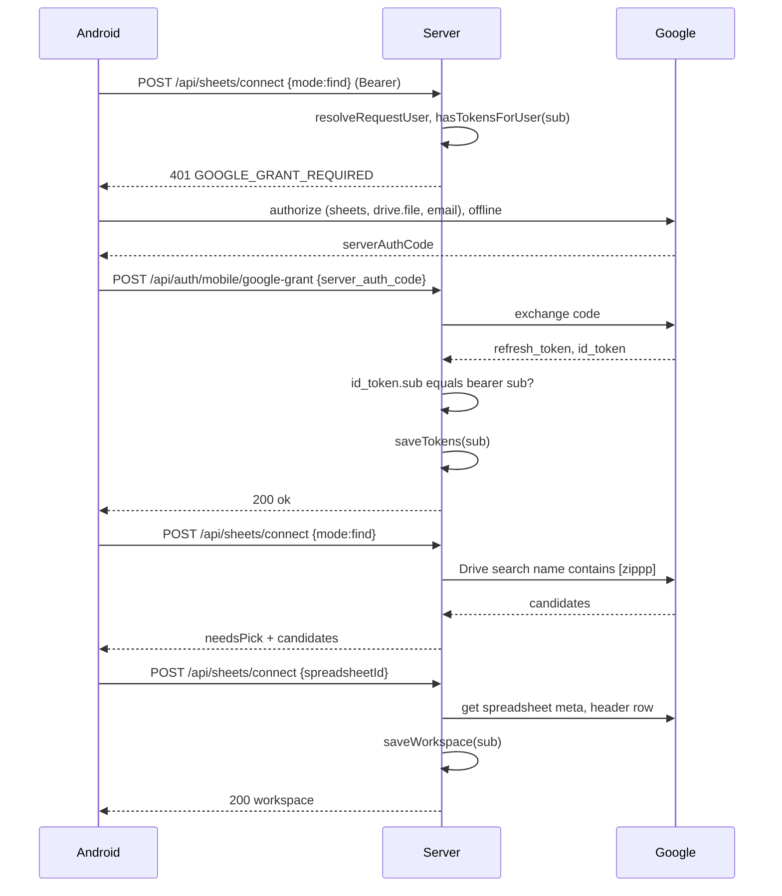

# 09 Bearer auth for sheet, device, notice and contribute routes

Status: PLANNED. Nothing here is built. Card: `FEAT-119`. Blocks the sheet setup
screen in `06-sheet-choose-and-sign-in.md` Part B and the devices block in
`04-settings.md`.

## 1. Purpose

A phone signed in with a mobile bearer token can today scan, append, read balance
and plan, and manage Spaces. It cannot set up or switch a sheet, see or revoke its
devices, read a notice, or donate an unreadable receipt, because those routes read
the web cookie only. This slice makes them accept the bearer token without
weakening the web path or the DEC-002 and data-boundary rules.

The owner approved the slice on 2026-11-05.

## 2. Findings that shape the design

These come from reading the code, not from the earlier specs.

1. **The Google helpers are cookie bound.** `findZippSpreadsheets`,
   `getSpreadsheetMeta`, `getHeaderRow`, `writeHeaderRow`, `createSpreadsheet` and
   `createTemplateSpreadsheet` in `src/lib/google/sheets.ts` all call `googleFetch`,
   which calls `getAuthenticatedClient()` with no user id, so it reads
   `sessionUserId()` from the cookie. `getAuthenticatedClient(userId?)` already
   accepts an id; the callers above do not pass one. `appendRows` is the only
   caller chain that threads `userId` today.
2. **`/api/sheets/connect` has a shared-key fallback.** It does
   `(await peekGoogleUserId()) || "google-user"`. On the bearer path that fallback
   must never run. A missing user is an error, not a shared `google-user` record.
3. **A phone-only Google user has no Drive or Sheets tokens.**
   `POST /api/auth/mobile/google` verifies an ID token and issues a session. It never
   stores a refresh token. Tokens exist only after the user has done the web consent
   (`/api/auth/callback`, scopes `spreadsheets`, `drive.file`, `userinfo.email`).
   Magic link sign-in maps the email to the existing billing user id
   (`userIdForEmail`), so those users only exist if they signed in on the web before.
   So bearer on `sheets/connect` is not enough: a new phone user also needs a way to
   grant Drive and Sheets access from the phone. See section 6.
4. **The token `sub` is the Google user id, and the stores are keyed by it.**
   `workspace/<sub>.json` and `google-tokens/<sub>.json`. The same id is the billing
   user id. This is why binding the bearer user id to the store key is sufficient
   for isolation, and why a wrong id is the main thing to test.
5. **No shared rate limiter and no Origin check exist.** Rate limiting exists for
   magic link (per IP) and top-up only. State-changing cookie routes rely on
   `SameSite=Lax`. The earlier phrase "keep Origin checks" would be false: there is
   nothing to keep. This slice adds a small limiter, and lists an Origin check on the
   cookie path as a separate hardening item (section 9).
6. **`POST /api/billing/subscribe` accepts a bearer token today.** It uses
   `requestUser`, which resolves mobile users, although its comment says web only and
   context 7.6 rule 3 forbids mobile tokens on payment routes. A mobile token can
   obtain a Paddle checkout URL. This breaks DEC-002 in spirit. Fix in this slice.
7. **`GET /api/billing/balance` returns credits, `refCode`, `referralEarned` and
   `invite` to a bearer caller.** Android must not show them. Server side, trim these
   for `source === "mobile"` in this slice so a future screen cannot leak them by
   accident.
8. **Bearer never falls back to the cookie.** In `resolveRequestUser`, if an
   `Authorization: Bearer` header is present the cookie is ignored, including when
   the token is invalid. A request that carries both cannot borrow the cookie user.
   Keep this behaviour and test it.
9. **`/api/extract` stays on `mobile-auth.ts`.** The data-boundary test fails if the
   photo path imports `request-user.ts`. The new routes are on the sheet path, where
   Google modules are allowed. They must not import any AI provider module.

## 3. Shared rules for every route in this slice

| Rule | Detail |
|---|---|
| Resolver | `resolveRequestUser(req)` from `@/lib/auth/request-user`. Use `resolveRequestUser`, not `requestUser`, so the error code can be returned. |
| User id | Use `user.userId` for every store and Google call. Pass it explicitly (`...ForUser`, `getAuthenticatedClient(userId)`). Never call a cookie reading helper in a route that may be reached by bearer. |
| Mobile gate | When `MOBILE_API_ENABLED` is not `true`, the resolver returns `INVALID_TOKEN` for any bearer. Routes return 401 with that code. The new `/api/auth/mobile/*` routes keep returning 404 `NOT_FOUND` when dark. |
| Revoked device | The resolver already calls `verifyMobileToken`, which checks `isDeviceRevoked(device_id, jti, sub)`. It fails closed when the store is down. Routes return 401 `DEVICE_REVOKED`. |
| Device-user binding | `isDeviceRevoked` compares `dev.user_id` with the token `sub`. A token for device A cannot act as user B. |
| CSRF | Not applicable to the bearer path: the browser does not attach the header on its own. The cookie path is unchanged in this slice. |
| Response codes | Add a stable `code` next to the existing English `error` string. Android reads `code` only and never shows `error`. Web keeps using `error`. |
| Cache | `Cache-Control: no-store` on every new bearer response. |
| Logging | No token, refresh token or spreadsheet content in logs. Log event name, user id hash and code only. |
| Mobile scope | One scope, `mobile_scan`. The allow list is the route list in section 4. Admin, top-up, invite and payment routes reject `source === "mobile"` with 403 `WEB_ONLY`. |

### 3.1 Rate limiter

New helper `rateLimit(key, limit, windowSec)` in `src/lib/billing/redis.ts` using
`INCR` plus `EXPIRE` on Upstash, with an in-memory fallback outside production, the
same pattern as `device-store.ts`. Fails closed for create and revoke, fails open
for reads.

| Route and mode | Key | Limit |
|---|---|---|
| `sheets/connect` list, find | `rl:sheet:list:<userId>` | 20 per minute |
| `sheets/connect` create | `rl:sheet:create:<userId>` | 3 per hour (each call creates a Drive file) |
| `sheets/connect` pick by id | `rl:sheet:pick:<userId>` | 10 per minute |
| `sheets/map` PUT | `rl:sheet:map:<userId>` | 10 per minute |
| `auth/device/revoke` | `rl:dev:revoke:<userId>` | 10 per minute |
| `contribute` POST | `rl:contrib:<userId>` | 5 per hour |
| `auth/mobile/google-grant` | `rl:grant:<userId>` | 5 per hour |

A blocked call returns 429 `RATE_LIMITED`.

## 4. Route by route

### 4.1 `POST /api/sheets/connect`

| | |
|---|---|
| Current auth | Cookie only: `hasTokens()` and `peekGoogleUserId()`. |
| Change | `resolveRequestUser`. Require Google tokens for `user.userId` via a new `hasTokensForUser(userId)`. Pass `userId` into `findZippSpreadsheets`, `getSpreadsheetMeta`, `getHeaderRow`, `writeHeaderRow`, `createSpreadsheet`, `createTemplateSpreadsheet` and `saveWorkspace`. Replace the `"google-user"` fallback with a 401. |
| Modes | `find` (default), `list`, `create`, and pick by `spreadsheetId`. Same bodies as web. |
| Cookie path | Unchanged behaviour. The bearer path is additive. |

Request (bearer):

```json
{ "mode": "find" }
{ "mode": "list" }
{ "spreadsheetId": "1AbC..." }
{ "mode": "create", "templateId": "personal-expense", "sheetName": "Pengeluaran 2026" }
```

Responses (all `no-store`; `code` is new, other fields are existing):

| Case | HTTP | Body |
|---|---|---|
| Connected | 200 | `{ ok:true, created:false, workspace:{...workspacePublic} }` |
| Created | 200 | `{ ok:true, created:true, workspace }` |
| Several sheets, user must pick | 200 | `{ ok:false, needsPick:true, code:"NEEDS_PICK", candidates:[{id,name,modifiedTime}] }` |
| List | 200 | `{ ok:true, needsPick:true, candidates:[...] }` |
| None found | 200 | `{ ok:true, none:true, code:"NONE_FOUND", candidates:[] }` |
| No Google grant for this user | 401 | `{ ok:false, code:"GOOGLE_GRANT_REQUIRED" }` |
| Google refused or scope missing | 401 | `{ ok:false, code:"GOOGLE_RECONSENT", needsReconsent:true }` |
| Bad JSON | 400 | `{ ok:false, code:"INVALID_REQUEST" }` |
| Name empty | 400 | `{ ok:false, code:"SHEET_NAME_REQUIRED" }` |
| Name taken | 409 | `{ ok:false, code:"SHEET_NAME_TAKEN", duplicateName:true }` |
| Not found or no access to `spreadsheetId` | 404 | `{ ok:false, code:"SHEET_NOT_FOUND" }` |
| Rate limited | 429 | `{ ok:false, code:"RATE_LIMITED" }` |
| Token invalid, revoked, mobile off | 401 | `{ ok:false, code:"INVALID_TOKEN" or "DEVICE_REVOKED" }` |
| Google error | 4xx or 5xx | `{ ok:false, code:"GOOGLE_ERROR" }` |

Security notes:
- `spreadsheetId` is user supplied. Access is enforced by Google with the user's own
  token and the `drive.file` scope, so a guessed id returns 404 and is never read
  with another user's credentials. Validate the id shape (`/^[A-Za-z0-9_-]{20,64}$/`)
  before calling Google.
- `sheetName` goes through `buildZippSheetTitle` (existing). Cap at 80 characters.
- Create writes a Drive file in the user's own Drive. The 3 per hour limit stops a
  stolen token from filling the user's Drive.
- Switching a sheet overwrites `workspace/<sub>.json`, including `column_map`,
  `staff_names`, `outlets`. This is the same as web. Android shows the warning copy
  `app.sheets.wizard.warn` before it sends the pick or create call.

### 4.2 `GET` and `DELETE /api/sheets/workspace`

| | |
|---|---|
| Current auth | Cookie only: `loadWorkspace()`, `deleteWorkspace()`. |
| Change (GET) | Bearer allowed. Use `loadWorkspaceForUser(user.userId)`. |
| Change (DELETE) | Web only in v1. A bearer caller gets 403 `WEB_ONLY`. Switching a sheet on the phone uses connect, which overwrites. A phone cannot leave the account without a sheet by accident. Revisit if the owner wants "disconnect" on Android. |

GET response: `{ ok:true, workspace }` or 404 `{ ok:false, workspace:null, code:"NO_SHEET" }`.
`/api/auth/mobile/me` already returns the workspace subset the app needs, so Android
calls this only after a connect when it needs the full map.

`workspacePublic` includes `google_user_id`, which equals the caller's own `sub`.
Strip it for mobile to keep the payload minimal.

### 4.3 `PUT /api/sheets/map`

| | |
|---|---|
| Current auth | Cookie only: `loadWorkspace()`. |
| Change | Bearer allowed. Load with `loadWorkspaceForUser`, save through `saveWorkspace` (already keyed by `google_user_id`). |
| New validation (also protects web) | `staff_names` and `outlets`: at most 50 entries, each trimmed and at most 80 characters. `column_map` and `constants`: at most 40 keys, key and value at most 120 characters. `sheet_tab` at most 100 characters. `default_outlet` must be in `outlets` or null. Today there are no caps. |

Errors: 400 `INVALID_REQUEST`, 400 `NO_SHEET`, 429 `RATE_LIMITED`.
Android uses this only for outlets, staff and default outlet. The column map editor
stays web only.

### 4.4 `GET /api/notices` and `POST /api/notices/read`

| | |
|---|---|
| Current auth | Cookie only: `currentUser()`. `GET` returns `{ ok:true, notice:null }` when signed out, which hides auth failures. |
| Change | `resolveRequestUser`. `getNotice(user.userId)` and `clearNotice(user.userId)`. For bearer failures return 401 with a code instead of `notice:null`, so Android can sign the user out on `DEVICE_REVOKED`. Cookie path keeps the old `notice:null` response for signed-out web users. |
| Android | Show the notice as a dismissible card on Home. The notice text is admin authored. Treat it as untrusted text: plain text only, no links opened. |

### 4.5 `POST /api/contribute`

| | |
|---|---|
| Current auth | Cookie only: `currentUser().signedIn`. |
| Change | Bearer allowed. Keep `consent === "true"`, 8 MB cap, `image` and `reason` and `lang` fields. Add the 5 per hour limit. |
| Notes | `saveContribution` stores the image and the failure reason only, with no user id. It must stay that way. No Google data, no workspace. Android sends the original capture file, with EXIF stripped (FEAT-108 owns EXIF stripping; until then Android must not offer the donate button). |
| Errors | 400 `CONSENT_REQUIRED`, 400 `NO_IMAGE`, 413 `TOO_LARGE`, 429 `RATE_LIMITED`, 500 `SAVE_FAILED`. |

### 4.6 `GET /api/auth/devices`

| | |
|---|---|
| Current auth | Cookie only. Comment says mobile must not manage other devices. |
| Change | Bearer allowed for **listing only**. Add `current: boolean` per device (true when `device_id` equals the token's device). Do not return `jti`. The route already omits it. |

Response device fields unchanged plus `current`. Android shows device name, platform,
last seen, and a Revoke button on every row except the current one, where it shows
"This device".

### 4.7 `POST /api/auth/device/revoke`

| | |
|---|---|
| Current auth | Cookie only. |
| Change | Bearer allowed for **one device id at a time**. `revoke_all: true` stays web only (403 `WEB_ONLY` for bearer). Revoking the caller's own device is allowed and means sign out (the app clears its token). |
| Binding | `revokeDevice(deviceId, user.userId)` already refuses a device that belongs to another user and returns 404 `DEVICE_NOT_FOUND`. Return 404, not 403, so ids cannot be probed. |
| Alert | After a bearer revoke of a different device, send the existing Telegram user alert (pairing alert style): "Device X was revoked from Device Y". A stolen phone revoking the owner's other phones is the main risk of this route, and the alert gives the owner a signal. |
| Limit | 10 per minute per user. |

Errors: 400 `DEVICE_ID_REQUIRED`, 404 `DEVICE_NOT_FOUND`, 403 `WEB_ONLY`,
429 `RATE_LIMITED`.

### 4.8 `/api/billing/*`

| Route | Today | Change |
|---|---|---|
| `GET /billing/plan` | `requestUser`, bearer works | None. Keep. |
| `GET /billing/balance` | `resolveRequestUser`, bearer works, returns credits, `refCode`, `referralEarned`, `invite` | For `source === "mobile"` return only `{ ok, configured }`. Android shows fair-use percent from `plan`, never a balance (DEC-002). |
| `POST /billing/subscribe` | `requestUser`, bearer works | Reject `source === "mobile"` with 403 `WEB_ONLY`. Closes the DEC-002 gap in finding 6. |

### 4.9 New: `POST /api/auth/mobile/google-grant`

Gives a phone-only Google user the Drive and Sheets tokens that sections 4.1 to 4.3
need. See section 6 for the client flow.

| | |
|---|---|
| Auth | Bearer, same resolver. 404 `NOT_FOUND` when the mobile API is dark. |
| Request | `{ "server_auth_code": "4/0A..." }` |
| Server | Exchange the code with the Web OAuth client (`createOAuthClient()`, redirect URI empty string for Android codes). Require the response to carry a `refresh_token` and the three scopes. Read the ID token `sub` from the exchange. **Reject with 403 `GRANT_ACCOUNT_MISMATCH` unless that `sub` equals the bearer `user.userId`.** Then `saveTokens` keyed by that `sub`. |
| Response | `{ ok:true, scopes:["spreadsheets","drive.file","email"] }` or `{ ok:false, code }` |
| Errors | 400 `INVALID_REQUEST`, 401 auth codes, 403 `GRANT_ACCOUNT_MISMATCH`, 422 `GRANT_SCOPE_MISSING`, 502 `GOOGLE_ERROR`, 429 `RATE_LIMITED`. |
| Boundary | Lives on the sheet path. Not imported by the photo path. Add it to the data-boundary "sheet path" assertions, not to `PHOTO_PATH`. |

The `sub` equality check is the security core. Without it a user could attach a
second Google account's tokens to their identity.

## 5. Error codes to Android wording

Android reads `code` only. Existing keys are in `wording.txt`; the others are to be
added in the build slice, `en` and `id`, no em dashes.

| Code | Android key | State |
|---|---|---|
| `INVALID_TOKEN`, `DEVICE_REVOKED` | `android.error.device_revoked` | exists |
| `GOOGLE_RECONSENT` | `android.error.google_reconsent` | exists |
| `GOOGLE_GRANT_REQUIRED` | `android.error.google_grant_required` | to add |
| `NO_SHEET`, `NONE_FOUND` | `android.error.no_sheet` plus button `android.error.no_sheet.action` that opens the setup screen (decided; the message text itself needs no reword) | message exists, button key to add (W-2) |
| `SHEET_NAME_REQUIRED` | `app.sheets.name.required` | exists |
| `SHEET_NAME_TAKEN` | `android.error.sheet_name_taken` | to add |
| `SHEET_NOT_FOUND` | `android.error.sheet_not_found` | to add |
| `RATE_LIMITED` | `android.error.rate_limited` | to add |
| `WEB_ONLY` | `android.error.web_only` | to add |
| `GRANT_ACCOUNT_MISMATCH` | `android.error.grant_mismatch` | to add |
| `GRANT_SCOPE_MISSING` | `android.error.google_reconsent` | exists |
| `DEVICE_NOT_FOUND` | `android.error.device_not_found` | to add |
| `CONSENT_REQUIRED`, `NO_IMAGE`, `TOO_LARGE`, `SAVE_FAILED` | `android.error.contribute_failed` | to add |
| `GOOGLE_ERROR`, network, 5xx | `android.error.server` | exists |

## 6. How Android picks or creates a sheet

The Google Picker widget is web only. The web sheet screen does not use it either:
it lists `[zippp]` sheets from Drive search through `mode:"list"` and lets the user
pick one. Android uses the same server-listed approach. With the `drive.file` scope,
Drive search shows only files this app created or the user opened with it, which is
why the list is the full set of choices.

Android sheet setup states (mirrors the web phases in 06 section 3.1):

```text
CHECK    -> POST connect {mode:"find"}
  workspace      -> DONE (go Home)
  needsPick      -> CHOOSE  (list of candidates)
  none           -> EMPTY   (Create new sheet button)
  GRANT_REQUIRED -> GRANT   (Google consent, then CHECK again)
CHOOSE   -> user taps a row -> warn (wizard.warn) -> POST connect {spreadsheetId} -> DONE
EMPTY    -> template pick (5 templates) -> name field -> POST connect {mode:"create"} -> DONE
```

User without a sheet: they land on EMPTY, pick a template, type a name (prefixed
with `[zippp]` by the server), and the server creates the spreadsheet in their Drive
with the template header row. This is the web "create" path, called with a bearer.

### 6.1 Granting Drive and Sheets access from the phone

Decided (owner, 2026-11-05): Android requests offline access through the Google
authorization API with scopes `spreadsheets`, `drive.file` and `userinfo.email`,
using the Web client id as the server client id. It receives a `serverAuthCode` and
posts it to `POST /api/auth/mobile/google-grant`. No browser, one consent sheet.
Needs the Android OAuth client and the Web client both in the same Google Cloud
project, and the project's sensitive scope verification (already needed for web).

The web Custom Tab alternative was rejected: it can store tokens under a different
Google account than the one signed in on the phone.

### 6.2 Sequence diagram

```text
Android                    Server                          Google
  |                          |                               |
  | POST connect {find}      |                               |
  | Authorization: Bearer    |                               |
  |------------------------->| resolveRequestUser            |
  |                          | verify JWT + device not revoked
  |                          | hasTokensForUser(sub)         |
  |<-- 401 GRANT_REQUIRED ---|                               |
  |                          |                               |
  | (Google consent: scopes sheets, drive.file, email)       |
  |<------------------ serverAuthCode ---------------------------|
  | POST google-grant        |                               |
  |------------------------->| exchange code --------------->|
  |                          |<-- refresh_token, id_token ---|
  |                          | id_token.sub == bearer sub ?  |
  |                          | saveTokens(sub)               |
  |<-- 200 ok ---------------|                               |
  |                          |                               |
  | POST connect {find}      |                               |
  |------------------------->| findZippSpreadsheets(sub) --->| Drive search
  |<-- needsPick + list -----|<------------------------------|
  | POST connect {id}        |                               |
  |------------------------->| getSpreadsheetMeta(id, sub) ->|
  |                          | saveWorkspace(sub)            |
  |<-- 200 workspace --------|                               |
```



## 7. Tests to write

Each route gets the same table. Test files: one per route group under
`src/app/api/**` helpers where the route cannot be imported directly, following
`src/lib/mobile/me-workspace.test.ts`: put the logic in a pure function and test it,
then add static source checks like `data-boundary.test.ts` for the rest.

| Case | Expected |
|---|---|
| No auth, no cookie | 401 `UNAUTHORIZED` |
| Valid cookie, no bearer | Same result as today (web unchanged) |
| Valid bearer, mobile on | Success, acts as `sub` |
| Bearer for a revoked device | 401 `DEVICE_REVOKED` |
| Bearer whose `jti` does not match the device | 401 `DEVICE_REVOKED` |
| Bearer for device A used to revoke device of user B | 404 `DEVICE_NOT_FOUND`, B unchanged |
| Bearer for user A, body names user B's `spreadsheetId` | Never reads B's workspace; Google refuses with A's token |
| Valid bearer, `MOBILE_API_ENABLED` not true | 401 `INVALID_TOKEN` |
| Invalid bearer plus valid cookie | 401, cookie ignored |
| Bearer, user has no Google tokens (connect) | 401 `GOOGLE_GRANT_REQUIRED` |
| `google-grant` with mismatched `sub` | 403 `GRANT_ACCOUNT_MISMATCH`, no tokens saved |
| `google-grant` with missing scope or no refresh token | 422 `GRANT_SCOPE_MISSING` |
| `revoke` with `revoke_all` and bearer | 403 `WEB_ONLY` |
| `workspace` DELETE with bearer | 403 `WEB_ONLY` |
| `subscribe` with bearer | 403 `WEB_ONLY` |
| `balance` with bearer | Body has no `credits`, `refCode`, `referralEarned`, `invite` |
| Rate limit exceeded | 429 `RATE_LIMITED`, no side effect |
| `map` with 51 outlets or 81 character name | 400 `INVALID_REQUEST` |
| Create with a name already taken | 409 `SHEET_NAME_TAKEN`, no file created |
| Static: new routes import no AI module | `data-boundary.test.ts` extended |
| Static: `sheets/connect` contains no `"google-user"` fallback | new assertion |
| Static: `extract` still imports `mobile-auth`, not `request-user` | existing test stays green |

Gates after the slice: `npm test`, `npx tsc --noEmit`, `npm run build`, all pass.

## 8. Rollout order

1. Library: add `userId` parameters to the Google helpers, `hasTokensForUser`, and
   `rateLimit`. No route change. Existing tests stay green.
2. Hardening that is safe on its own: `subscribe` rejects mobile, `balance` trims for
   mobile. Ship first because it closes the DEC-002 gap.
3. Read routes: `notices`, `sheets/workspace` GET, `auth/devices` GET.
4. Write routes: `sheets/connect`, `sheets/map`, `auth/device/revoke`, `contribute`.
5. `auth/mobile/google-grant`, with the Android client change.
6. Update context 7.5 and 7.6 and the route list, then the Android screens in `04` and
   `06`.
7. Preview first (`MOBILE_API_ENABLED=true`), device run, then Production only after
   STORY-102, as for all mobile work.

## 9. Related hardening, not in this slice

- Origin check on cookie-path state-changing routes. No such check exists today.
- Sheet connect on the cookie path still has the `"google-user"` fallback. Remove it
  with the same change, since the bearer fix removes it from the shared code.
- `GET /api/notices` returns `notice:null` for signed-out callers on the cookie path.

## 10. Open questions for the owner

1. ~~Grant flow~~ Decided 2026-11-05: `serverAuthCode` via `google-grant` (section 6.1).
2. **Revoke from the phone:** allow revoking one other device from a phone, with a
   Telegram alert, or keep revoke web only? A stolen unlocked phone could revoke the
   owner's other devices.
3. **Disconnect sheet on Android:** keep `DELETE /api/sheets/workspace` web only
   (recommended), or allow it?
4. **Column map editing on Android:** web only (recommended), or add it later?
5. **Rate limits:** are the numbers in section 3.1 acceptable?
6. **Drive scope:** `drive.file` only shows sheets this app created or opened. A user
   with an older sheet made elsewhere cannot pick it from Android. Accept this, or
   add a web step "open this sheet with zippp" first?

## 11. Acceptance checklist

1. With a bearer token, `POST /api/sheets/connect {mode:"list"}` returns the user's
   candidates and never another user's.
2. A phone-only Google user with no tokens gets `GOOGLE_GRANT_REQUIRED`, completes the
   grant, and the next connect call succeeds.
3. A grant with a different Google account is rejected and saves nothing.
4. A user with no sheet can create one from the phone and `me` then returns it.
5. `device/revoke` with a bearer for another user's device returns 404.
6. A revoked device gets 401 `DEVICE_REVOKED` on every route in section 4.
7. `subscribe` and `balance` meet the DEC-002 rules for a bearer caller.
8. Web cookie behaviour of every route is unchanged (existing web flows pass).
9. `npm test`, `npx tsc --noEmit` and `npm run build` pass.
10. `data-boundary.test.ts` passes with the new assertions.
