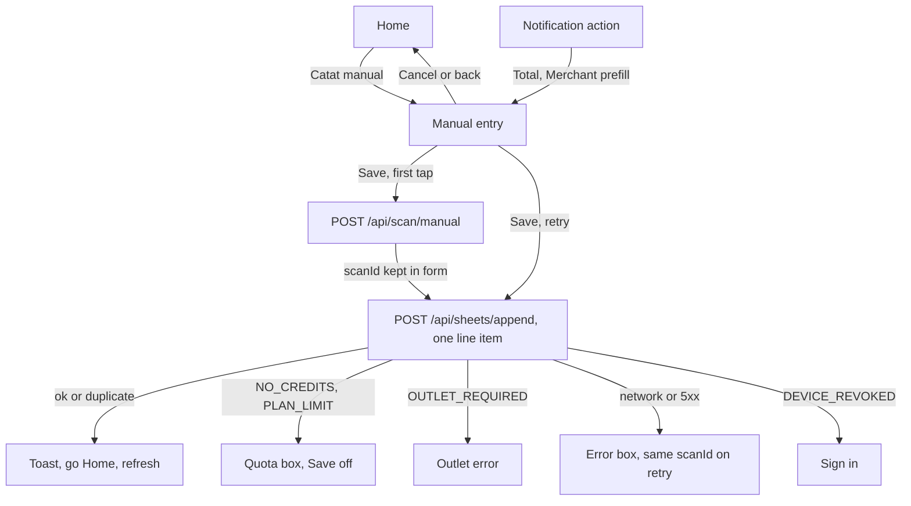

# 11 Manual entry

Android spec for FEAT-118. Contract card: FEAT-115. Conversion table, tokens and touch-target rules are in `01-shell-and-navigation.md`. Field style and ops fields are shared with `03-review-sheet.md`. Entry point is the Manual button on Home (`07-home-dashboard.md` section 4 block D).

Web sources: none for the screen (the web has no manual entry form; the word "manual" in `AppProvider.tsx` and `SnapScreen.tsx` is a capture source label, not a form). Server: `src/app/api/scan/manual/route.ts`, `src/app/api/sheets/append/route.ts`, `src/lib/review-ops.ts`, `src/components/app/draft.ts` (`parseMoney`).
Android sources: `ui/manual/ManualEntryScreen.kt`, `notify/CaptureListener.kt`, `MainActivity.kt` (`ManualPrefill`, `manualPrefillFrom`), `data/ApiClient.kt` (`createManualScan`, `append`).

## 1. Purpose

Record a spend that has no receipt photo: a bank or e-wallet payment the user remembers, or one the notification listener noticed (FEAT-115). One screen, one row in the user's Google Sheet. It spends from the same quota as a camera scan and uses the same scan id and idempotency rule.

It is not a replacement for review. There is no extraction, so no flags and no line item grid. The user types what they know, and what they leave empty stays empty.

## 2. Facts and contradictions

1. **The current screen cannot save anything.** `ManualEntryScreen` posts `Receipt(lineItems = emptyList())`. `sheets/append` returns `400 RECEIPT_EMPTY` when `line_items.length === 0` (`append/route.ts`), and `buildAppendRows` also throws on an empty list. Every manual save shows "Gagal menyimpan ke Google Sheet". This is a blocking bug, found by reading the server code. Fix in this spec: send exactly one line item (section 5).
2. **Amount parsing is wrong for Indonesian input.** The screen uses `amount.trim().toDoubleOrNull()`. Typing `25.000` gives `25.0` (25 rupiah instead of 25,000), silently, with no flag. The web uses `parseMoney` in `draft.ts`: `1.234,50`, `1,234.50` and `25.000` are all handled as grouped numbers. The spec requires the same rules on Android (section 5.1) and shows the parsed value back to the user before saving.
3. **A retry creates a second scan.** The Save handler calls `createManualScan` on every tap. If `append` fails by network after the server already wrote the row, the next tap gets a new `scanId` and writes a duplicate row and spends again. The idempotency key is `scan:${userId}:${scanId}`, so the form must keep one `scanId` for its whole life and reuse it on retry (section 5.2).
4. **Date default is a guess and must be labelled.** The current screen puts today's date in the field as plain text. In review (file 03) a missing date is filled with the capture date, drawn with an amber border and the note `android.review.dateAssumed`. Manual entry follows the same rule: today's date is a default the user can change, shown as assumed until the user touches it. It is never silently presented as a fact.
5. **The notification prefill is a suggestion, not data.** `CaptureListener` puts the amount (already normalised to a plain decimal string like `25000.5`) and the notification title (first 80 characters) into the intent. The title is often an app name ("GoPay"), not a merchant. Both fields are editable and are labelled as coming from the notification. Nothing leaves the device until Save (FEAT-115 rule). If the notification gave no amount or title, the field is empty.
6. **Manual does not check quota, append does.** `POST /api/scan/manual` issues an id and returns. The spend, and the quota check (`NO_CREDITS`, `PLAN_LIMIT`), happen in `append`. So the screen finds out at Save. Home already disables the Manual button at zero quota (file 07) to avoid the dead end, but a plan limit reached mid-month can still appear here.
7. **Ops fields are missing on the current screen.** FEAT-102 ops (staff, outlet, payment, customer, purpose) apply to every row in the template. The current screen sends none, so a resto sheet with several outlets gets `OUTLET_REQUIRED` (400) and a reimbursement row has no purpose. The spec adds them, driven by the same `opsFor(template_id)` rules as review.
8. **Layout is unstyled Material.** The current code uses `OutlinedTextField`, `Button` and `MaterialTheme.typography`. The spec moves it to the review field style and `ZipppButton`.
9. **No offline path.** The screen needs the network twice (issue id, append). Offline drafts are FEAT-108. Until then an offline Save keeps the form and shows the server-unavailable message, nothing is lost.

## 3. Layout tree

Shell: Card tone. Header shown with Home and Settings (file 01 section 4.2: Manual entry has the wordmark, Home and Settings).

```
Column(fillMaxSize, background page)
  ZipppHeader(showHome = true, showSettings = true)
  ZipppShell(Card)                              padding 24 / 16 / 48, gap 16
    Column(verticalScroll, imePadding, spacedBy 16)
      Text android.manual.title                 ZipppType.h1 30sp, ink
      Text android.manual.body                  ZipppType.body 14sp, muted
      Text android.manual.fromNotification      ZipppType.small 12sp, muted      only when prefilled
      Field Total                               3.1, required, first, keyboard decimal
      Field Merchant                            3.2
      Row(spacedBy 12)
        DateField                               3.3, weight 1
        Field Category                          weight 1
      Field Item (optional)                     3.4
      OpsFields                                 3.5, per template
      Box(error / quota card)                   3.7
    Spacer(weight 1)
    Column(spacedBy 12)                         bottom stack
      Button android.manual.save                Primary 56dp
      Button android.manual.cancel              Mist 52dp
```

Tailwind and Compose mapping: the page padding, gap and radii come from `01` section 2. The inputs copy `INPUT_BASE` from the web review card (file 03, "Input style").

### 3.1 Field style (all text fields)

```
RoundedCornerShape(4.dp), 1dp border ZipppColors.line (focus: orange), background ZipppColors.surface #F6D3C5
height >= 48dp, horizontal padding 8dp, text 14sp ZipppColors.text
label above the field: 10sp SemiBold, line height 10, ZipppColors.muted, 2dp gap
```

States: normal, focused (orange border), error (danger border plus message below, 11sp Medium danger), disabled while saving (alpha 0.6, read only).

### 3.2 Total (required)

Label `android.review.total`. Keyboard: decimal, `ImeAction.Next`. Text ExtraBold 18sp, right aligned, tabular digits. Placeholder empty. Below the field, when the text parses, a one line echo in 11sp muted: the parsed value as a grouped number, for example `25,000` for the input `25.000`. This is the only guard against the 1000x mistake. The echo shows no currency symbol and no `Rp` (DEC-002, and the sheet owns the format). Invalid text (no digits, two decimal marks) shows the field error `android.manual.totalErr` and keeps Save disabled.

### 3.3 Date

Not a free text field. A read only field showing the date as `dd/MM/yyyy`, tap opens the Material 3 `DatePickerDialog` (48dp field). The stored value is an ISO string `YYYY-MM-DD` in the device time zone, because Home reads the Date column as ISO first and treats `d/M/yyyy` as ambiguous (file 07 section 8). Default is today. Until the user picks a date the border is amber (`#FBBF24`, focus `#F59E0B`) and a note `android.review.dateAssumed` shows below in 11sp Medium amber-700 `#B45309`. Picking any date, including today, clears the amber state. The picker is capped at today (no future spends) and goes back at most 2 years.

### 3.4 Category, Merchant, Item

| Field | Label key | Rules |
|---|---|---|
| Merchant | `android.review.merchant` | Free text, max 120, trimmed, empty means null. Placeholder `app.check.merchantFallback`. Prefilled from the notification title when present |
| Category | `android.review.category` | Free text, max 80, trimmed, empty means null. No invented default |
| Item (optional) | `android.review.description` + `(app.check.optional)` | Free text, max 120, trimmed. Becomes the line item description (section 5.1). Empty means null |

Never infer a category or a merchant from the amount. Empty stays empty (project rule).

### 3.5 Ops fields

Same rules as `03-review-sheet.md` section 3 ("Ops fields"), from `opsFor(me.workspace.template_id)` and these `me.workspace` fields: `staff_names`, `outlets`, `default_outlet`, `payment_options`.

| Template id | Fields |
|---|---|
| `resto-inventory` | staff, outlet |
| `personal-expense` | payment |
| `sales-recap` | payment, customer |
| `reimbursement` | purpose |
| `custom` or other | none |

Staff, outlet and payment are `ExposedDropdownMenuBox` (48dp field, 48dp items, first entry empty). Customer and purpose are text fields (max 200). Outlet is required when `outlets.length > 1` and there is no `default_outlet`: after the first Save tap with it missing, border danger and `app.check.outletErr`. Labels: `android.review.staff`, `android.review.outlet`, `android.review.payment`, `android.review.customer`, `android.review.purpose`, with `(app.check.optional)` on the optional ones. The lists come from `me`, never hard coded in the client.

### 3.6 Save and Cancel

| Button | Kind | Height | State |
|---|---|---|---|
| Save, `android.manual.save` ("Simpan") | Primary, maroon, white text | 56dp | Disabled (alpha 0.4) while Total is empty or invalid, or quota is exhausted, or saving. Busy: 20dp spinner, label unchanged |
| Cancel, `android.manual.cancel` ("Batal") | Mist | 52dp | Enabled while not saving. Returns to Home |

System back and the header Home button do the same as Cancel. If any field was edited and nothing is saved, the first back press shows a 48dp-row inline confirm bar above the buttons ("Buang isian?" with Discard and Keep, `android.manual.discard`, `android.manual.keep`). The confirm is inline, not a dialog, to keep the screen light.

### 3.7 Error and quota area

A white, 8dp radius, 12dp padded box above the buttons. Danger text 12sp for errors, ink for the quota card. Cleared on any edit.

## 4. States

| State | Condition | Shows |
|---|---|---|
| Empty | opened from the Home Manual button | All fields empty except Date (today, assumed). Total focused, keyboard open |
| Prefilled | opened from the notification prompt | Total and Merchant filled, the note `android.manual.fromNotification` visible, cursor in Total with the text selected |
| Typing | any edit | Echo under Total updates, errors clear |
| Invalid total | text has no valid number | Field error, Save disabled |
| Ready | Total valid | Save enabled |
| Saving | calls in flight | Spinner in Save, all fields read only, Cancel disabled |
| Saved | append ok | Toast `app.review.savedTo` with the tab name when `me.workspace.sheet_tab` is known, else `android.manual.saved`. Go Home, Home refreshes (cache busted, file 07) |
| Quota exhausted | `NO_CREDITS` or `PLAN_LIMIT` | Box with `android.error.no_credits` or `android.plan.limit`, Save disabled. No purchase link (DEC-002). The form content stays |
| Outlet missing | `OUTLET_REQUIRED` locally or from the server | Outlet field in error with `app.check.outletErr` |
| Server or network error | any other failure | Box with `android.error.append`. Save re-enabled. The same `scanId` is kept (section 5.2) |
| Session lost | `DEVICE_REVOKED` | Clear token, Sign in (file 01) |

## 5. Behaviour and network

### 5.1 Building the receipt

The server needs at least one line item. Manual entry sends exactly one, built from what the user typed and nothing else.

```
Receipt
  merchant   = Merchant text, null when empty
  date       = ISO YYYY-MM-DD from the date field (default today, see 3.3)
  currency   = null                      (the sheet owns the currency format)
  category   = Category text, null when empty
  subtotal   = null
  tax        = null
  total      = parseMoney(Total)
  line_items = [ { description: Item text or null,
                   qty: null, unit_price: null,
                   amount: parseMoney(Total) } ]
```

Why `amount = total` and `tax = null`: the Home spend formula is `Amount + Tax` per row and the Sheet repeats the receipt Total on every row (file 07 section 8). With one row, `amount = total`, `tax = null` makes Home and the Sheet agree on the spend.

`parseMoney` rules (port of `draft.ts` `parseMoney`): trim; empty means null; `^\d{1,3}(\.\d{3})+(,\d+)?$` is a dotted thousands number, remove dots and treat the comma as decimal; `^\d{1,3}(,\d{3})+(\.\d+)?$` is a comma thousands number, remove commas; otherwise replace a lone comma with a dot and parse. A result that is not finite, zero or negative is invalid. The notification amount (`25000.5`) goes through the same function and parses unchanged.

Ops fields go in the request body next to the receipt: `staff`, `outlet`, `payment`, `purpose`, `customer`, exactly as `AppendRequest` already has. Empty values are sent as null, never as the string "".

### 5.2 Calls and ids

| Step | Call | Notes |
|---|---|---|
| Open | none | `me` is already loaded by Home (workspace for ops) |
| First Save tap | `POST /api/scan/manual` with `{}`, bearer | Returns `{ ok, scanId }`. Server records `recordScanOwner(userId, scanId)`. Keep `scanId` in the form state |
| Then | `POST /api/sheets/append` with `{ scanId, receipt, staff, outlet, payment, purpose, customer }`, bearer | Spends on `scan:${userId}:${scanId}` |
| Retry after any failure | skip the first call, reuse the stored `scanId` | An append that succeeded before a lost response returns `duplicate: true`, which the screen treats as success |
| Success | none | Clear the stored `scanId`, bust the Home cache key, go Home |

Rules: one `scanId` per opened form. A new scan id is issued only when the previous one reached success or the form was discarded. If `scan/manual` itself fails, show `android.error.append` and keep the form (no id yet).

Error mapping (read `code` only, never server text):

| Code | HTTP | Android key |
|---|---|---|
| `NO_CREDITS` | 402 | `android.error.no_credits` |
| `PLAN_LIMIT` | 402 | `android.plan.limit` |
| `OUTLET_REQUIRED`, `OUTLET_INVALID` | 400 | `app.check.outletErr` |
| `STAFF_INVALID`, `PAYMENT_INVALID` | 400 | `android.error.append` |
| `RECEIPT_EMPTY`, `RECEIPT_INVALID`, `SCAN_NOT_ISSUED`, `SCAN_ID_INVALID` | 400 | `android.error.append` (client bug, logged by code) |
| `NO_WORKSPACE` | 400 | `android.error.no_sheet` |
| `GOOGLE_RECONSENT` | 401 | `android.error.google_reconsent` |
| `DEVICE_REVOKED`, 401 | 401 | `android.error.device_revoked`, then Sign in |
| `SCAN_ISSUE_FAILED`, `STORE_UNAVAILABLE`, 5xx, network | 503 | `android.error.server` |

### 5.3 Entry and exit

| Entry | Source | Prefill |
|---|---|---|
| Home, Manual button | `MainActivity` screen state | none |
| Notification action "Catat pengeluaran" | `CaptureListener` intent extras `EXTRA_MANUAL`, `EXTRA_AMOUNT`, `EXTRA_MERCHANT` | Total, Merchant |

If the app is not signed in when the notification action fires, the intent is held and applied after sign in (current behaviour, keep). Exit always lands on Home. The Capture screen has no Manual pill (decision 2026-11-05).

### 5.4 Privacy

The prefill text never leaves the phone before Save. Nothing from the notification is logged, kept in analytics, or written to disk by this screen. Only the fields shown in the form are sent.

## 6. Wording keys

Present (verified in `spec/wording.txt`): `android.manual.title`, `android.manual.body`, `android.manual.save`, `android.review.total`, `android.review.merchant`, `android.review.date`, `android.review.category`, `android.review.description`, `android.review.staff`, `android.review.outlet`, `android.review.payment`, `android.review.customer`, `android.review.purpose`, `android.review.dateAssumed`, `app.check.datePlaceholder`, `app.check.optional`, `app.check.outletErr`, `app.check.merchantFallback`, `app.review.savedTo`, `android.error.append`, `android.error.no_credits.short`, `android.plan.limit`, `android.error.no_sheet`, `android.error.google_reconsent`, `android.error.device_revoked`, `android.error.server`, `android.settings.back`.

Missing, to add (en then id, no em dashes, no hype, no kredit, saldo, Rp, `$`):

| Key | en | id |
|---|---|---|
| `android.manual.cancel` | Cancel | Batal |
| `android.manual.fromNotification` | Filled from a payment notification. Check it before saving. | Diisi dari notifikasi pembayaran. Periksa sebelum menyimpan. |
| `android.manual.totalErr` | Enter an amount greater than zero. | Isi nominal lebih dari nol. |
| `android.manual.totalEcho` | Reads as {amount} | Terbaca {amount} |
| `android.manual.discard` | Discard | Buang |
| `android.manual.keep` | Keep editing | Lanjut mengisi |
| `android.manual.discardAsk` | Discard what you typed? | Buang isian ini? |
| `android.manual.saved` | Saved | Tersimpan |

Do not use on Android: `app.credits.*`, `app.review.acceptCost`, `app.topup.*`.

Existing `android.manual.body` ("Isi nominalnya sendiri. Belum ada yang tersimpan sampai Anda menekan Simpan.") stays. It is accurate.

## 7. Wireframe (360dp wide, Card tone, prefilled)

```
+--------------------------------------+ 360dp
| status bar                           |
| zippp     [Beranda] [Pengaturan]     |  header, 48dp targets
|                                      |
|  Catat pengeluaran                   |  30sp ExtraBold
|  Isi nominalnya sendiri. Belum ada   |  14sp muted
|  yang tersimpan sampai Anda          |
|  menekan Simpan.                     |
|  Diisi dari notifikasi pembayaran.   |  12sp muted (prefilled only)
|  Periksa sebelum menyimpan.          |
|                                      |
|  Total                               |  10sp label
|  +--------------------------------+  |
|  |                       25000.5 |  |  48dp, peach, 4dp radius
|  +--------------------------------+  |
|  Terbaca 25,000.5                    |  11sp muted echo
|                                      |
|  Nama Toko                           |
|  +--------------------------------+  |
|  | GoPay                          |  |
|  +--------------------------------+  |
|  Tanggal            Kategori         |
|  +-------------+   +-------------+   |
|  | 05/11/2026  |   |             |   |  date: amber border (assumed)
|  +-------------+   +-------------+   |
|  tanggal diasumsikan                 |  11sp amber-700
|  Item (opsional)                     |
|  +--------------------------------+  |
|  |                                |  |
|  +--------------------------------+  |
|  Pembayaran (opsional)               |  ops, personal-expense
|  +--------------------------------+  |
|  | Pilih                       v  |  |
|  +--------------------------------+  |
|                                      |
|  [           Simpan              ]   |  56dp maroon, white text
|  [           Batal               ]   |  52dp mist
+--------------------------------------+  48dp bottom padding
```

Out of quota (Save disabled), error area:

```
|  +--------------------------------+  |
|  | Kuota scan habis.              |  |  white box, ink
|  +--------------------------------+  |
|  [           Simpan              ]   |  alpha 0.4
```

## 8. Flow

```
Home --[Catat manual]------------------> Manual (empty)
Notification --[Catat pengeluaran]-----> Manual (Total + Merchant filled)
Manual --Save--> POST scan/manual (first time only) --> scanId kept
              --> POST sheets/append {scanId, receipt(1 line), ops}
   ok / duplicate     --> toast "Tersimpan di {tab}" --> Home (refresh)
   NO_CREDITS / PLAN_LIMIT --> quota box, Save off, form kept
   OUTLET_REQUIRED    --> outlet field error
   network / 5xx      --> error box, Save on, SAME scanId on next tap
   DEVICE_REVOKED     --> Sign in
Manual --Cancel / back--> (confirm if edited) --> Home
```



## 9. Android-only differences, allowed

| Difference | Why |
|---|---|
| The whole screen | The web has no manual form. It belongs to the notification capture feature (FEAT-115, DEC-004) |
| Date picker instead of a text field | Avoids `d/M/yyyy` ambiguity and typing on a phone. The sheet still receives ISO |
| One synthetic line item with `amount = total` | The sheet writes one row per line item and requires at least one |
| Prefill from a notification | FEAT-115. On device only |
| Inline discard confirm | A dialog is heavier than needed |
| No ops dropdown when the lists are empty | Same rule as review (file 03) |

## 10. Acceptance checklist (screenshot checkable)

1. Opened from Home: the screen is white inside the shell, header shows the wordmark, Home and Settings, title is 30sp ExtraBold, the Total field is focused and the keyboard is open.
2. Opened from the notification action: Total and Merchant are filled, the line "Diisi dari notifikasi pembayaran" is visible, and the Total text is selected.
3. Typing `25.000` in Total shows the echo "Terbaca 25,000". Typing `1.234,50` shows "Terbaca 1,234.5". The echo has no currency symbol.
4. Total empty, `0`, or `abc` shows the error and Save is at alpha 0.4.
5. Fields use the peach style (`#F6D3C5`, 4dp radius, 1dp border), at least 48dp tall, label 10sp above.
6. The date shows `dd/MM/yyyy` with an amber border and the note "tanggal diasumsikan". Picking a date clears the amber border and the note. The picker does not allow a future date.
7. A `resto-inventory` workspace shows Staff and Outlet dropdowns. A `personal-expense` workspace shows Payment. A `custom` workspace shows no ops field.
8. With several outlets and no default, tapping Save with Outlet empty shows the outlet error and sends nothing.
9. Save is 56dp maroon with white text. Cancel is 52dp mist. No tappable is under 48dp.
10. Saving a valid spend writes exactly one row in the Sheet: Merchant, Date (ISO), Category, Amount equal to the total, Total equal to the total, Tax empty.
11. After a save the toast says "Tersimpan di {tab}" (or "Tersimpan" when the tab is not known), the app is on Home, and the Today card on Home includes the new amount.
12. Saving `25.000` writes 25000 to the Sheet, not 25.
13. Switch to airplane mode, tap Save: the service-unavailable message shows, the form keeps its values. Turn the network on and tap Save again: one row appears in the Sheet (not two), and the quota drops by one.
14. At 100 percent plan usage the quota message shows, Save is disabled and no screen text mentions kredit, saldo, Rp, a price or a purchase link.
15. Editing a field and pressing back shows the inline "Buang isian ini?" bar with two 48dp actions. Discard returns to Home.
16. With a revoked token, Save returns to Sign in.
17. At 1.3x font scale nothing is clipped and the buttons are reachable by scrolling. The Save button stays visible above the keyboard (`imePadding`).

## 11. Test plan

Server (no server change is required for this screen): confirm with a unit test that `parseReceipt` accepts one line item with `description: null, qty: null, unit_price: null, amount: 25000` and `buildAppendRows` returns one row with the total in the Total column and the tax column empty.

Client unit tests (Kotlin, JVM): `parseMoney` table (`25.000`, `1.234,50`, `1,234.50`, `25000.5`, `25,5`, `abc`, ``, `0`, `-1`), ISO date from the picker, the receipt builder (one line item, nulls for empty fields), scan id reuse across a failed then successful save (fake `ApiClient`).

Device: checklist items 10 to 13 with a real Sheet.

## 12. Requested changes elsewhere

1. `me.workspace` needs `sheet_tab` (server `src/lib/mobile/me-workspace.ts`, Android `Workspace` in `Models.kt`) for the saved toast. Without it the generic key is used.
2. File 07 section 12 and the Home cache rule must bust the key after a manual save too (already stated at line 635, keep).
3. File 02 and file 03 describe `scanId` for capture. This file adds the rule that a manual form keeps one `scanId` across retries. Capture drafts already do (draft id and `scanId` are fixed per draft).

## 13. Open questions

1. Show `subtotal` and `tax` fields? Spec says no: unknown stays empty and Home uses `Amount + Tax`. A user with tax in the amount enters the total only.
2. Should the notification prefill leave Merchant empty when the title is a known wallet app name (GoPay, OVO, Dana)? Spec prefills it and labels the prefill, to avoid keeping a list of app names.
3. Add recent merchants as suggestion chips? Left out: it needs history, and zippp keeps no receipt ledger.
