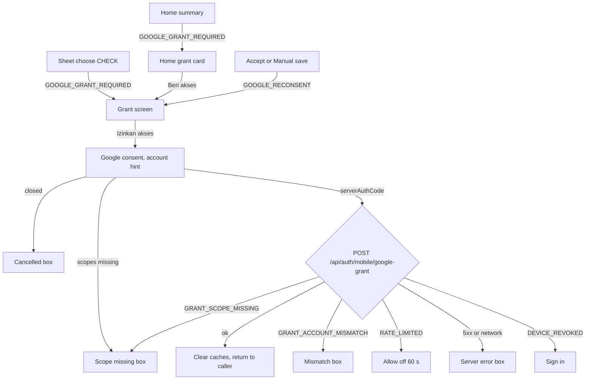
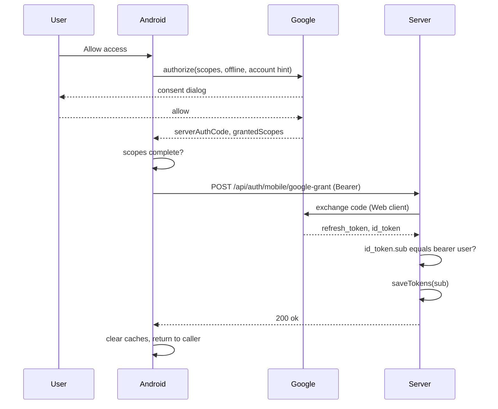

# 12 Google grant screen

Android spec for FEAT-118. Backend card: FEAT-119 (`09-bearer-route-slice.md` sections 4.9 and 6). Conversion table, tokens and touch-target rules are in `01-shell-and-navigation.md`. Sign in is in `06-sheet-choose-and-sign-in.md` part A. Sheet setup that triggers this screen is `06` part B.

Decision (owner, 2026-11-05): Option A. Android asks Google for offline access with the Sheets and Drive scopes and sends the one time `serverAuthCode` to the server. No browser, no Custom Tab.

Web sources: `src/lib/google/oauth.ts` (scopes), `src/lib/google/token-store.ts` (`saveTokens`, `loadTokensForUser`), `src/app/api/auth/callback/route.ts` (what the web does with a code), `src/app/api/auth/mobile/google/route.ts` (phone sign in by id token, no Sheets tokens), `src/app/api/sheets/append/route.ts` (line 310: `SheetsAuthError` becomes `GOOGLE_RECONSENT`).
Android sources: `ui/auth/SignInScreen.kt` (`signInWithGoogle`, Credential Manager), `data/ApiClient.kt` (`exchangeGoogle`), `app/build.gradle.kts` (`GOOGLE_SERVER_CLIENT_ID`), `gradle/libs.versions.toml` (credentials 1.3.0). There is no grant code or screen yet.

## 1. Purpose

Give a user who signed in on the phone the same Google access the web login gives: permission for zippp to read and write the Google Sheet and to find or create `[zippp]` sheets in their Drive. The server keeps the refresh token. The phone never holds a Sheets token.

Without it, nothing can be saved to a Sheet. Extraction works (no Google call), but Accept, Manual save, the Home totals and the sheet picker all need the user's Google token.

## 2. Facts and contradictions

1. **Phone sign in gives an identity, not access.** `POST /api/auth/mobile/google` verifies an id token and issues a mobile JWT. It saves no Drive or Sheets tokens. A user who first signs in on a phone has a session and no Google access. A user who signed in on the web first already has tokens, so the grant is not needed for them.
2. **Who actually needs the screen.** Google sign in on the phone first: yes. Pairing code: no (the code is made by a signed in web user, so tokens exist). Email magic link: no in practice (`userIdForEmail` only resolves an email that already belongs to a known user). So the screen is for first time phone Google users, and for anyone whose tokens were revoked or lost.
3. **Two server codes mean "no usable Google access".** Routes that were given a bearer (file 09) return `401 GOOGLE_GRANT_REQUIRED` when the user has never granted. `sheets/append` already returns `401 GOOGLE_RECONSENT` for any Google auth failure (`append/route.ts:310`), including "no tokens at all". Android must treat both the same way: open this screen. Today `android.error.google_reconsent` says to sign in again, which does not fix a missing grant.
4. **The account must be the signed in account.** The server rejects a code whose Google `sub` differs from the bearer user (`403 GRANT_ACCOUNT_MISMATCH`, 09 section 4.9). The phone should make a mismatch hard to cause: it passes the signed in email as the account hint so Google does not show the chooser.
5. **Google lets the user untick scopes.** Granular consent can return a code with fewer scopes than asked. The server answers `422 GRANT_SCOPE_MISSING`, but the phone can see it first (`grantedScopes`) and avoid a wasted call against the 5 per hour limit.
6. **The server needs a refresh token.** The client must request `forceCodeForRefreshToken = true`. Without it Google may return a code that yields no refresh token on a repeat grant, and the server rejects it.
7. **`MeResponse` has no email.** `GET /api/auth/mobile/me` returns `user.email`, but `MeResponse` in `Models.kt` has only `workspace` and `plan`. The account hint needs it. Requested change in section 12.
8. **Consent screen status.** If the Google OAuth consent screen is in "Testing" mode, only listed test users can grant, and refresh tokens expire after 7 days. Production Sheets access also needs the sensitive scope verification the web already needs. Confirm status before relying on this flow (section 13).
9. **Constants live in one place.** The scope URLs must come from one Kotlin file (`GoogleScopes.kt`) and match `GOOGLE_OAUTH_SCOPES` in `oauth.ts` exactly. No scope string in a screen.

## 3. When the screen appears

| Trigger | Where | After a successful grant |
|---|---|---|
| `connect {mode:"find"}` returns `GOOGLE_GRANT_REQUIRED` | Sheet choose, step CHECK (06 part B, 09 section 6) | run CHECK again |
| `GET /api/home/summary` returns `GOOGLE_GRANT_REQUIRED` | Home card (07 section 7.10), button "Beri akses" | refetch the summary |
| `append` returns `GOOGLE_RECONSENT` or `GOOGLE_GRANT_REQUIRED` | Review sheet Accept, Manual save | return to the same draft or form, keep its content, tap Accept or Save again |
| `home/summary` returns `GOOGLE_RECONSENT` | Home card | refetch the summary |
| First Google sign in with no workspace | start of Sheet choose | CHECK runs first. The grant appears only if CHECK says so |

The screen takes a `returnTo` and calls one `onGranted()`. It never decides where to go by itself. A user can leave with "Nanti saja" (not now) when they came from Home, Review or Manual. From Sheet choose there is nothing else to do, so that link is replaced by Sign out.

## 4. Layout tree

Shell: Card tone, no header on Sheet choose (no workspace yet), header shown when opened from Home, Review or Manual (file 01 section 4.2).

```
ZipppShell(Card)                              padding 24 / 16 / 48, gap 16
  Column(verticalScroll, spacedBy 16)
    Text "zippp"                              ZipppType.wordmark 24sp, orange        (no-header case only)
    Text android.grant.title                  ZipppType.h1 30sp, ink
    Text android.grant.body                   ZipppType.body 14sp, muted
    ZipppSectionCard                          what zippp asks for, 3 rows
      Row(icon 20dp + Text 14sp)              android.grant.item.sheets
      Row(icon 20dp + Text 14sp)              android.grant.item.files
      Row(icon 20dp + Text 14sp)              android.grant.item.email
    Text android.grant.account                ZipppType.small 12sp, muted           "{email}" shown in bodyStrong
    Box(error)                                white, 8dp radius, 12dp padding, small danger
  Spacer(weight 1)
  Column(spacedBy 12)
    Button android.grant.allow                Primary (maroon, white text), 56dp, full width
    TextRow android.grant.notNow              48dp tap row, 14sp semibold, ink     (Home, Review, Manual)
    TextRow app.auth.signout                  48dp tap row, 14sp semibold, ink     (Sheet choose only)
```

Row icons are bundled vector drawables, 20dp, ink: `ic_sheets_small` (grid), `ic_folder` (files), `ic_mail` (email). The existing `ic_sheets.xml` is the multi colour Sheets mark and is not reused here.

Allow button states: idle, working (20dp spinner, label `android.grant.working`, disabled), disabled while the previous attempt is rate limited.

## 5. States

| State | Condition | Shows |
|---|---|---|
| Intro | screen opened | Title, body, three rows, account line, Allow |
| Working | Google authorization or `google-grant` in flight | Allow shows spinner and `android.grant.working`. Both text rows disabled |
| Google sheet open | Google's consent dialog is on top | Screen unchanged underneath |
| Success | server returned `ok:true` | Brief checkmark row for 400 ms (no text), then `onGranted()` |
| Cancelled | user closed Google's dialog | Box `android.grant.cancelled`, Allow enabled |
| Scope missing | `grantedScopes` lacks Sheets or Drive file, or server `GRANT_SCOPE_MISSING` | Box `android.grant.scopeMissing`, Allow enabled |
| Account mismatch | server `GRANT_ACCOUNT_MISMATCH` | Box `android.error.grant_mismatch` with the account email, Allow enabled |
| Rate limited | server `RATE_LIMITED` | Box `android.error.rate_limited`, Allow disabled for 60 seconds, no countdown text |
| No Play services | `authorize` throws `ApiException` with `API_NOT_CONNECTED` or Play services unavailable | Box `android.grant.noPlay`, Allow disabled |
| Google error | server `GOOGLE_ERROR`, 5xx, network | Box `android.error.server`, Allow enabled |
| Session lost | `DEVICE_REVOKED` or 401 | Clear token, Sign in (file 01) |
| Missing client id | `GOOGLE_SERVER_CLIENT_ID` empty | Box `android.signin.googleMissingClient` (debug builds). Release builds fail the build instead |

The error box clears when Allow is tapped again.

## 6. Behaviour and network

### 6.1 Client steps

```
1  tap Allow
2  request = AuthorizationRequest.builder()
             .setRequestedScopes([SHEETS, DRIVE_FILE, EMAIL])          from GoogleScopes.kt
             .requestOfflineAccess(GOOGLE_SERVER_CLIENT_ID, true)     forceCodeForRefreshToken
             .setAccount(Account(email, "com.google"))                account hint, the signed in email
             .build()
3  Identity.getAuthorizationClient(activity).authorize(request)
4  result.hasResolution()  -> launch result.pendingIntent through
                              rememberLauncherForActivityResult(StartIntentSenderForResult)
                              -> getAuthorizationResultFromIntent(data)
5  user closes the dialog  -> ApiException status CANCELED -> state Cancelled
6  check result.grantedScopes contains SHEETS and DRIVE_FILE  (EMAIL is optional on the client,
                              the server requires it from the exchange)       else state Scope missing
7  code = result.serverAuthCode  (null means error, state Google error)
8  POST /api/auth/mobile/google-grant  { "server_auth_code": code }  bearer
9  ok -> invalidate caches (me, home summary), onGranted()
```

Dependencies: `com.google.android.gms:play-services-auth` (Authorization API). `androidx.credentials` stays for sign in only. Add the artifact to `libs.versions.toml`; do not rely on it arriving transitively through `credentials-play-services-auth`.

Security rules for the code:

- The `serverAuthCode` is single use and lives for minutes. Post it immediately, over TLS, in the JSON body. Do not store it, put it in an Intent extra, a log line, a crash report, a navigation argument or a `rememberSaveable`. Set the local variable to null after the call.
- The phone holds no client secret. The server exchanges the code with the Web client (09 section 4.9, redirect URI empty string for Android codes).
- The same `sub` check lives on the server (`403 GRANT_ACCOUNT_MISMATCH`). The account hint on the phone is a convenience, not the control.

### 6.2 Server contract (from 09 section 4.9, repeated for the client)

| | |
|---|---|
| Call | `POST /api/auth/mobile/google-grant`, `Authorization: Bearer <jwt>`, `{ "server_auth_code": "4/0A..." }` |
| 200 | `{ "ok": true, "scopes": ["spreadsheets","drive.file","email"] }` |
| Errors | `400 INVALID_REQUEST`, `401` (`INVALID_TOKEN`, `DEVICE_REVOKED`, `UNAUTHORIZED`), `403 GRANT_ACCOUNT_MISMATCH`, `422 GRANT_SCOPE_MISSING`, `429 RATE_LIMITED` (5 per hour per user), `502 GOOGLE_ERROR`, `404 NOT_FOUND` (mobile API dark) |

### 6.3 Error mapping

| Code | Android key | State |
|---|---|---|
| `GRANT_ACCOUNT_MISMATCH` | `android.error.grant_mismatch` (to add by 09, text below) | Account mismatch |
| `GRANT_SCOPE_MISSING` | `android.grant.scopeMissing` | Scope missing |
| `RATE_LIMITED` | `android.error.rate_limited` (to add by 09, text below) | Rate limited |
| `GOOGLE_ERROR`, `INVALID_REQUEST`, 5xx, network, `NOT_FOUND` | `android.error.server` | Google error |
| `DEVICE_REVOKED`, `INVALID_TOKEN`, 401 | `android.error.device_revoked` | Session lost |
| user cancelled | `android.grant.cancelled` | Cancelled |

## 7. What Home shows without a grant

Home calls `GET /api/home/summary` after sign in. With no tokens the server returns `401 GOOGLE_GRANT_REQUIRED` (file 07 section 11). Home then shows the grant card from 07 section 7.10 and nothing else changes:

- The Today and Last cards are hidden. No zero is shown, because zero would be wrong.
- The Sheet card shows the title if `me.workspace` has one, else is hidden.
- Scan and Manual stay enabled. Extraction and manual id issue do not need Google. A draft that cannot be sent waits in the queue, and Accept opens this screen (section 3).
- The quota card still shows. Quota is decided by zippp, not by Google.
- Tapping the card button opens this screen with `returnTo = Home`.

Because most users meet this screen during Sheet choose, before any scan exists, the Home card is the fallback, not the main path.

## 8. Wording keys

Present (verified in `spec/wording.txt`): `android.error.google_reconsent`, `android.error.server`, `android.error.device_revoked`, `android.error.no_sheet`, `android.signin.googleMissingClient`, `app.auth.signout`, `app.sheets.retry`.

Listed as "to add" by files 07 and 09 (exact text fixed here):

| Key | en | id |
|---|---|---|
| `android.error.google_grant_required` | Allow access to Google Sheets to continue. | Izinkan akses ke Google Sheets untuk melanjutkan. |
| `android.error.grant_mismatch` | That Google account is different from the one you signed in with. Choose {email}. | Akun Google itu berbeda dari akun yang Anda pakai untuk masuk. Pilih {email}. |
| `android.error.rate_limited` | Too many tries. Wait a while and try again. | Terlalu banyak percobaan. Tunggu sebentar lalu coba lagi. |
| `android.home.error.grant.action` | Grant access | Beri akses |

New keys for this screen:

| Key | en | id |
|---|---|---|
| `android.grant.title` | Connect Google Sheets | Hubungkan Google Sheets |
| `android.grant.body` | Zippp saves each receipt as a row in a Google Sheet in your own Google Drive. Zippp keeps no copy of your receipts. | Zippp menyimpan setiap struk sebagai baris di Google Sheet di Google Drive Anda sendiri. Zippp tidak menyimpan salinan struk Anda. |
| `android.grant.item.sheets` | Read and add rows in your Google Sheets | Membaca dan menambah baris di Google Sheets Anda |
| `android.grant.item.files` | Open only sheets zippp creates or you pick | Membuka hanya sheet yang dibuat zippp atau Anda pilih |
| `android.grant.item.email` | Read your email address | Membaca alamat email Anda |
| `android.grant.account` | Use this Google account: {email} | Pakai akun Google ini: {email} |
| `android.grant.allow` | Allow access | Izinkan akses |
| `android.grant.working` | Opening Google... | Membuka Google... |
| `android.grant.notNow` | Not now | Nanti saja |
| `android.grant.cancelled` | Access was not allowed. You can try again any time. | Akses tidak diizinkan. Anda bisa mencoba lagi kapan saja. |
| `android.grant.scopeMissing` | Access was not fully allowed. Tick every box and try again. | Akses belum diizinkan penuh. Centang semua kotak lalu coba lagi. |
| `android.grant.noPlay` | Google Play services are needed to continue. | Layanan Google Play diperlukan untuk melanjutkan. |

Rules: no em dashes, no hype words, no kredit, saldo, Rp, `$`, price or purchase link. `{email}` is the only variable.

## 9. Wireframes (360dp wide, Card tone)

Intro (opened from Sheet choose, no header):

```
+--------------------------------------+ 360dp
| status bar                           |
|  zippp                               |  24sp orange
|                                      |
|  Hubungkan Google Sheets             |  30sp ExtraBold
|  Zippp menyimpan setiap struk        |  14sp muted
|  sebagai baris di Google Sheet di    |
|  Google Drive Anda sendiri. Zippp    |
|  tidak menyimpan salinan struk Anda. |
|                                      |
|  +--------------------------------+  |
|  | [grid] Membaca dan menambah    |  |  card, 8dp radius, 16dp padding
|  |        baris di Google Sheets  |  |
|  | [folder] Membuka hanya sheet   |  |
|  |        yang dibuat zippp atau  |  |
|  |        Anda pilih              |  |
|  | [mail] Membaca alamat email    |  |
|  +--------------------------------+  |
|  Pakai akun Google ini:              |  12sp muted
|  adit@example.com                    |  14sp semibold
|                                      |
|  (spacer)                            |
|  [         Izinkan akses         ]   |  56dp maroon, white text
|  Keluar                              |  48dp text row
+--------------------------------------+  48dp bottom padding
```

Working:

```
|  [   (o) Membuka Google...       ]   |  56dp, spinner 20dp, disabled
|  Keluar                              |  disabled
```

Account mismatch:

```
|  +--------------------------------+  |
|  | Akun Google itu berbeda dari   |  |  white box, danger text
|  | akun yang Anda pakai untuk     |  |
|  | masuk. Pilih adit@example.com. |  |
|  +--------------------------------+  |
|  [         Izinkan akses         ]   |
```

Scope missing:

```
|  +--------------------------------+  |
|  | Akses belum diizinkan penuh.   |  |
|  | Centang semua kotak lalu coba  |  |
|  | lagi.                          |  |
|  +--------------------------------+  |
|  [         Izinkan akses         ]   |
```

Opened from Home (header shown, Not now instead of Sign out):

```
|  zippp                  [Pengaturan] |  header
|  Hubungkan Google Sheets   ...       |
|  [         Izinkan akses         ]   |
|  Nanti saja                          |  48dp text row
```

## 10. Flow

```
Sheet choose CHECK --401 GOOGLE_GRANT_REQUIRED--> Grant screen
Home summary       --401 GOOGLE_GRANT_REQUIRED--> Home grant card --[Beri akses]--> Grant screen
Accept / Manual    --401 GOOGLE_RECONSENT------> Grant screen (draft kept)
Grant screen --[Izinkan akses]--> Google consent (account hint = signed in email)
   cancelled                 --> box, stay
   scopes missing            --> box, stay
   code granted              --> POST google-grant
        ok                   --> caches cleared --> returnTo (CHECK again | refetch summary | retry Accept)
        GRANT_ACCOUNT_MISMATCH--> box with email, stay
        GRANT_SCOPE_MISSING  --> box, stay
        RATE_LIMITED         --> box, Allow off 60 s
        5xx / network        --> box, stay
```





## 11. Android-only differences, allowed

| Difference | Why |
|---|---|
| The whole screen | The web gets this consent as part of its normal login redirect |
| Account hint, scope check on the phone | Avoid a wasted call and a mismatch |
| Three plain rows explaining the scopes | Google's dialog shows scope names, not what zippp does with them |
| "Not now" on Home, Review, Manual | There is a useful screen behind it. Not on Sheet choose |
| `android.grant.noPlay` | Phones without Google Play services cannot use the Authorization API |

## 12. Requested changes elsewhere (not made here)

1. `06` part B: add a GRANT phase between `checking` and `choose-source`, and in the wireframes. `08` section 4.4 has a placeholder wireframe and should be replaced by section 9 of this file.
2. `07` section 7.10 and the error table: `GOOGLE_RECONSENT` should also open this screen (not "sign in with Google again"), because re-granting is the fix. Drop `android.home.error.reconsent` or keep it for the case where the grant call itself fails with `GOOGLE_RECONSENT`.
3. `09` section 5: the keys `android.error.google_grant_required`, `android.error.grant_mismatch`, `android.error.rate_limited` are "to add". This file fixes their text (section 8). Also add that `append` returns `GOOGLE_RECONSENT` for a user with no tokens, so the mapping `GOOGLE_RECONSENT -> grant screen` is required on the client.
4. `02` section 5 and `03` section 5 (append error mapping): `GOOGLE_RECONSENT` and `GOOGLE_GRANT_REQUIRED` open the grant screen and keep the draft ready.
5. `Models.kt`: add `user: MeUser? = null` (`email`) to `MeResponse`. Server already returns it.
6. `build.gradle.kts` and `libs.versions.toml`: add `play-services-auth`. New file `GoogleScopes.kt` for the three scope strings.
7. Context file section 7: mention the grant screen where `google-grant` is described (FEAT-119 PLANNED block). Section 8: current app flow gains the grant step.
8. FEAT-118 card: add `10`, `11`, `12` to the screen spec table (done by the other track).

## 13. Acceptance checklist (screenshot checkable)

1. First Google sign in on a fresh install with no web history lands on the grant screen after Sheet choose CHECK. The screen shows the wordmark in orange, the 30sp title "Hubungkan Google Sheets", the body, a white card with three rows and 20dp icons, and the account line with the signed in email.
2. Allow is 56dp, maroon, white text, full width. Sign out is a 48dp text row below it. No other tappable is under 48dp.
3. Tapping Allow shows the Google consent dialog for the signed in account directly, without an account chooser.
4. The dialog lists Sheets and Drive file access. Allowing all returns to the app and shows the checkmark briefly, then Sheet choose runs CHECK again and continues (finds or creates a sheet).
5. Unticking the Sheets box and continuing shows the scope missing message. No call to `google-grant` is made (check server logs or network inspector).
6. Closing the dialog shows the cancelled message and Allow works again.
7. Forcing a different account (test build with a wrong hint) shows the mismatch message with the correct email, and no tokens are saved (the next `connect find` still answers `GOOGLE_GRANT_REQUIRED`).
8. Pressing Allow six times in one hour with failures shows the rate limited message and disables Allow for 60 seconds.
9. Airplane mode after Google returns shows the service-unavailable message. Turning the network on and tapping Allow again works (a new code is requested, the old one is not reused).
10. Home for a never granted user shows the grant card, no Today or Last card, Scan and Manual enabled, and the quota card.
11. From the Home card, "Izinkan akses" then success returns to Home and the Today and Last cards load.
12. With an unsent draft and no grant, Accept opens the grant screen. After granting, the same draft is open and one tap on Accept saves one row.
13. Opened from Home, "Nanti saja" returns to Home. Opened from Sheet choose, there is no Not now link, only Sign out.
14. A revoked mobile token returns to Sign in and clears stored data.
15. The `serverAuthCode` appears in no log line and no saved state (logcat filter on the app, process death and restore while the dialog is open).
16. After granting, revoking zippp in the Google account page and using the app shows the grant screen again on the next Sheets action, and granting again works.
17. No text on the screen contains kredit, saldo, Rp, `$`, a price or a purchase link.
18. At 1.3x font scale nothing is clipped and Allow is reachable by scrolling.
19. A phone without Google Play services shows `android.grant.noPlay` and a disabled Allow.

## 14. Test plan

Server: covered by FEAT-119 (file 09 section 7, cases for `google-grant`: matching `sub`, mismatched `sub`, missing scope, missing refresh token, rate limit).

Client unit tests (JVM): `GoogleScopes` equals the server list (a test reads `GOOGLE_OAUTH_SCOPES` from `oauth.ts` text and compares, or a shared constant check in CI); scope check function (`grantedScopes` subsets); error mapping table; the `serverAuthCode` is never part of a `toString()` of the state class.

Device: items 3 to 9, 12 and 16 need a real Google account and the Android OAuth client with the debug and release SHA-1 registered in the same Cloud project as the Web client.

## 15. Slices

| Slice | Scope | Needs |
|---|---|---|
| G1 | `play-services-auth` dependency, `GoogleScopes.kt`, `GoogleGrant` wrapper (authorize, resolution, scope check), `ApiClient.googleGrant`, `MeUser` in `Models.kt` | FEAT-119 step for `google-grant` |
| G2 | `GrantScreen` composable and wording | G1 |
| G3 | Wire the three triggers (Sheet choose CHECK, Home card, Accept and Manual save) and the `returnTo` contract | G2, files 06 and 07 changes |
| G4 | Tests and the device run | G3 |

## 16. Open questions

1. Is the OAuth consent screen in Testing or Production, and is Sheets scope verification complete? Testing mode caps users and expires refresh tokens after 7 days.
2. Should `me` return a `google_granted` boolean so the app can offer the grant before the first failing call (for example straight after Google sign in), instead of discovering it from an error? It costs one field and saves one failed request per new user.
3. Should the screen offer a web fallback link (Option B) when Play services are missing? Spec says no: Option B has the account mismatch gap and the owner rejected it.
