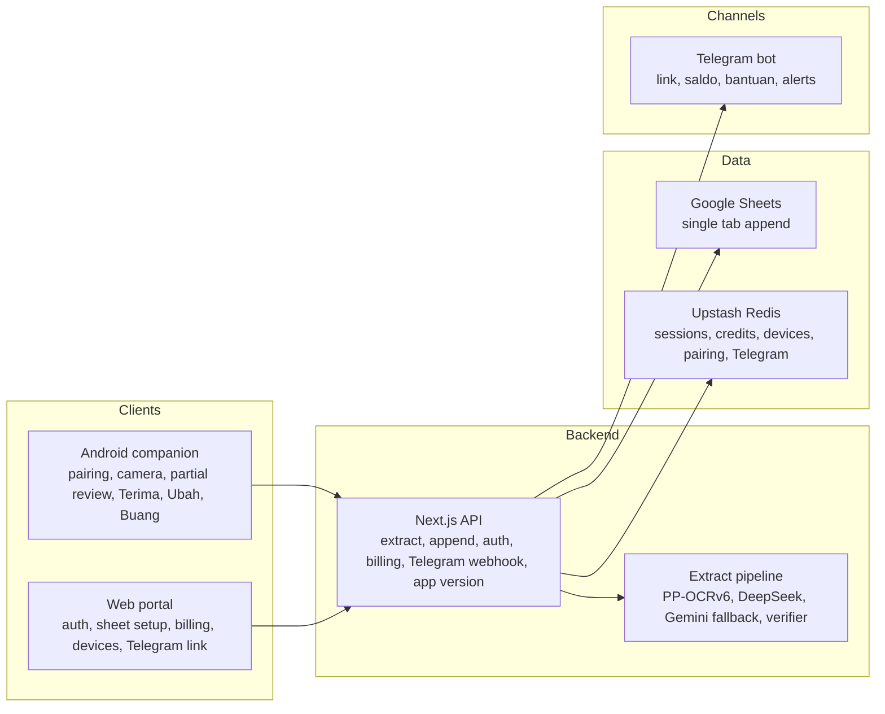
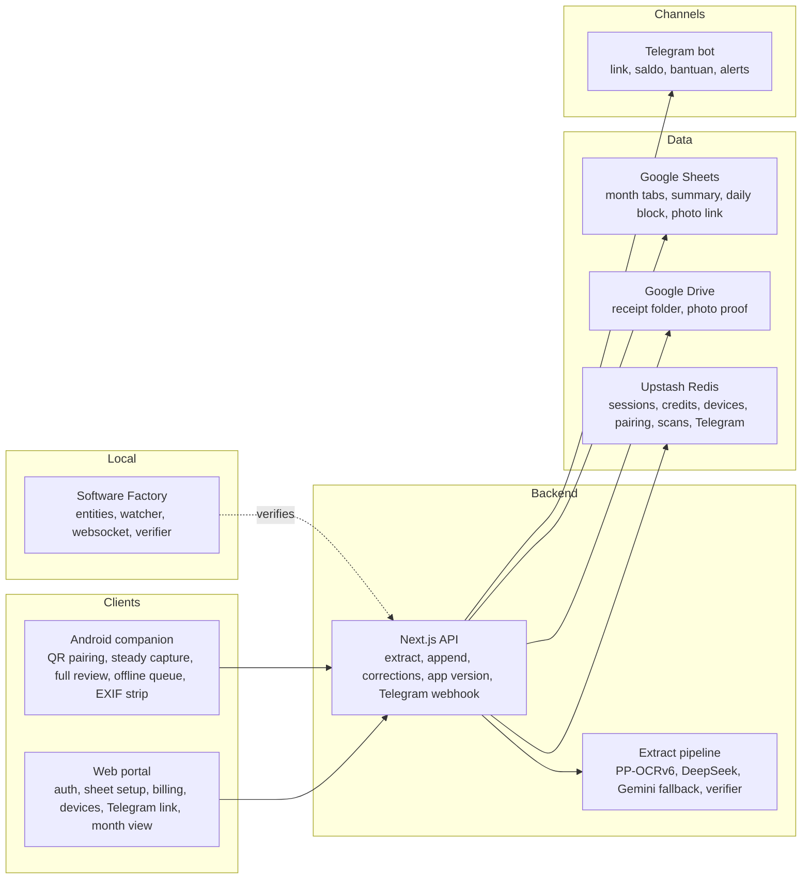

# What it is

A system design map of zippp. The live side shows the code and deployment that exist today. The planned side shows the target described by the specs.

# Goal

Make the gap between the current system and the planned system visible in one place.

# Live (as is)

# Planned (as per spec)

# Notes

The live map has a single Sheet tab, no Drive photo proof, and a partial Android review. The planned map adds month tabs, the daily block, Drive photo proof, QR pairing, steady detection, offline queue, EXIF stripping, correction telemetry, and the local factory.
