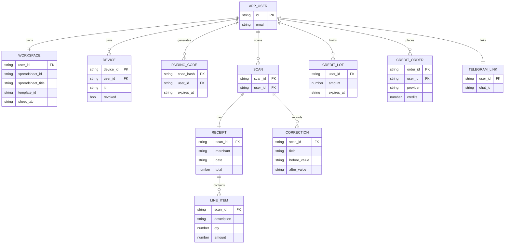
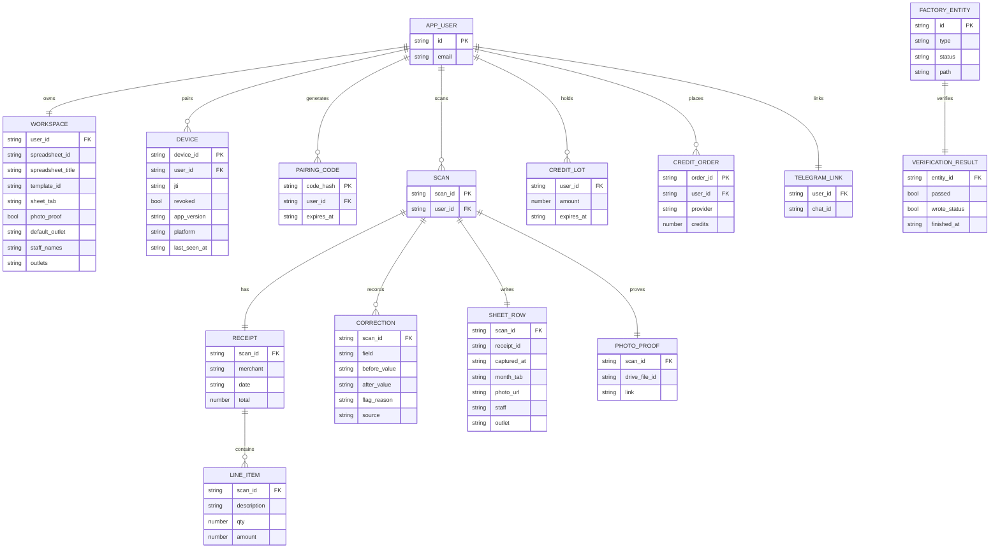

# What it is

A logical entity relationship map for zippp. The live side lists the records that exist today. The planned side adds the rows, proof, and factory evidence described by the specs.

# Goal

Show the complete data model and the gap between the implemented records and the planned records.

# Live (as is)

# Planned (as per spec)

# Notes

This is a logical model, not a physical database schema. The physical stores are Redis for sessions, credits, devices, pairing, scans, and Telegram; Google Sheets for receipt rows; Google Drive for optional photo proof; and local markdown for factory entities. zippp keeps no receipt ledger of its own.
