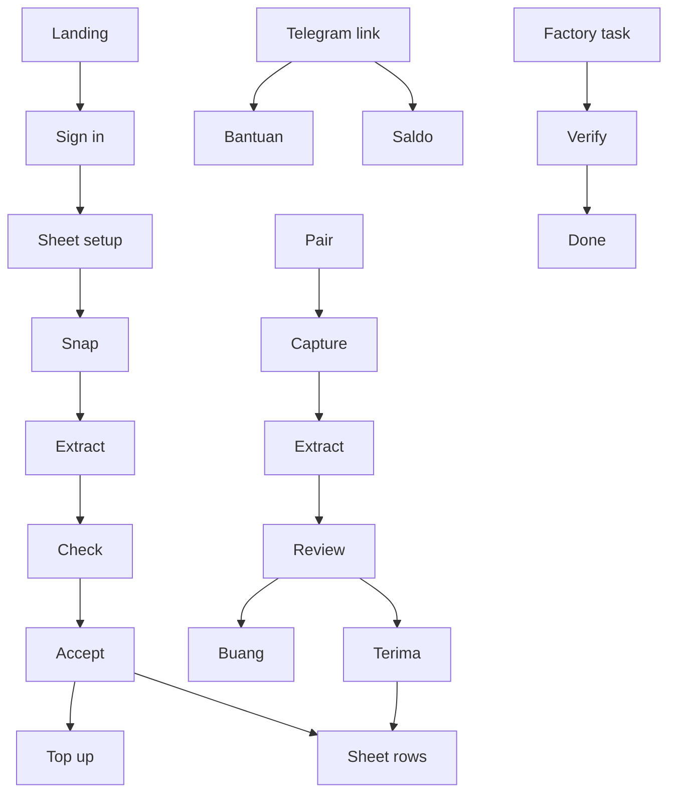
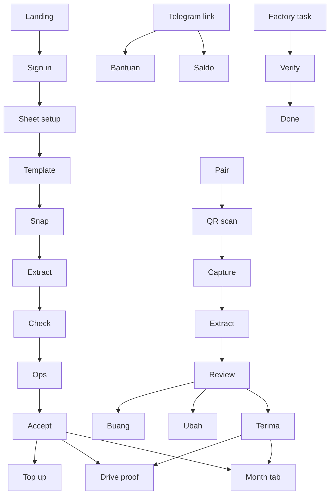
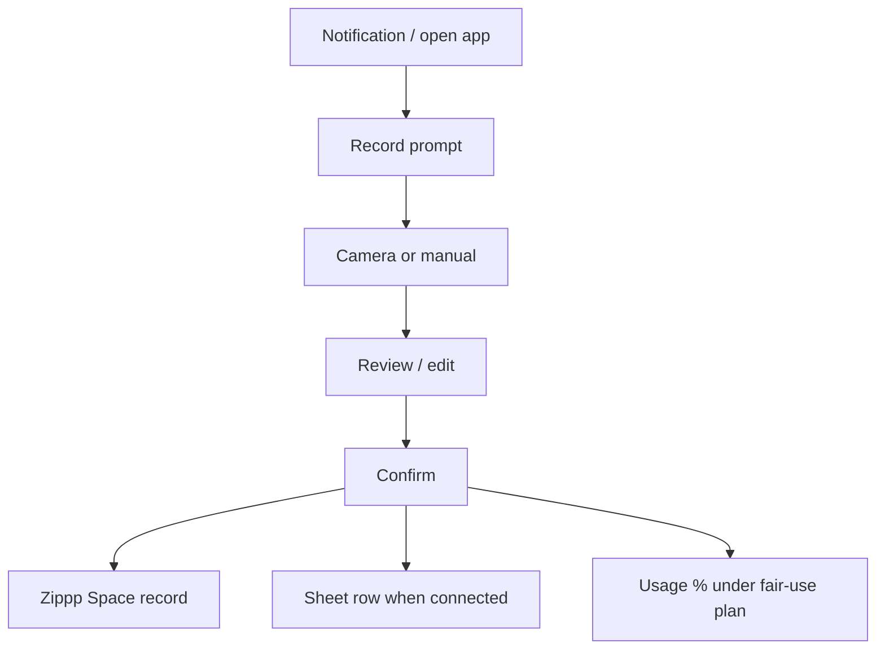

# What it is

The web, Android, Telegram, and factory user flows. The live side shows the paths that exist today. The planned side shows the paths described by the specs.

# Goal

Show where a person enters, what they do, and where the work lands in the Sheet.

# Live (as is)

# Planned (as per spec)

# Planned — Zippp Space primary loop (DIR-001)

North-star path under `ROAD-001` (does not replace Live / Planned mill diagrams above).

Auth on web + Android; checkout and plan management on web only (`DEC-002`, `DEC-003`).

# Notes

The live flow has no template step, no ops step, no month tab, no Drive proof, no QR step, and no edit branch on Android. The planned flow adds those paths. Space loop above is the product destination once ROAD Phases 3+ ship.
