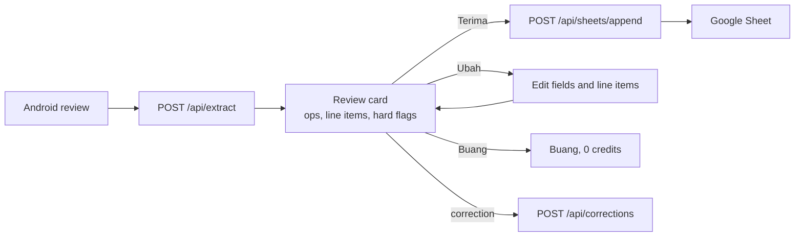

# What it is

Android review before confirm: edit line items, handle missing date, hard flags, corrections. Reshape under **personal expense / Space** — not multi-persona ops theater.

# Goal

A member can confirm a real spend on Android without opening web.

# Context

- `DIR-001`, `DEC-005` (reshape)
- Historical companion review notes still useful for Terima/Ubah/Buang FSM

# Acceptance criteria

- [x] The review card collects staff, outlet, payment, purpose, and customer when the template requires them.
- [x] Ubah edits merchant, date, totals, every line item, and every ops field.
- [x] Hard flags block Terima until the field is edited or explicitly acknowledged.
- [x] A null date is filled with the capture date and marked tanggal diasumsikan.
- [x] Accepted corrections post to /api/corrections with field, before, after, flags, and run id.
- [x] No token, sheet id, or raw server error string is rendered in the app.

# Verification

- Static trace ID: `// @implements FEAT-102`
- Target files: `android/app/src/main/java/link/zippp/app/ui/review/ReviewScreen.kt`, `src/app/api/corrections/route.ts`
- Test: `npm test`
- Production: none while mobile is dark.

# Out of scope

- New templates.
- Photo proof. FEAT-103 owns that.
- Month tabs. FEAT-104 owns that.

# Definition of done

A paired device can review a real receipt with all template ops, edit every line item, see the assumed date pill, and send correction telemetry without opening the web app.

# Diagram

# Notes

Template ops, telemetry, assumed date, and line-item edits are implemented; device proof is pending.

Implementation note (2026-11-03): review card, ops fields, line-item edits, assumed date, and correction telemetry are implemented in `ReviewScreen.kt`; correction paths match the web record. Compiled with `:app:compileSideloadDebugKotlin`. No device run yet.
