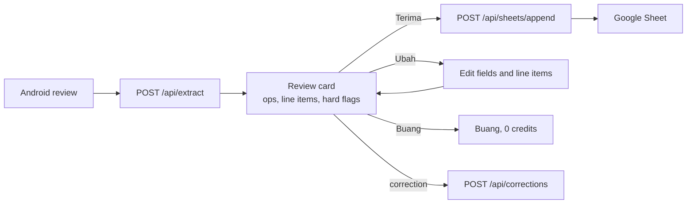

# What it is

The Android review card must collect the same template operations as the web card, record corrections, handle a missing date, and allow full line-item edits before Terima.

# Goal

Make the Android review path match the web review contract so a person can accept a real nota without opening the web app.

# Context

- `spec/themes/02-android-telegram-pivot/SPEC-ANDROID-COMPANION.md` section 7.
- `spec/themes/01-mvp/USER-FLOW.md` review card and ops per template.
- `spec/themes/01-mvp/AUDIT-2026-10.md` section 5.4.

# Acceptance criteria

- [ ] The review card collects staff, outlet, payment, purpose, and customer when the template requires them.
- [ ] Ubah edits merchant, date, totals, every line item, and every ops field.
- [ ] Hard flags block Terima until the field is edited or explicitly acknowledged.
- [ ] A null date is filled with the capture date and marked tanggal diasumsikan.
- [ ] Accepted corrections post to /api/corrections with field, before, after, flags, and run id.
- [ ] No token, sheet id, or raw server error string is rendered in the app.

# Verification

- Static trace ID: `// @implements FEAT-102`
- Target files: `android/app/src/main/java/link/zippp/app/ui/review/ReviewScreen.kt`, `src/app/api/corrections/route.ts`
- Test: `npm test`
- Production: none while mobile is dark.

# Out of scope

- New templates.
- Photo proof. FEAT-103 owns that.
- Month tabs. FEAT-104 owns that.

# Definition of done

A paired device can review a real receipt with all template ops, edit every line item, see the assumed date pill, and send correction telemetry without opening the web app.

# Diagram

# Notes

The current Android review edits merchant and total only. Template ops, telemetry, assumed date, and line-item edits are missing.
