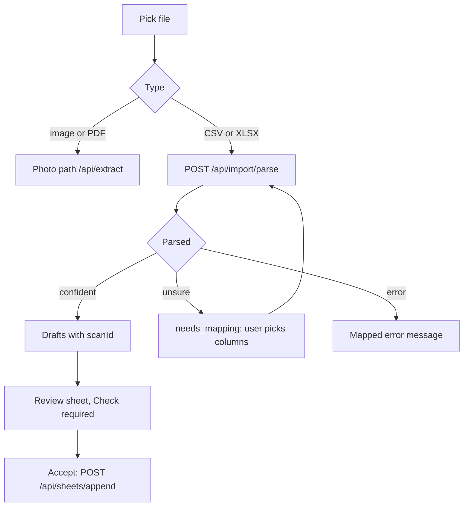

# What it is

A user picks a CSV or Excel file (a bank statement export, a sales recap, a
spreadsheet of expenses) and zippp turns its rows into the same review drafts that
a photo produces. The user checks each draft, then sends it to their own Google
Sheet. Nothing is sent without a check. PDF and image uploads already work through
the photo path and are not part of this card (see `android-spec/02-capture.md`).

# Goal

People who already have their spending in a bank export or a spreadsheet can bring
it into their zippp Sheet without retyping, with no invented values.

# Context

- Owner decision 2026-11-05: Upload accepts images, PDF, and Excel or CSV.
- The server pipeline today is image only: `ALLOWED_TYPES` in
  `src/app/api/extract/route.ts` is JPEG, PNG and WebP. A spreadsheet never goes
  through `/api/extract`, and never through OCR or the language model.
- The Google Sheet is the system of record. zippp keeps no receipt ledger
  (AGENTS.md). The file is read in memory and thrown away.
- Spending is decided at append time as today: `scan:${userId}:${scanId}`, one spend
  per draft. The import step itself spends nothing.
- Related: FEAT-102 (review contract, hard flags), FEAT-104 (daily totals, so imported
  rows must use the same `Amount + Tax` shape), FEAT-118 and `02-capture.md`
  (picker and drafts), FEAT-119 (rate limiter, bearer helpers).
- No spreadsheet library is in `package.json` today. A dependency research document
  is completed in `android-spec/14-spreadsheet-library-research.md` proposing
  `read-excel-file@9.3.14` (MIT) for XLSX and `csv-parse@7.0.3` (MIT) for CSV (sync API
  `csv-parse/sync`), pending owner sign-off.
- File size limit is aligned to Vercel's 4.5 MB request ceiling: max 4 MB file cap (with
  headroom for multipart framing). Legacy `.xls` and Google Drive conversion are rejected
  for V1.

# Scope: V1 and later

| Item | Phase |
|---|---|
| CSV (`.csv`, `text/csv`), delimiter `,` `;` or tab, UTF-8 with or without BOM, Windows-1252 | V1 |
| Excel `.xlsx` (first non-empty sheet) | V1 |
| One transaction row becomes one draft | V1 |
| Several rows with the same receipt number become one draft with line items | V1 |
| Automatic column detection with a "check the columns" step when unsure | V1 |
| Up to 25 drafts per file, reviewed one by one in the existing review sheet | V1 |
| Web picker accepts the same files | V1 (slice S-I4) |
| Bulk review list (select many, Check, Send) and up to 100 drafts per file | Later (S-I5) |
| Legacy `.xls`, `.xlsm`, `.ods`, choosing among several sheets | Later (S-I6) |
| Server-side duplicate detection across imports | Not planned (conflicts with no-ledger; see decisions) |
| Language model help to guess columns | Not planned until the owner approves what may leave the server |

# Design

## 1. Flow

```text
Upload (picker) -> file type routed to import
  Android: Uri -> multipart POST /api/import/parse (bearer)
  Web:     File -> multipart POST /api/import/parse (cookie)
Server:  detect type -> read table in memory -> find header row -> map columns
         -> parse rows -> build receipts -> issue scanId per draft
  ok + confident  -> drafts[]            -> review strip as usual
  ok + unsure     -> needs_mapping       -> user fixes columns -> POST again with mapping
  error           -> mapped message
Review:  one draft at a time in the review sheet, Check required, Accept sends
```



## 2. Server route: `POST /api/import/parse`

- Auth: `resolveRequestUser` (bearer or cookie). A bearer request is refused with
  `404 MOBILE_API_DISABLED` when `MOBILE_API_ENABLED` is off, same as extract.
  Mobile `scanId`s are recorded with `recordScanOwner` so append accepts them.
- Request: `multipart/form-data`, field `file`, optional field `mapping` (JSON, see
  below). Content type or extension must be `.csv` or `.xlsx`.
- Limits (Proposed, constants in `src/lib/billing/config.ts`):

| Constant | Value |
|---|---|
| `IMPORT_MAX_BYTES` | 4 MiB (matches Vercel 4.5 MB request ceiling with multipart margin) |
| `IMPORT_MAX_UNZIPPED_BYTES` | 50 MiB (zip uncompressed size cap for XLSX) |
| `IMPORT_MAX_ZIP_ENTRIES` | 200 entries |
| `IMPORT_MAX_ZIP_RATIO` | 100 to 1 per entry |
| `IMPORT_MAX_ROWS_READ` | 2,000 |
| `IMPORT_MAX_COLS` | 50 |
| `IMPORT_MAX_DRAFTS_V1` | 25 |
| `IMPORT_MAX_DRAFTS_LATER` | 100 |
| `IMPORT_HEADER_SCAN_ROWS` | 20 |
| `IMPORT_RATE_PER_HOUR` | 10 per user |

- Response, success:

```json
{
  "ok": true,
  "importId": "uuid",
  "status": "ready",
  "mapping": { "date": 0, "description": 1, "debit": 3, "credit": 4, "group": null,
               "currency": null, "category": null, "dateFormat": "dd/MM/yyyy" },
  "summary": { "rowsRead": 312, "drafts": 25, "skipped": 41, "overLimit": 246 },
  "drafts": [ { "scanId": "uuid", "sourceRow": 14, "receipt": { }, "flags": [ ] } ],
  "skipped": [ { "row": 3, "reason": "income" } ]
}
```

- Response, unsure: `status: "needs_mapping"`, with `headers` (array of strings),
  `sample` (the first 3 data rows as strings), `suggested` (the best guess), and
  `questions` (which of `dateFormat`, `signRule` could not be decided). No drafts and
  no `scanId` are issued until a mapping is confirmed.
- Errors (HTTP, body `{ ok: false, error: CODE }`): `400 NO_FILE`, `413 TOO_LARGE`,
  `415 UNSUPPORTED_TYPE`, `422 EMPTY` (no row with an amount), `422 UNREADABLE`
  (corrupt, password protected, macro workbook), `429 RATE_LIMITED`,
  `404 MOBILE_API_DISABLED`, `401` auth codes as extract.
- The route never imports Google modules and never passes user or sheet data into the
  parser, like extract.

## 3. Reading the table

1. CSV: detect encoding (UTF-8 with BOM, UTF-8, else Windows-1252). Detect the
   delimiter by counting `,` `;` and tab in the first 20 lines; Indonesian Excel
   exports use `;` with a comma decimal. Quoted fields and embedded line breaks are
   handled by a real CSV reader, not by `split`.
2. XLSX: read the first sheet that has at least one non-empty row. Read cached cell
   values. **Never evaluate formulas.** A formula cell with no cached value is empty.
   Dates stored as Excel serial numbers are converted (1900 date system; the 1904
   flag is honoured). Reject `.xlsm` and any workbook with a VBA part, and stop
   reading when the unzipped size passes `IMPORT_MAX_UNZIPPED_BYTES`.
3. Stop at `IMPORT_MAX_ROWS_READ` rows and `IMPORT_MAX_COLS` columns. Rows past the
   limit are counted in `summary.overLimit`, not read.

## 4. Header row and column detection

1. Header row: the first row inside the first `IMPORT_HEADER_SCAN_ROWS` rows that has
   at least two cells matching known header names. If none matches, the first
   non-empty row is the header and the result is `needs_mapping`.
2. Header names are matched after lower-casing, trimming and removing punctuation.
   These are parser aliases, not user-facing copy.

| Field | Aliases (English and Indonesian) |
|---|---|
| date | date, tanggal, tgl, waktu, posting date, transaction date, tanggal transaksi |
| description | description, deskripsi, keterangan, uraian, merchant, nama, transaksi, detail, remark, berita |
| amount | amount, jumlah, nominal, nilai, total, mutasi |
| debit | debit, debet, db, keluar, pengeluaran, withdrawal |
| credit | credit, cr, masuk, pemasukan, deposit |
| group | no nota, nomor nota, no transaksi, invoice, receipt, order id, no struk |
| currency | currency, mata uang, curr |
| category | category, kategori |
| tax | tax, pajak, ppn |

3. A balance column (aliases `balance`, `saldo`) is recognised only so it can be
   ignored. It is never read as an amount.
4. Spending rule:
   - Two columns, debit and credit: debit is spending. A row with only a credit is
     income and goes to `skipped` with reason `income`.
   - One amount column with mixed signs: unsure, ask `signRule` (negative numbers
     are spending, or positive numbers are spending). The answer applies to the file.
   - One amount column, all the same sign: every row is spending.
5. Date format: look at the whole date column, not one row. If any value has a first
   part above 12 the format is `dd/MM/yyyy`; if any second part is above 12 it is
   `MM/dd/yyyy`; if every value is ambiguous, ask `dateFormat`. ISO `yyyy-MM-dd`,
   `dd-MM-yyyy`, `dd MMM yyyy` with Indonesian month names (Jan, Feb, Mar, Apr, Mei,
   Jun, Jul, Agu, Sep, Okt, Nov, Des) and Excel serials are recognised without asking.
6. Confidence: the import is `ready` only if date, description and an amount (or
   debit) column are found, date format and sign rule are decided, and at least 80%
   of data rows parse. Otherwise `needs_mapping`.

## 5. Parsing values (never invent)

- Amounts use the same rules as the web `parseMoney` (`src/components/app/draft.ts`),
  moved to a shared module so server and web agree: `12.500` and `12.500,50` read as
  12,500 and 12,500.50; `12,500.50` reads as 12,500.50; a lone `12,5` reads as 12.5.
  Also strip `Rp`, `IDR`, spaces and non-breaking spaces, read `(1.000)` as negative,
  and read a trailing `DB` or `CR` marker.
- A cell that does not parse leaves the field empty and adds a flag
  `import_amount_unparsed`. A row with no usable amount goes to `skipped`
  (`no_amount`). The value is never guessed.
- A missing or unparsable date leaves `date` empty with flag `import_date_missing`.
  The review sheet shows "Date is empty" like any unknown field; it is **not** filled
  with the import date (unlike a photo, which assumes the capture date).
- Currency is read from a currency column, else left empty. The sheet's own format
  decides how a number is shown; the app never adds `Rp` or `$`.
- Category is kept only if the cell equals a known category name (case-insensitive);
  otherwise empty. No model runs in V1.
- Description is trimmed and whitespace is collapsed. It is not rewritten or cleaned
  beyond that.

## 6. Rows to drafts

- One transaction row becomes one `Receipt`: `merchant` = description, `date`,
  `currency`, `total` = amount, `subtotal` null, `tax` = tax column or null, one line
  item `{ description, qty: null, unit_price: null, amount }`. This is the same shape
  as manual entry (`android-spec/11-manual-entry.md`) and matches the Home spend
  formula `Amount + Tax`.
- If a group column is mapped, rows with the same value become one receipt: each row
  is a line item, `total` is the file's total cell if a total column exists on the
  last row of the group, else the sum of the line amounts. A computed total adds the
  informational flag `import_total_computed` so the review sheet says it was added up.
- Each draft gets a fresh server `scanId` and source `import`. The append route must
  accept `import` in its source allow-list (to be verified in `sheets/append`).
- Hard flags follow FEAT-102: `import_amount_unparsed` and `import_date_missing` block
  Accept until the field is edited or the user acknowledges. `import_total_computed`
  is informational.
- The draft limit applies after skipping: the first `IMPORT_MAX_DRAFTS_V1` valid
  groups, in file order. The rest are counted in `summary.overLimit` and the user is
  told (`android.import.overLimit`).

## 7. Review path and no auto-send

- Drafts enter the same strip and review sheet as photo drafts. Each draft needs the
  user's Check before Accept sends it. Nothing is sent when the file is read.
- A draft shows its file row in the subtitle (`android.import.rowRef`, "Baris 14").
- Duplicate protection is local: the client keeps the SHA-256 of imported files
  (hash only, 64 bytes, on the device or in browser storage). Picking a file whose
  hash is already there shows `android.import.repeat` before reading it, and the
  user can continue. The server stores no row fingerprints (that would be a receipt
  ledger). Idempotency stays per `scanId` at append.

## 8. Quota and cost

- Parsing is free: no model, no OCR, no spend, like `/api/extract`.
- Each draft spends exactly as a photo draft does when the user sends it. A V1 file
  therefore costs at most 25 sends, and only for rows the user checks and sends.
- The server decides everything about quota at append. The client may hide the Send
  button when the plan is known to be full, as capture does.
- The rate limiter (`IMPORT_RATE_PER_HOUR`, 10) keeps one account from using the
  parser as a free converter.

## 9. Privacy and security

- The file is read from the request body into memory and dropped. It is never
  written to disk, Blob or Redis, and never sent to a third party.
- Logs hold: user id hash, file extension, byte size, rows read, drafts, duration,
  outcome code. No cell values, no header text, no file name.
- XLSX is untrusted input: unzip with a size and entry-count cap, no external
  entities, no formula evaluation, no macro parts, no network access, no
  `file://` or hyperlink following.
- Cell text is plain text. When a draft is later written to the sheet, the existing
  `escapeSheetText` guard neutralises leading `= + - @` (formula injection).
- Bearer requests count the same as cookie requests for the rate limit.
- The response goes only to the caller and carries `Cache-Control: no-store`.

## 10. Client behaviour

Android (`ImportFlow.kt`, called from `CameraScreen`):

1. A picked `.csv` or `.xlsx` is streamed to the server with the bearer token. The
   Import progress row (`android.capture.importing`) shows until the response.
2. `status: ready`: add the drafts to `BatchStore` with source `import`, show the
   first in the review sheet, and a toast `android.import.draftsReady`
   ("{drafts} untuk diperiksa") plus `android.import.skipped` when rows were skipped.
3. `status: needs_mapping`: open the mapping sheet (below). On Continue, post again
   with `mapping`.
4. Errors map to keys in section 12. Never show a raw code.
5. A file over 4 MiB is refused before upload with `android.import.tooLarge`.

Mapping sheet (bottom sheet, same shell as the review sheet, 88% max height):

```text
+------------------------------------------+
| <android.import.mappingTitle>      [x]   |
| <android.import.mappingBody>             |
| Date            [ Tanggal          v ]   |  rows 48dp, label 12sp muted
| Description     [ Keterangan       v ]   |
| Money out       [ Debit            v ]   |
| Money in        [ Kredit           v ]   |
| Receipt number  [ none             v ]   |
| Date format     [ dd/MM/yyyy       v ]   |  only if asked
| Spending is     [ negative numbers v ]   |  only if asked
| Preview (3 rows, read only)              |
| [ Continue ]  56dp primary               |
+------------------------------------------+
```

Dropdowns list the file's header names plus "none". Continue is disabled until date,
description and one amount column are chosen.

Web (`SnapScreen.tsx`, slice S-I4): the Upload input accepts the same types, shows the
same mapping step in the existing confirm card styling, and uses the same endpoint.

# Acceptance criteria

- [ ] A semicolon CSV with `dd/MM/yyyy` dates and `1.234.567,89` amounts becomes drafts with correct values
- [ ] An XLSX with Excel serial dates and numeric cells becomes drafts with correct dates
- [ ] A file with debit and credit columns skips income rows with reason `income`
- [ ] An ambiguous date column returns `needs_mapping` and never guesses
- [ ] A cell that does not parse leaves the field empty and flags it
- [ ] The import date is never written into an empty date field
- [ ] Rows with the same receipt number become one draft with line items
- [ ] No draft is sent until the user checks and accepts it
- [ ] More than 25 groups: the first 25 become drafts and the user is told how many were left
- [ ] A 10 MiB file, a zip bomb, an `.xlsm` and a password-protected workbook are rejected with distinct mapped messages
- [ ] The file is never stored and no cell value appears in logs
- [ ] The eleventh import in an hour is refused with `RATE_LIMITED`
- [ ] Android and web use the same parser and agree on a shared fixture set
- [ ] No Android string contains kredit, saldo, Rp, `$` or Top up

# Verification

- `npm test` runs the fixture tests below.
- Manual: import a real bank CSV and an XLSX on the phone, check three drafts against
  the file, send one, see it in the Sheet.

## Test plan

| Test | Input | Expected |
|---|---|---|
| Delimiter | `;`, `,` and tab CSV of the same data | identical drafts |
| Encoding | UTF-8 BOM, UTF-8, Windows-1252 with accents | merchant text intact |
| Money | `12.500`, `12.500,50`, `12,500.50`, `Rp 1.000`, `(1.000)`, `1.000 DB` | 12500, 12500.5, 12500.5, 1000, -1000, 1000 |
| Dates | `05/11/2026`, `2026-11-05`, `5 Nov 2026`, `5 Nop 2026`, serial 46331 | correct date, or flag when invalid |
| Date ambiguity | all values with both parts at most 12 | `needs_mapping`, no guess |
| Sign rule | mixed signs in one column | `needs_mapping` asks `signRule` |
| Income | credit-only rows | skipped `income` |
| Group | 3 rows, one receipt number, no total column | one draft, 3 lines, total summed, `import_total_computed` |
| Unknown stays empty | blank date, junk amount | empty field plus flag, no invented value |
| Header offset | 6 title lines above the header | header found |
| Limits | 2,500 rows, 60 columns | read stops at the limits, counts correct |
| XLSX safety | zip bomb, `.xlsm`, encrypted, formula with no cache | rejected or empty, no evaluation |
| Auth | no auth, cookie, bearer ok, bearer revoked, mobile disabled | 401, ok, ok, 401, 404 |
| Rate limit | 11 requests in an hour | the 11th is 429 |
| Privacy | run with a log spy | no cell value or header text logged |
| Round trip | draft then append | row written, `Amount + Tax` matches Home |

# Wording keys

Added to `spec/wording.txt` (English and Indonesian). Parser aliases above are code,
not copy.

`android.import.title`, `android.import.mappingTitle`, `android.import.mappingBody`,
`android.import.field.date`, `android.import.field.description`,
`android.import.field.debit`, `android.import.field.credit`,
`android.import.field.amount`, `android.import.field.group`,
`android.import.field.currency`, `android.import.field.category`,
`android.import.field.none`, `android.import.dateFormat`,
`android.import.signRule`, `android.import.sign.negative`,
`android.import.sign.positive`, `android.import.continue`,
`android.import.draftsReady`, `android.import.skipped`,
`android.import.overLimit`, `android.import.rowRef`, `android.import.empty`,
`android.import.unsupported`, `android.import.tooLarge`,
`android.import.unreadable`, `android.import.rateLimited`,
`android.import.repeat`.

# Out of scope

- Reading PDF tables or bank PDF statements (the PDF path reads page 1 as a receipt)
- Writing imported rows straight to the Sheet without review
- Storing the file, a copy of the rows, or row fingerprints on the server
- Brokerage or bank sync (see FEAT-116 out of scope)
- Currency conversion
- Category inference by a language model

# Slices

| Slice | Scope | Phase |
|---|---|---|
| S-I1 | Spreadsheet dependency research completed in `android-spec/14-spreadsheet-library-research.md` (`read-excel-file@9.3.14` and `csv-parse@7.0.3`); implement `parse-table.ts` (CSV, XLSX, limits); shared `parseMoney` module; fixtures and tests | V1 |
| S-I2 | `map-columns.ts`, `rows-to-receipts.ts`, `POST /api/import/parse`, auth, rate limit, constants, route tests | V1 |
| S-I3 | Android `ImportFlow.kt`, mapping sheet, `IMPORT_ENABLED` flag, strings from `wording.txt`, picker MIME wiring in capture | V1 |
| S-I4 | Web picker, mapping step in `SnapScreen.tsx`, `app.import.*` copy | V1 |
| S-I5 | Bulk review list, 100 drafts per file | Later |
| S-I6 | `.xls`, several sheets, optional model-assisted header guess (needs owner approval of what leaves the server) | Later |

# Decisions needing the owner

1. **Cost per row.** Each sent draft spends one scan, as a photo does. A statement of
   200 rows could use 200 scans if every row is sent. Keep that, or charge one scan per
   file, or make imports free up to a cap? Recommendation: keep one per sent draft for
   V1, because append and the plan meter stay unchanged.
2. **Duplicate detection.** Local file hash only (Recommended), or server row
   fingerprints (stronger, but a hash ledger of receipts).
3. **Income rows.** Skipped as not spending (Recommended), or shown as drafts with a
   negative amount?
4. **V1 limit.** 25 drafts per file in the one-by-one review sheet, or wait for the bulk
   review list before shipping any import?
5. **Spreadsheet library.** Decision proposed in `android-spec/14-spreadsheet-library-research.md`:
   `read-excel-file@9.3.14` (MIT) for XLSX and `csv-parse@7.0.3` (MIT, sync API) for CSV.
   SheetJS on public npm is rejected (vulnerable 0.18.5) and CDN is emergency fallback only;
   Google Drive conversion is rejected for privacy/latency/quota; legacy `.xls` is excluded
   from V1. The proposal needs owner sign-off.

# Definition of done

A real bank CSV and a real XLSX import on the phone and on the web, drafts match the
file, unknown cells stay empty, nothing is sent without a check, tests pass, and the
file is not stored.
